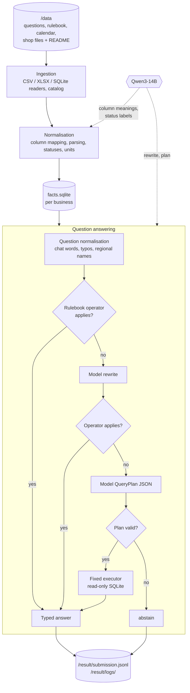

# DataMate — Zalo AI Challenge 2026

DataMate answers Vietnamese business questions over a shop's own records (CSV, XLSX and
SQLite files plus a README per shop). It runs fully offline inside one Docker image. The
values are computed by Python functions over normalised data. A local language model,
Qwen3-14B served by vLLM, reads data that has no README, reformulates questions and plans
queries. The model never produces a number itself.

## Pipeline



### 1. Ingestion (`src/data/ingestion`, `src/data/catalog.py`)

Every file under `data/<business_id>/` is read with strict readers: CSV with delimiter
detection, XLSX sheet by sheet with merged and multi-row headers, and SQLite tables. Each
table is profiled into a catalog: header rows, column types, value samples and date systems.

### 2. Normalisation (`src/data/normalization`)

The catalog is mapped to one relational model and stored in `facts.sqlite`, with lineage
back to the source rows. The model covers orders, sale lines, customers, payments,
purchases, stock balances, lots and unit conversions.

- Column meanings come from the shop README. When the README is missing or does not match
  the files, Qwen3-14B proposes the meanings as schema-constrained JSON. A proposal is
  accepted only if arithmetic (quantity × price = amount), date and status checks pass.
- Money, quantities and dates are parsed exactly (Decimal), including spellings such as
  `1tr168`, `79k`, Excel serial dates and day/month without a year.
- Repeated rows, subtotal rows and repeated headers are removed.
- Status labels are mapped to completed, cancelled, returned or in delivery. A status
  written in a free-text note is read from that note; labels no rule recognises are
  classified by the model.
- Quantities are converted to base units from conversion tables or README sentences,
  including chained ratios. An item name written with and without accents becomes one item.

### 3. Question answering (`src/agent`)

For each question in `questions.jsonl` (`src/agent/planner.py`):

1. **Normalisation.** Chat spellings, abbreviations and Telex typing errors become standard
   words (`src/semantics/rulebook.py`, `src/semantics/typos.py`). An item named in its
   other regional form ("má lợn" / "má heo") is replaced by the catalog name
   (`src/semantics/dialect.py`).
2. **Rulebook operators.** `src/agent/rule_ops.py` and the domain modules (`pharmacy.py`,
   `repair.py`, `phone.py`, `baby.py`, `debt.py`, `lots.py`, `delivery.py`,
   `purchasing.py`, `staff.py`) implement the rulebook definitions as Python functions:
   revenue, order counts, growth, rankings, customers, debt, stock, gross and net profit,
   price-change effects and more. An operator answers only when the question's wording,
   time window and answer shape are fully covered. Otherwise it yields to the next step.
3. **Model rewrite.** Qwen3-14B rewrites the question into standard wording and the
   operators are tried again.
4. **Query plan.** Otherwise the model writes a JSON `QueryPlan` under guided decoding:
   metric, time window, filters and grouping. The plan is validated against the rulebook,
   the README and the data coverage. It is then executed by fixed functions
   (`src/agent/execution.py`, `src/agent/business_execution.py`) on read-only SQLite.
5. **Answer.** The result is formatted to its type (number, percent, string, date,
   boolean, list, table) and validated (`src/contracts.py`). A question that no step can
   answer with certainty is answered `abstain`. `unanswerable` is used when the rulebook or
   data show that the shop does not record what is asked.

Time expressions are resolved against `as_of_date` and `calendar.csv`
(`src/temporal/resolver.py`). Each answer is written and fsynced as soon as it is ready.

## Models

| Field | Value |
|---|---|
| Model | Qwen3-14B (BF16 safetensors, not quantized, not fine-tuned) |
| Public source | https://huggingface.co/Qwen/Qwen3-14B |
| Fixed revision | `40c069824f4251a91eefaf281ebe4c544efd3e18` |
| Original release date | 2025-04-29 |
| License | Apache-2.0 (`/code/models/qwen3-14b/LICENSE`) |
| Parameters | 14.77B; no other model is used |
| Location in the image | `/code/models/qwen3-14b/` |

Inference settings (fixed defaults in `src/cli.py` and `src/agent/local.py`):

| Setting | Value |
|---|---|
| Runtime | vLLM 0.10.1.1, PyTorch 2.7.1+cu128 (`vllm/vllm-openai:v0.10.1.1`) |
| GPUs | 2 (`tensor_parallel_size=2`), `NCCL_P2P_DISABLE=1`, `nvidia-nccl-cu12==2.27.7` |
| Context length | 16384 tokens, `gpu_memory_utilization` 0.85 |
| Decoding | greedy (temperature 0), seed 0, guided JSON, 256/384 output tokens |
| Thinking mode | disabled (`enable_thinking=False`); logs record `thinking: null` |
| Time limits | 120 s per question, 900 s for model loading |

## Training and data

No training, fine-tuning or data generation is performed. The rulebook operators are
hand-written from the rulebook, the shop READMEs and the provided train split. The train
answers are used only for offline scoring. Details are in `training_code/README.md` and
`training_code/data_manifest.json`.

## Input and output

| Path | Content |
|---|---|
| `/data/questions.jsonl` | `id`, `business_id`, `question`, `as_of_date` |
| `/data/rulebook.md`, `/data/calendar.csv` | split rules and the solar–lunar calendar |
| `/data/data/<business_id>/` | shop files and README |
| `/result/submission.jsonl` | one typed answer per question, in input order |
| `/result/logs/<n>_<id>.json` | `id`, `answer`, `elapsed_ms`, `thinking`, `code`, `inputs`, `output`, plan and execution |
| `/result/run_manifest.json` | run identity, progress and timing |
| `/result/prepared/<business>/facts.sqlite` | normalised data of each business |

## Project structure

```
.
├── predict.sh            # entry point: /data -> /result
├── Dockerfile
├── requirements.txt      # inference dependencies
├── src/
│   ├── cli.py            # command line (predict, catalog, prepare, evaluate)
│   ├── runtime.py        # preparation and streaming inference with logs
│   ├── data/             # ingestion, profiling, normalisation, facts store
│   ├── semantics/        # rulebook parsing, vocabulary, typos, regional names
│   ├── temporal/         # time-window resolution
│   ├── agent/            # planner, rulebook operators, executors, local model
│   └── evaluation/       # offline scorer (not used during inference)
├── models/qwen3-14b/     # model weights (downloaded, not in git)
└── training_code/        # no-training statement, model manifest and checksums
```

## Setup

Download the model at the fixed revision and verify the checksums:

```bash
R=40c069824f4251a91eefaf281ebe4c544efd3e18
mkdir -p models/qwen3-14b && cd models/qwen3-14b
for f in LICENSE config.json generation_config.json merges.txt tokenizer.json \
         tokenizer_config.json vocab.json model.safetensors.index.json \
         model-0000{1..8}-of-00008.safetensors; do
  curl -fL -o "$f" "https://huggingface.co/Qwen/Qwen3-14B/resolve/$R/$f"
done
cd - && sha256sum -c training_code/model.sha256
```

## Build

```bash
docker build --platform linux/amd64 -t zaic2026_datamate_datamate:final .
```

The image is based on `vllm/vllm-openai:v0.10.1.1`. It contains `/code/predict.sh`,
`README.md`, `requirements.txt`, `src/`, `models/` and `training_code/`.

## Run

```bash
docker run --rm --gpus '"device=0,1"' --network none --shm-size=16g \
  --entrypoint bash \
  -v /path/to/test_split:/data:ro \
  -v /path/to/output:/result \
  zaic2026_datamate_datamate:final /code/predict.sh
```

`predict.sh` takes no arguments. It reads `/data` and writes `/result/submission.jsonl` and
one log per question under `/result/logs/`. Progress is printed to stderr and a JSON run
summary to stdout. `run_manifest.json` records model metadata, including its load time,
and the per-question `elapsed_ms` is in each log.
On a host with vLLM installed, the same entry point accepts explicit paths:

```bash
./predict.sh --data-dir /path/to/test_split --output-dir /path/to/output
```

## Evaluation

The train split includes `answers.jsonl`. Predictions on it are scored with a separate
command that is never imported by inference:

```bash
python -m src.cli evaluate --answers /path/to/train/answers.jsonl \
  --predictions /path/to/output/submission.jsonl --report /path/to/score.json
```

Scoring is +1 for a correct answer, −1 for a wrong answer and 0 for `abstain`.
