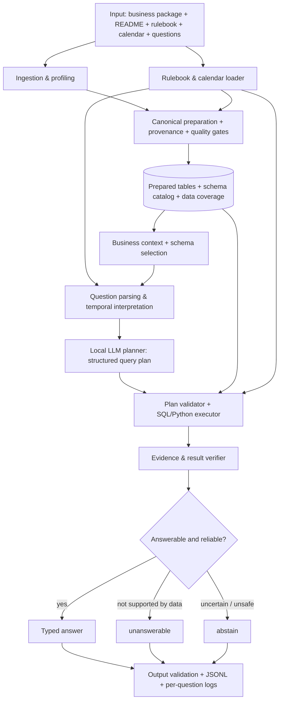

# DataMate — Roadmap triển khai End-to-End (Baseline v1)

> **Dự án:** Zalo AI Challenge 2026 — *DataMate: Talking To Your Data Through Agentic AI*  
> **Ngày lập:** 01/11/2026  
> **Lần rà soát:** 02/11/2026 — triển khai preparation S1: 157 tests; đối chiếu raw dev và cold/warm cache. Bằng chứng full runtime/Docker/CUDA Phase 2 giữ phạm vi lịch sử.\
> **Mục tiêu:** Xây dựng **một baseline chạy được từ đầu đến cuối**, tự động trả lời câu hỏi tiếng Việt trên CSV/XLSX/SQLite, hoạt động hoàn toàn offline, có thể đánh giá bằng đáp án train và đóng gói Docker để nộp thi.  
> **Phạm vi:** Tập trung vào một giải pháp **đúng quy định, tổng quát hóa được, có thể tái lập và đo lường được**. Các kỹ thuật tối ưu PA nâng cao, fine-tuning, ensemble hay multi-agent **để sau khi baseline hoàn chỉnh**.  
> **Trạng thái:** `PHASE_3_S1_READY` — CSV order-line có README/rulebook rõ đã có normalization, facts SQLite exact Decimal, lineage/quality/cache và tích hợp runtime. Xem [normalization report](reports/normalization_verification.json). Phase 2 đã nghiệm thu trước đó; normalization Excel/SQLite/JOIN/unit/domain, metric execution, LLM và M1 chưa thực hiện. Full train/public runtime và CUDA chưa được nghiệm thu lại cho bản này.
> **Thiết lập hiện có (theo xác nhận của người thực hiện):** dự án đang có thư mục `dataset/` và đã đưa `dataset/` vào `.gitignore`; **không tạo lại bước gitignore dataset**. Mã nguồn dùng trực tiếp `src/`, **không có lớp thư mục `src/datamate/`**. Cần kiểm tra trạng thái Git thực tế trước khi kết luận dữ liệu chưa từng được track.

**Cách sử dụng:** Các phase là nhóm công việc, không phải chuỗi phải hoàn thiện tuần tự. Triển khai theo lát cắt ở mục 4 và lịch mục 7. Các hợp đồng tại Phụ lục C–F là tiêu chí cho code và nghiệm thu; checklist chưa đánh dấu không phải chức năng đã tồn tại. Phase 0 đã được nghiệm thu lại sau cleanup; chỉ tick hạng mục khi tất cả kiểm tra liên quan đạt, không dùng kết quả CPU thay bằng chứng Docker/GPU.

---

## 1. Mục tiêu, phạm vi và tiêu chí hoàn thành

### 1.1. Bài toán cần giải quyết

Mỗi câu hỏi gồm `id`, `business_id`, câu hỏi tiếng Việt (`question`) và ngày tham chiếu (`as_of_date`). Hệ thống phải đọc gói dữ liệu **của đúng doanh nghiệp** gồm một hoặc nhiều CSV, XLSX, SQLite, README; đọc `rulebook.md` và `calendar.csv` **của split hiện tại**; sau đó suy luận và thực thi phép truy vấn cần thiết để xuất đáp án JSONL đúng kiểu.

Baseline không chỉ là Text-to-SQL. Nó bao gồm một chuỗi phụ thuộc: **khám phá dữ liệu → chuẩn hóa có kiểm chứng → hiểu ngữ nghĩa nghiệp vụ → hiểu câu hỏi → lập kế hoạch → thực thi tính toán → kiểm tra → xuất đáp án hoặc từ chối**.

### 1.2. Definition of Done (DoD) — baseline hoàn chỉnh

Một bản baseline được coi là hoàn thành khi thỏa tất cả điều kiện sau:

- [ ] Chạy **một lệnh** trên cấu trúc dataset được mount tại `/data`, không phụ thuộc đường dẫn riêng của máy phát triển.
- [ ] Đọc được các loại input quy định (`.csv`, `.xlsx`, `.sqlite`, `README.md`, `rulebook.md`, `calendar.csv`, `questions.jsonl`), kể cả nhiều file/sheet/table cho một doanh nghiệp.
- [ ] Chạy tự động **data preparation theo doanh nghiệp**, bảo toàn raw data, provenance và cảnh báo lỗi chuyển đổi; không phải sửa dữ liệu thủ công để trả lời từng câu.
- [ ] Có semantic metadata tối thiểu để biết bảng, khóa, grain, kiểu dữ liệu, thời gian bao phủ, trường thiếu và các quy tắc áp dụng.
- [ ] Có capability matrix theo cấu trúc nguồn và metric: `supported`, `unsupported`, `ambiguous`; phân loại dòng, trạng thái đơn, đơn vị giá vốn, snapshot/lịch sử và thứ tự output được kiểm chứng theo Phụ lục C–F.
- [ ] Nhận một câu hỏi tiếng Việt, tạo kế hoạch truy vấn có cấu trúc, thực thi bằng công cụ cục bộ và đưa ra đáp án có căn cứ hoặc `unanswerable`/`abstain`.
- [ ] Hỗ trợ đúng **hợp đồng đầu ra** cho `number`, `percent`, `string`, `date`, `boolean`, `list`, `table`, `unanswerable`, `abstain`; trường hợp chưa hỗ trợ vẫn phải xử lý an toàn.
- [ ] Có evaluator nội bộ sử dụng nhãn train để báo cáo Penalized Accuracy (PA), correct/wrong/abstain, coverage, accuracy theo nhóm và thời gian thực thi; tuyệt đối không coi việc chạy được là đồng nghĩa với đúng.
- [ ] Có test tự động, log theo câu hỏi và ít nhất một lần **end-to-end dry run offline** sau khi đóng Docker.
- [ ] Tuân thủ các giới hạn đã xác minh từ tài liệu BTC; các con số kỹ thuật tạm thời ở mục 2.1 có nguồn đối chiếu trước khi chốt model/image và nộp bài.

**Không đặt mục tiêu baseline là giải đúng 100% số câu.** Mục tiêu giai đoạn này là tạo một hệ thống có thể kiểm tra, đo lỗi và cải tiến lặp lại; không hard-code câu trả lời hoặc logic theo `business_id`/`question_id`.

### 1.3. Dữ liệu và phát hiện đã có — không làm lại từ đầu

Báo cáo khảo sát đã có: **30 doanh nghiệp train / 3.000 câu hỏi có nhãn** và **14 doanh nghiệp public test / 1.000 câu hỏi không có nhãn phát hành**; khoảng **504 bảng vật lý và 5,33 triệu dòng thô** qua cả hai split. Các đầu ra EDA đã mô tả `file_inventory`, `table_inventory`, `table_profiles`, `schema_catalog`, phân tích câu hỏi và một số phép tính SQLite được đối chiếu với nhãn train.

Các rủi ro đã được nhận diện: header nhiều dòng; ngày dạng văn bản, serial Excel và thiếu năm; tiền tệ dạng chuỗi; đơn vị lớn–nhỏ; ô trống kế thừa thông tin nhóm; dòng trùng phụ thuộc grain; mã hàng/khách không nhất quán; giao dịch, thanh toán, công nợ và trả hàng có ngữ nghĩa khác nhau. Một số ngành và quy tắc trong public không xuất hiện ở train. **Dùng các quan sát này để thiết kế kiến trúc tổng quát; không huấn luyện bằng public test hoặc biến thành ngoại lệ dựa vào ID.**

---

## 2. Ràng buộc cuộc thi và nguyên tắc kiến trúc

### 2.1. Nguồn quy định, ràng buộc thiết kế và trạng thái xác minh

Không coi mọi con số của bản roadmap trước là quy định đã được xác minh. Phân biệt ba trạng thái: **đã đối chiếu file phát hành**, **đã đối chiếu trang BTC**, **cần đối chiếu tài liệu BTC**. Nguồn và mốc truy cập được liệt kê ở Phụ lục B; khi nguồn BTC cập nhật, ghi phiên bản mới và điều chỉnh config liên quan.

| Nội dung | Điều kiện đang dùng để lập kế hoạch | Trạng thái / hành động |
|---|---|---|
| Ngữ nghĩa và chấm đáp án | Rulebook đúng split, README của shop, calendar; điểm đúng +1, sai −1, abstain 0 | Đã đối chiếu các file phát hành cục bộ; đọc lại tại runtime, không mặc định hai split cùng luật. Công thức PA chuẩn hóa nội bộ được nêu ở mục 3 / Phase 8. |
| Lịch thi | Nộp giải pháp 16/11 lúc 23:59 GMT+7; private phát hành 20/11 lúc 09:00; nộp kết quả 23/11 lúc 23:59 | Đã đối chiếu timeline trên trang BTC; đối chiếu lại hướng dẫn nộp thực tế. |
| Offline và input bất biến | Không network/API lúc inference, không tải weights/package khi chạy; input chỉ đọc | Ràng buộc thiết kế của baseline. Đối chiếu quy định kỹ thuật trước final image. |
| Model eligibility | Bản trước dùng mốc weights công khai **trước 01/10/2026**; license phải phù hợp | **Cần đối chiếu** mốc và cách tính với tài liệu BTC; ghi nguồn, phiên bản, release date, license của từng model trước khi lựa chọn cho bài nộp. |
| Parameter budget | Bản trước dùng tổng **≤ 15B**, gồm model phụ và toàn bộ MoE, không phụ thuộc quantization | **Cần đối chiếu** giá trị và cách tính. Giữ như giới hạn làm việc tạm thời, chưa coi là thông số BTC đã xác nhận. |
| Hardware / runtime | Bản trước nêu **2 × RTX 5090 32 GB**, RAM 512 GB, CUDA ≥ 12.8 | **Cần đối chiếu** GPU/RAM, driver, base image và runtime chính thức; không suy ra cấu hình máy phát triển từ cấu hình này. |
| Time budget | Lập kế hoạch theo **6 giờ wall-clock**, tính cả model loading và data preparation | **Cần đối chiếu** thời lượng, điểm bắt đầu/kết thúc và cơ chế timeout; cấu hình được, có headroom và benchmark cold start. |
| Entrypoint / mounts | Thiết kế dự kiến: `predict.sh`, `/data` read-only, `/result/submission.jsonl`, `/result/logs/` | **Cần đối chiếu** hợp đồng Docker; dùng adapter/config đường dẫn nếu BTC yêu cầu khác. |
| Submission quota | Bản trước nêu **5 lượt public/ngày**, tối đa **2 lần nộp Docker** | **Cần đối chiếu** hạn mức và cách chọn bản xét; không tự động nộp khi chưa biết hợp đồng. |
| Reproducibility | Bản trước nêu chênh PA upload/re-run **≤ 0,03** | **Cần đối chiếu** ngưỡng và cách so. Baseline vẫn phải lưu seed/config/hash, stable ordering và đo độ lặp lại. |
| Dữ liệu và can thiệp | Không hard-code đáp án/ID, không sửa output thủ công; phát triển bằng train và synthetic hợp lệ, không train bằng public/private test | Chính sách phát triển của dự án; đối chiếu thêm quyền dùng dữ liệu ngoài và quy định test của BTC. Đọc README/rulebook/dữ liệu test tại runtime là đầu vào inference, không phải bước học/cập nhật weights. |

**Gate:** Phase 0 ghi rõ nguồn còn thiếu và triển khai các phần độc lập với chúng. Chưa xác minh cấu hình không chặn viết parser/evaluator hoặc Docker stub cấu hình được; nhưng phải giải quyết trước quyết định model/image không dễ đổi và trước nộp bài. Không biến trạng thái `cần đối chiếu` thành `đã đạt` chỉ vì smoke test chạy trên máy local.

### 2.2. Nguyên tắc thiết kế xuyên suốt

1. **Correctness before sophistication:** dữ liệu đúng và phép toán xác định quan trọng hơn số lượng agent hoặc độ phức tạp prompt.
2. **Raw immutable:** file đầu vào luôn giữ nguyên; mọi thao tác ghi diễn ra trong thư mục cache/tạm riêng, ví dụ `/tmp/data-cache`. `dataset/` ở máy phát triển đã được `.gitignore`; thư mục nguồn `/data` của Docker chỉ được đọc.
3. **Generic logic, adaptive mappings:** giữ các parser và luật tổng quát; xây schema mapping dựa trên nguồn thực tế, README, rulebook và kiểm tra dữ liệu, không theo ID doanh nghiệp.
4. **Preserve grain and provenance:** phân biệt đơn hàng, dòng hàng, lần thanh toán, phiếu nhập, sự kiện trả hàng, giao hàng, bảo hành, sửa xe; luôn truy ra nguồn.
5. **Rulebook is runtime authority:** mỗi split có thể khác luật. Điều kiện tường minh trong câu ưu tiên mặc định; luật ngành ưu tiên luật chung. README định nghĩa cách mã hóa và ý nghĩa cột của nguồn; mâu thuẫn chưa giải quyết phải được ghi nhận, không tự chọn luật thuận tiện.
6. **Separate preparation from query-time computation:** chuẩn bị một lần theo doanh nghiệp, nhưng thời gian tham chiếu, bộ lọc và metric phải tính theo từng câu.
7. **No fabrication:** thiếu bảng/khóa/thời gian không được tự suy ra giá trị; phân biệt `0`, `NULL`, `unanswerable`, `abstain`.
8. **Fast feedback loops:** mỗi lát cắt có fixtures kiểm tra các lỗi có tác động; evaluator chạy từ Phase 0, lượt hỏi–LLM–execution thật xuất hiện ở M1, không đợi chuẩn hóa mọi shop. Không viết nhiều lớp framework trước khi có phép tính đầu tiên kiểm chứng được.
9. **Inference không đọc nhãn:** `answers.jsonl` chỉ thuộc evaluator, không được đi vào ingestion dữ liệu shop, prompt, retrieval hay cache inference. Chỉ scan file trong gói dữ liệu shop; không dùng `explore/`, báo cáo ghép QA hoặc nhãn train làm nguồn trả lời.

### 2.3. Kiến trúc mục tiêu của baseline



**Ranh giới quan trọng:** LLM quyết định *cần tìm và tính gì*, còn SQL/Python thực thi phép tính. Có thể có nhánh rule-based cho các câu đơn giản, nhưng chưa cần multi-agent. Chỉ cung cấp cho LLM phần schema, README và rule liên quan; không đẩy nguyên hàng triệu dòng vào context.

Preparation nạp quy ước nguồn và các luật ảnh hưởng phân loại dòng trước khi canonical hóa. Tại query-time, engine kiểm tra lại các rule references và capability cần cho plan. Đọc được rulebook mới không đồng nghĩa engine đã có operator thực thi luật đó; operator chưa hỗ trợ phải dẫn tới `abstain`.

---

## 3. Các giai đoạn thực hiện

### Phase 0 — Project setup, compliance và đường chạy tối thiểu

**Mục tiêu:** có repository dễ kiểm soát, môi trường chạy rõ ràng và một đường thực thi từ input đến output ngay cả khi chưa có Agent thông minh.

**Công việc**

- [x] **Đã xác minh:** `dataset/` tiếp tục được `.gitignore`; không tạo lại repo, không commit dữ liệu nguồn.
- [x] Tạo `.venv` riêng bằng uv/Python 3.11.18; `pyproject.toml` + `uv.lock` quản lý dependencies. Không dùng môi trường dự án khác, không bật system/user site-packages. Bỏ lockfile export và shell setup trùng lặp; dùng `uv sync --locked` trực tiếp. Mock Docker vẫn stdlib-only.
- [x] Kiểm tra ignore thực tế: `git check-ignore -v dataset/` khớp `/dataset`; `git ls-files dataset/` rỗng. Không có dữ liệu tracked cần untrack hoặc xóa.
- [x] Giữ `.dockerignore` và builder tar allowlist chỉ lấy Dockerfile, entrypoint và source; builder chặn source symlink. Verifier tạo context hai lần cùng hash. Đây là kiểm tra nội dung context, không thay nghiệm thu image/container.
- [x] Giữ tài liệu Phase 0 trong `README.md` và roadmap; hợp nhất assumptions/nguồn quy định, bỏ ADR và nhật ký lặp. Model selection/manifest thực tế thuộc Phase 5 khi có model được chọn.
- [x] Bộ kiểm tra cấu trúc split/JSONL đã qua tests đầu vào lỗi và hai split thực: ID duy nhất, thư mục/README, ISO date/calendar liên tục/weekday, rulebook và file dữ liệu hiện diện. Chưa coi đây là kiểm tra nội dung bảng của Phase 2.
- [x] `predict.sh` / `src/cli.py` stub đã chạy train 3.000 câu và public 1.000 câu, mỗi split hai lần; ID/output giống nhau, đủ log, 0 lỗi. Chỉ mock abstain, không có LLM hay execution nghiệp vụ.
- [x] Evaluator nội bộ có fixtures cho mọi type/alias/list/table, +1/−1/0, số tiền lớn lệch 1 đồng, mẫu số đầy đủ và 90 đúng/10 sai/2.900 bỏ. Mock train được chấm 0 đúng/0 sai/3.000 abstain, PA=0, coverage=0, accuracy answered=null. **Tương đương evaluator BTC vẫn chưa xác minh** và đã ghi rõ trong report/docs.
- [x] CLI inference/evaluation tách biệt, mock adapter ghi `is_mock=true`; test chặn mở labels và network trong inference, per-question failure tiếp tục batch, output ngoài input, 259 source files giữ nguyên hash trước/sau acceptance.
- [x] Reverify Docker của bản dọn gọn đã đạt trên host ngày 01/11/2026: verifier Python build/run với network none, input/root read-only, output writable; đủ 3.000 predictions/logs, scoring all-abstain PA=0, coverage=0 và không missing/malformed. Verifier kiểm tra mount/root và thử ghi input bị từ chối; artifact tạm đã tự xóa. Hash Docker/source context của bản đã nghiệm thu được lưu trong `reports/runtime_verification.json`; không dùng kết quả trước cleanup để nghiệm thu.
- [x] Host đã xác nhận `.venv` Python 3.11.18, torch 2.6.0+cu124/CUDA 12.4 chạy tensor cuda:0, synchronize/readback thành công; GTX 1650 4.096 MiB, driver 555.97. Cleanup giữ nguyên môi trường này; full verifier kiểm tra lại GPU. Tương thích BTC/Blackwell vẫn thuộc gate image cuối.

**Nghiệm thu sau cleanup:** người dùng chạy full verifier trên host ngày 01/11/2026 lúc 21:02 giờ Việt Nam; report mới ghi `runtime_verified=true`, mọi gate passed. Bản dọn gọn đạt lint/format, 58 test cốt lõi, train/public mỗi split hai lượt ổn định, 259 file nguồn giữ nguyên hash, Docker offline/mount/output/scoring và CUDA tensor trong `.venv` đạt; không còn artifact verify tạm. Hash trong report thuộc lượt host nghiệm thu trước các thay đổi tên/hướng dẫn CLI. Các lỗi socket/GPU từ phiên agent bị giới hạn không phải kết quả host và đã được thay thế bằng lượt nghiệm thu mới này. Phase 0/M0 hoàn thành cho bản sau cleanup; Phụ lục G–H vẫn là kế hoạch nghiên cứu, không phải kết quả thực nghiệm.

**Deliverables:** Repo hiện có được chuẩn hóa, Git/Docker ignore được xác minh, local checks, `src/cli.py`, `predict.sh`, Docker stub, evaluator tối thiểu đã kiểm chứng và trạng thái quy định cần xác minh trong roadmap.  
**Exit criteria:** Chạy `predict.sh` offline trên sample split, tạo JSONL/logs đủ số câu; all-abstain được evaluator báo đúng `PA_full=0`, coverage bằng 0 và accuracy trên answered là N/A. Fixture có câu đúng/sai/bỏ kiểm tra đúng mẫu số và kiểu. Không ghi nhận các bước này đã hoàn tất trước khi chạy thực tế.

### Phase 1 — Hoàn thiện EDA có mục tiêu và tạo data contracts

**Mục tiêu:** chuyển EDA sẵn có thành **đặc tả có thể kiểm tra**, tập đánh giá cố định và đầu vào cụ thể cho S1 (doanh thu/số đơn). Dùng inventory/profile cũ làm điểm xuất phát, xác minh những phần cần thiết bằng code và dữ liệu nguồn.

**Ranh giới công việc:** Phase 1 chốt nghĩa dữ liệu, schema contract, fixture có expected values và cách đánh giá. Readers, chuẩn hóa và execution nghiệp vụ được triển khai theo lát cắt ở Phase 2–6. Chỉ code các kiểu dữ liệu/validator thực sự cần cho S1 hoặc để kiểm tra deliverables Phase 1; chưa tạo đủ class/module cho toàn bộ mô hình đích. Tái sử dụng `Question`/`Split` và output validator/evaluator hiện có. Việc tích hợp LLM để đạt M1 vẫn theo Phase 5; không chờ hoàn tất mọi cấu trúc/ngành mới bắt đầu S1.

**Thứ tự thực hiện**

1. Đối chiếu inventory train ở mức cấu trúc, ghi mức độ tiếp xúc EDA và khóa protocol/split đánh giá trước khi xem thêm gold hoặc thử nghiệm.
2. Chọn nguồn S1 và tập train đại diện trong phần dev; chốt grain, coverage, contracts và acceptance cases của S1 trước.
3. Thử bộ nhãn câu hỏi trên một tập dev nhỏ, sửa định nghĩa rồi khóa phiên bản và phân loại toàn bộ 3.000 câu train.
4. Hoàn thiện đặc tả các cấu trúc đại diện, capability matrix P0/P1/P2 và các kiểm tra deliverables. S1 có thể được triển khai song song sau bước 2; đánh giá trên tập nào phải ghi rõ tập đó và mẫu số.

**Công việc và bằng chứng cần có**

- [x] **Đối chiếu inventory trên train.** Dùng công cụ có thể chạy lại để so đường dẫn, kích thước/hash và danh sách file/sheet/table với `file_inventory.csv`/`table_inventory.csv` cũ; báo thiếu/thừa/thay đổi và xử lý hoặc ghi rõ lý do từng chênh lệch. Chỉ profile sâu lại nguồn thay đổi, có nghi vấn hoặc cần xác minh cho contract; không mặc định quét lại mọi dòng. Tách đường chạy train khỏi public và cấu hình output ngoài `dataset/`. Script EDA cũ cần được rà soát trước khi tái sử dụng: hiện có đường dẫn cố định, đọc cả hai split và ghi sản phẩm vào `dataset/explore/`.
- [x] **Khóa protocol validation trước khi mở rộng xem nhãn.** `config/validation_split.json` ghi phiên bản, seed/quy tắc chọn, danh sách business và question IDs, nhóm cấu trúc cùng fingerprint nguồn. Có các phần dev, validation để chọn cấu hình và final-held-out để xác nhận bản đã chọn; mỗi phần không rỗng, không giao business, và mọi câu của một business thuộc cùng phần. Dev chứa các gold POS đã dùng trong EDA. Ghi rõ phần được phép dùng để fit/calibration nếu bổ sung các bước đó về sau; không lấy final-held-out cho các mục đích này.
- [x] **Tách hai phép đánh giá tổng quát hóa.** Business holdout đo shop chưa dùng để phát triển nhưng có thể cùng cấu trúc; structure holdout giữ cả nhóm nguồn/template có quan hệ gần ra khỏi phần phát triển của phép đánh giá đó. Ghi cách nhóm và membership cho từng phép đánh giá; có thể dùng phân hoạch riêng nếu một split không đáp ứng được cả hai. Nếu không đủ nhóm độc lập, ghi cấu trúc nào chưa đo được; không coi đổi business ID là đã có unseen-schema. Không dùng public score hoặc public/private data để chọn split, prompt, model hay tham số.
- [x] **Ghi mức độ tiếp xúc dữ liệu trước đây.** EDA đã khảo sát cả train/public, đọc phân bố nhãn train và kiểm chứng 9 câu POS; giữ các gold này làm regression/dev evidence. Phân biệt đã xem schema/dữ liệu, thống kê nhãn và giá trị đáp án cụ thể; phần chưa xác định ghi `unknown`. Final-held-out là phần không dùng thêm để tuning sau khi khóa protocol, không tuyên bố chưa từng được quan sát. Chỉ xem kết quả cuối sau khi chọn cấu hình; nếu dùng lỗi đó để sửa hệ thống, ghi phần đã trở thành dev và không tiếp tục báo là final độc lập.
- [x] **Chọn nguồn S1 và tập train đại diện từ dev.** Ghi lý do chọn và bảng ánh xạ cấu trúc → nguồn → rủi ro → acceptance refs. Bao phủ CSV phẳng có mã đơn, Excel nhiều sheet/tháng hoặc nhiều phần, header/detail riêng, sổ không mã đơn, POS SQLite và nguồn nhà thuốc có lô/hạn dùng. Một business có thể bao phủ nhiều dạng; số lượng theo cấu trúc thực tế, không chọn chỉ theo ngành. Cấu trúc chỉ có ở holdout phải ghi là chưa khảo sát sâu cho phát triển, không kéo vào dev chỉ để đủ checklist. Quan sát public đã có chỉ ghi như giới hạn/rủi ro; không mở rộng khảo sát test để tạo fixture hoặc tối ưu parser.
- [x] **Đặc tả grain, row roles và lỗi dữ liệu.** Với từng nguồn đại diện, ghi khóa/phạm vi khóa, quan hệ và nguy cơ fan-out, ranh giới nhóm/kế thừa, điều kiện dedup, date roles, đơn vị/nguồn giá và coverage basis, kèm source refs và phần chưa biết. Bảng hỗn hợp phân biệt `sale_item`, adjustment, service fee, trả hàng, thanh toán, snapshot/event và `unknown` theo Phụ lục C. Từ vựng lỗi thống nhất gồm ngày/tiền/đơn vị, kiểu cột, dòng kế thừa, trùng trong cùng đơn, ghi chú trạng thái, ô lỗi Excel và mã không nhất quán; mỗi loại có ví dụ synthetic, ảnh hưởng tới metric và cách xử lý hoặc fallback dự kiến. Không dùng profile ngày sơ bộ làm coverage chính thức.
- [x] **Khóa bộ nhãn và phân loại 3.000 câu train.** Lưu annotation cục bộ ngoài `dataset/`, một record mỗi question ID, có schema/taxonomy version và nguồn gán nhãn. Thử trước trên khoảng 100 câu dev được chọn theo cấu trúc và dạng câu; rà thủ công để sửa định nghĩa, rồi khóa taxonomy trước khi gán toàn bộ. Regex chỉ tạo đề xuất; câu đa nghĩa ghi `unknown`/`ambiguous` và lý do, không ép nhãn để đủ thống kê. Bộ nhãn tối thiểu theo bảng dưới; validator kiểm tra đủ đúng 3.000 IDs, không trùng/thừa, enum/refs hợp lệ và thống kê số câu chưa phân giải theo từng chiều.
- [x] **Chốt contracts tối thiểu theo Phụ lục C–F.** Mô tả mục đích, trường bắt buộc, kiểu/nullability, invariant và ví dụ cho `SourceTable`, `SourceRow`, `ColumnProfile`, `EntityMapping`, `BusinessContext`, `Coverage`, `TransformationIssue`, `QueryPlan`, `Answer`, `MetricContract`, `Capability`. Đánh dấu trường cần cho S1 và phần mở rộng hoãn; giữ provenance, grain, đơn vị, thời gian và uncertainty cho dữ liệu liên quan. `Answer` kế thừa hợp đồng hiện có. Chỉ thêm code khi có nơi sử dụng/kiểm tra cụ thể; không tạo class rỗng hay registry tổng quát chỉ để khớp danh sách.
- [x] **Chốt capability matrix và acceptance cases.** Mỗi dòng theo cấu trúc nguồn/metric có required facts/fields/rules/operators, priority, status, acceptance refs, evidence và fallback theo F.1. S1 phải xác định rõ phần hỗ trợ dự kiến, điều kiện bật và các cấu trúc chưa hỗ trợ. Dùng fixture synthetic có input, expected output/intermediate values và căn cứ rule; không sao chép dữ liệu gốc vào Git. Case S1 tối thiểu bao gồm ngày/tiền, grouping/dedup theo grain, huỷ/trả cả đơn, count distinct, coverage, zero/parse failure và label isolation (các phần liên quan của C01–C06, C12, C16–C18, C30); thêm C09 khi nguồn có JOIN. Mọi dạng đại diện có acceptance cases được chỉ định hoặc fallback có lý do.

**Bộ nhãn câu hỏi tối thiểu**

| Chiều | Cách ghi và giới hạn |
|---|---|
| Intent | `intents[]` cho phép nhiều nhãn, như aggregate, ranking, comparison, lookup, listing; định nghĩa ranh giới và ví dụ trong taxonomy. |
| Metric | `metrics[]` tham chiếu danh mục metric; một câu có thể hỏi nhiều chỉ tiêu. Không lưu SQL, plan giải sẵn hoặc đáp án trong annotation. |
| Thời gian | Ghi `temporal_features[]`: ngày/kỳ tường minh, tương đối, nhiều kỳ, snapshot, lịch âm, cần lịch sử trước kỳ; không ép các đặc điểm đồng thời thành một nhãn duy nhất. |
| Phụ thuộc dữ liệu | `required_facts[]` mô tả nhu cầu từ nghĩa câu; trạng thái đã xác minh nguồn thực sự đủ/thiếu giữ riêng, chỉ gán khi có source refs. Không biến phỏng đoán thành capability hoặc gold answerability. |
| Output | `expected_output_type` suy từ câu có thể chưa rõ. `gold_output_type` chỉ được trích bởi luồng đánh giá từ labels, giữ riêng khỏi metadata dùng cho inference; không cần xem giá trị đáp án để phân loại. |
| Chất lượng annotation | Ghi phương pháp gán, trạng thái proposed/reviewed/unknown/ambiguous và lý do khi cần. Công bố phần chưa rà thủ công; không gọi toàn bộ nhãn tự động là gold annotation. |

Annotations, gold types và thống kê theo câu chỉ phục vụ phân tích/đánh giá. Inference không đọc chúng hoặc `train_qa_joined.jsonl`. Không mở gold final-held-out để giải bất đồng annotation; ghi unresolved. Rulebook/README/dữ liệu nguồn vẫn là input runtime hợp lệ theo F.3.

**Deliverables**

| Nơi lưu | Nội dung và ranh giới |
|---|---|
| `docs/data-contracts.md` | Contracts/taxonomy version, trường S1, invariants và tham chiếu C–F; đặc tả ổn định, không sao chép tiến độ từ roadmap. |
| `docs/data-observations.md` | Bằng chứng đối chiếu inventory, nguồn đại diện, grain/keys/coverage, từ vựng lỗi và giới hạn EDA; tham chiếu artifact cục bộ, không nhúng raw data hoặc đáp án. |
| `docs/capability-matrix.md`, `docs/acceptance-cases.md` | Phạm vi/case theo F, input/expected synthetic và trạng thái planned/implemented/passed riêng biệt. Chỉ ghi `supported` khi execution/fallback liên quan đã được kiểm tra thật. |
| `config/validation_split.json` | Manifest có thể kiểm tra lại membership, seed/quy tắc nhóm, fingerprints và phạm vi dùng từng phần; không chứa câu trả lời. |
| `scripts/`, `tests/` | Công cụ đối chiếu/validate tối thiểu và fixtures synthetic; dùng cấu trúc hiện có, không tạo framework hoặc cây thư mục chỉ để dự phòng. |
| Output cục bộ trong `.artifacts/` | Inventory diff, annotation 3.000 câu và metadata đánh giá có nguồn/version; không commit dữ liệu/nhãn/generated runs, không ghi vào `dataset/`. |

**Exit criteria — chỉ nghiệm thu Phase 1 khi có đủ bằng chứng:**

1. Đối chiếu train inventory chạy lại được, không còn chênh lệch chưa giải thích; output và fingerprint nguồn truy ra được. Không cần full profiling khi không có lý do.
2. Split manifest qua kiểm tra toàn bộ IDs/membership, không giao business và đầy đủ fingerprint; có protocol business/structure holdout và ghi nhận mức độ tiếp xúc EDA. Không đòi mọi nhóm cấu trúc đều chia được; giới hạn phải tường minh.
3. Nguồn S1 đã chọn; mỗi cấu trúc đại diện có contract, grain, khóa hoặc bằng chứng không có khóa, coverage basis/unknown, acceptance refs và giới hạn. Cấu trúc không đủ bằng chứng được giữ unknown/unsupported.
4. Annotation bao phủ đúng 3.000 câu với taxonomy cố định; validator và lượt rà tập dev thử nghiệm đạt, có thống kê phương pháp gán và unresolved theo từng chiều. Đủ record không đồng nghĩa đã xác minh đúng mọi nhãn.
5. Contracts S1 và capability matrix có required sources/operators, expected values synthetic và fallback cụ thể. Kiểm tra schema/manifest và invariant đã triển khai phải chạy đạt; case nghiệp vụ chờ Phase 2–6 ghi `planned`, không lấy mock làm bằng chứng metric đúng. Chưa được bật revenue/count chỉ vì fixture đã được viết.
6. Ghi trạng thái, kết quả kiểm tra, giới hạn và việc tiếp theo trong roadmap. Phase 1 hoàn thành nghĩa là đặc tả/fixtures/protocol sẵn sàng cho S1; M1 vẫn cần **LLM thật → plan → execution → output → evaluator**, và baseline vẫn cần các gate ở các phase sau.

**Nghiệm thu Phase 1 — 01/11/2026:** [contracts](docs/data-contracts.md), [observations](docs/data-observations.md), [capability matrix](docs/capability-matrix.md), [acceptance cases](docs/acceptance-cases.md), [validation manifest](config/validation_split.json), hai công cụ offline và 33 fixture synthetic đã có. Lint/format và **84 tests** (58 cũ + 26 mới) đạt trong `.venv` Python 3.11. Inventory **162 file / 340 bảng train** khớp hash/kích thước/tên bảng với EDA cũ, input giữ nguyên. Manifest seed 20261101 có hai protocol: business dev/validation/final = **16/7/7 shop, 1.658/671/671 câu**; structure = **27/2/1 shop, 2.645/237/118 câu**, tách toàn họ handwritten/mixed. Pilot và khảo sát sâu mới chỉ dùng giao hai dev.

**Annotation và bằng chứng:** taxonomy v1 bao phủ đúng **3.000 IDs**; **100 câu dev đã rà nghĩa câu**, **2.900 câu proposed**. Số unresolved theo chiều intent/metric/temporal/dependency/output lần lượt **43/212/48/212/2.331**; không coi proposal là gold annotation. Không trích gold types hoặc mở thêm giá trị đáp án; labels chỉ hash opaque bytes. Annotation chạy lại cho records giống từng byte; artifacts/reviews giữ cục bộ tại `.artifacts/data_preparation/`, không commit. Chi tiết hash/version và gates trong [reports/data_preparation.json](reports/data_preparation.json).

**Chốt Phase 1 — 02/11/2026:** rà soát lại code và deliverables theo exit criteria, không còn lỗi chặn trong phạm vi audit/contracts/protocol. Verifier hiện tại đạt lint/format, **84 tests**, train/public mock mỗi split hai lượt ổn định và **259 file nguồn giữ nguyên hash**. Audit train và 3.000 annotation được tái tạo, records giống từng byte; kiểm tra local links và hash artifact đạt. Kết quả CPU mới được ghi trong `final_review` của report data preparation; `runtime_verified=false` ở lượt CPU do Docker/CUDA chưa chạy, không thay bằng chứng host đầy đủ trước đây. Phạm vi Phase 1 đã khóa; các annotation proposed/unresolved, coverage unknown và capability nghiệp vụ chưa triển khai tiếp tục là giới hạn tường minh khi bắt đầu S1.

**Giới hạn và việc tiếp theo:** nguồn S1 là CSV order-line có mã đơn; kiểm tra targeted ghi 56.501 dòng / 22.428 order, 0 thiếu trường bắt buộc hoặc mâu thuẫn raw ngày/status trong order. Đây không phải output metric. Phát hiện dòng tổng ngày ở cả no-order ledger và header-only CSV đã được đặc tả thành `row_role=summary`, có fixture để tránh double-count. Available start của S1 còn unknown; quan hệ ở các nguồn khác vẫn có phần candidate. Các case nghiệp vụ là planned và capability revenue/count vẫn unsupported. Tập giữ lại không historically blind do EDA cũ; hai protocol chỉ hợp lệ khi không dùng feedback của holdout tương ứng. Bước tiếp theo là triển khai reader/normalization/coverage và execution S1 theo Phase 2–6, sau đó một câu qua LLM thật để đạt M1. Không chạy lại Docker/CUDA cho Phase 1; không dùng các gate này để tuyên bố baseline hoàn chỉnh.

### Phase 2 — Data ingestion và profiling tự động

**Mục tiêu:** đọc và bảo toàn nội dung gói dữ liệu từng business, tạo catalog/profile có provenance ở runtime từ nguồn được phát hành. Logic chọn reader/mapping dựa vào định dạng, cấu trúc và README, không dựa vào business/question ID. Đọc được nguồn không tự chứng minh đã hiểu grain hoặc tính đúng metric.

**Trạng thái:** hoàn thành trên nhánh `feat/phase2` ngày **02/11/2026**. Các checkbox P2-01…P2-08 có code và bằng chứng A–E; runtime offline đã kiểm tra lại. Runtime vẫn mock abstain, không có phép tính nghiệp vụ.

**Căn cứ dữ liệu và giới hạn khảo sát**

Đối chiếu mới **13 file bảng + 9 README** của 9 business trong giao hai dev tại `config/validation_split.json`; SHA-256 từng file khớp manifest trước/sau đọc. Quét đầy đủ 5 CSV để kiểm tra cấu trúc; XLSX chỉ đọc danh sách sheet và tối đa **100 XML row đầu mỗi sheet**; SQLite kiểm tra schema/storage classes, không tính đáp án. Không mở labels, QA/annotations hoặc public/private, không khảo sát sâu thêm holdout. Chi tiết cục bộ ở `.artifacts/phase2_requirements/source_checks.json`; artifact không commit. Các đường dẫn bảng dưới tương đối với `dataset/train/data/`, chỉ là source refs offline, không là điều kiện routing trong code.

| Nguồn đã đối chiếu | Bằng chứng mới / nguồn nghĩa | Yêu cầu rút ra |
|---|---|---|
| `biz_101/ban_hang.csv`, README | 56.501 records sau header, mỗi record 10 trường; ngày đều dạng `d thg m yyyy`, amount dạng nhóm nghìn bằng dấu phẩy. | Giữ text/quotes và số trường; parser ngày/tiền chung thuộc Phase 3. Không dùng ép kiểu tự động làm mất raw. |
| `biz_102/DonHang_ChiTiet.xlsx`, README | 18 sheet `T01_2025`…`T06_2026`; mẫu có cả cell text và numeric. README định nghĩa tiền dòng và cách nối qua tên sản phẩm. | Đọc đủ sheet; lưu sheet/year hints và native types; tên sheet không chứng minh available coverage, tên sản phẩm chưa là khóa verified. |
| `biz_106/DanhSachHoaDonChiTiet_{1,2}.xlsx`, README | Cả hai phần có title dòng 1, dòng 2 trống, header dòng 3. | Không mặc định header dòng 1; giữ part identity, không tự gộp/xóa dòng trùng giữa hai file. |
| `biz_107/SoBanHang.xlsx`, README | B62 là tiền text, E62 là nhãn tổng ngày; README xác nhận không có mã đơn/khách. | Summary là cấu trúc cần nhận diện, giữ raw ref; không fill qua tổng, không dùng số dòng hoặc source row ID làm số đơn. |
| `biz_110/danh_sach_hoa_don.csv`, README | 29.317 records, 8 trường; 429 dòng có nhãn cộng ngày, đầu tiên ở physical line 86. README phân biệt tiền hàng với tiền phải trả. | Raw row count gồm cả summary; catalog cần lưu ứng viên vai trò dòng. Header-only khác thiếu reader chi tiết. |
| `biz_111/{don_hang,chi_tiet_don,thanh_toan}.csv`, README | Mã đơn lần lượt là `Mã chứng từ`, `Ma don`, `Số HĐ`; kiểm tra raw có 66.469 mã header duy nhất, 0 null/orphan refs ở detail/payment, tối đa 3 detail và 4 payment rows/đơn. | Phát hiện quan hệ bằng README + thống kê khóa trên phạm vi đã đo; giữ ba grain riêng, chưa tạo JOIN nhân detail với payment. |
| `biz_119/DanhSachHoaDonChiTietLo.xlsx`, README | Bảng allocation riêng; README xác nhận một dòng bán có thể lấy nhiều lô. | Ghi quan hệ nhiều dòng allocation–một dòng bán là candidate; không coi mỗi allocation là giao dịch bán mới. |
| `biz_121/DonHang_ChiTiet.xlsx`, `DuLieuXuat.xlsx`, README | Header bán dòng 3; dòng 6–7 chỉ có E:I. File phụ có 6 sheet danh mục/nhập/lô/thuốc. | Giữ ô header trống để Phase 3 phục hồi nhóm có căn cứ; đọc cả workbook phụ, không chỉ sheet bán đầu tiên. |
| `biz_123/pos.sqlite`, README | 17 bảng, không khai báo PK/FK qua `table_info`/`foreign_key_list`; README mô tả liên kết mã đơn, payments và stock balances. | Schema khai báo không đủ xác minh khóa; giữ declared type và storage class thực. Locator SQLite phải độc lập với mã nghiệp vụ và thứ tự event. |

Mẫu XLSX trên **không chứng minh** toàn workbook không có formula/error/merged cells. Header nhiều dòng, encoding khác UTF-8, multiline CSV, 1904 date system, công thức thiếu cache, header trùng và file hỏng là **guardrails cần fixture synthetic**, chưa phải phát hiện đã xác nhận ở các nguồn vừa đọc. Quan sát Phase 1 tại [data observations](docs/data-observations.md) vẫn có giới hạn riêng; không nâng mọi quan hệ candidate thành verified.

**Ranh giới với các phase khác**

| Tầng | Trách nhiệm trong lát cắt S1 |
|---|---|
| Phase 2 | Decode raw, định vị file/sheet/table/row/cell; đề xuất cấu trúc/header/role; thống kê, provenance, issues và cache ingestion/profile. Giữ ambiguity để tầng sau kiểm tra. |
| Phase 3 | Parse ngày/tiền/đơn vị, xác lập row role nghiệp vụ, phục hồi nhóm, dedup và tạo facts có reconciliation. Khi profile cần giá trị đã parse, gọi chung parser đã kiểm chứng; không viết parser thứ hai trong profiler. |
| Phase 4/6/7 | Xác lập coverage đủ cho metric, áp rule/status theo câu, JOIN/tính toán và quyết định answerability. Schema/profile không tự cấp quyền trả revenue/count. |

**Yêu cầu triển khai có thể kiểm tra**

- [x] **P2-01 — Nguồn vào và isolation.** Discover các file bảng trong đúng `data/<business_id>/` cùng README của business; rulebook/calendar lấy đúng split qua loader hiện có. Loại trước khi mở các tên/path metadata offline đã xác định (answers, QA ghép, annotations, EDA/reports), kể cả khi nằm trong business folder hoặc đổi suffix thành CSV; ghi lý do loại. So danh sách README với file thực và ghi chênh lệch; file nguồn bảng thực không được bỏ chỉ vì README thiếu tên. Không scan root split/`dataset/` để nạp tùy ý labels, QA, annotations, EDA hay report. Không đưa `config/validation_split.json` vào runtime; manifest chỉ dùng offline. Không gọi `scripts.audit_dataset.inventory(split.root)` từ inference vì hàm audit hash cả labels. Kiểm tra resolved paths, từ chối source symlink/đường thoát root; output/cache nằm ngoài input và ngoài `dataset/`. Mỗi file được phát hiện có kết quả hoặc lý do không phải nguồn bảng; không network hoặc sửa nguồn.
- [x] **P2-02 — Hợp đồng readers.** Thực hiện theo bảng định dạng dưới, dùng chung biểu diễn raw/provenance theo [data contracts](docs/data-contracts.md). Reader báo `read_status=read/empty/failed`; `read` nghĩa là duyệt hết đơn vị nguồn, không phải hiểu đúng nghiệp vụ. Một sheet/table lỗi có source ref và nguyên nhân; tiếp tục kiểm kê nguồn độc lập khác, nhưng không báo file đã đọc đủ nếu còn sheet/table chưa đọc. Lỗi thiếu nguồn/authority bắt buộc được ghi rõ; không tạo context hoàn chỉnh giả.
- [x] **P2-03 — Cấu trúc và provenance.** Mỗi file có hash và đường dẫn tương đối; mỗi sheet/table/region có `source_id` theo namespace split/business/path/sheet-or-table/region, tách khỏi content hash của phiên bản. Mỗi cột có identity theo vị trí; giữ nguyên mọi header cell, tên hiển thị và tên nội bộ duy nhất, không ghi đè hai cột trùng tên. Lưu header rows, boundaries, hints, evidence và `structure_status=resolved/ambiguous/unsupported`; header chưa chắc giữ candidates, không âm thầm chọn. Dòng title/header lặp/blank/summary candidate/data candidate/unknown đều có accounting; Phase 2 không forward-fill, dedup, bỏ summary khỏi raw hay tự gán số đơn. `source_row_id` là locator nguồn, không phải entity/order ID; quy ước CSV/XLSX/SQLite ở contract phải truy ngược được.
- [x] **P2-04 — Profile và giới hạn tài nguyên.** Ghi riêng số raw records/physical lines hoặc XML rows và số data-candidate rows sau diễn giải cấu trúc. Với cấu trúc resolved, profile từng cột có row count, non-null/null/blank/error counts riêng, native types, inferred-type candidate và parse status; counts đối chiếu đúng tập dòng đã công bố. Không coi chuỗi literal `NULL`/`0` là ô trống. Giữ tối đa 5 sample values khác nhau/cột theo thứ tự nguồn ổn định; sample không thay bảng để tính. Mọi statistic có `exact/estimated/not_checked`, scope và rows scanned; không báo distinct/key hoặc date span của mẫu là kết quả toàn bảng. Duyệt theo iterator/batch; khai báo giới hạn RAM, số distinct/key candidates và hành động khi vượt giới hạn trong cấu hình lần chạy. Có thể spill ra vùng tạm ngoài input; giới hạn đạt phải ghi partial/not_checked hoặc failed, không OOM rồi bỏ nguồn. Không bắt buộc giữ mọi distinct value/raw cell dưới dạng Python object trong RAM.
- [x] **P2-05 — Khóa và quan hệ.** Đề xuất từ README, declared schema và dữ liệu; tên gần nhau chỉ là tín hiệu tìm ứng viên. Mỗi key ghi phạm vi file/sheet/business, các cột, null count và duplicate count; mỗi quan hệ ghi hướng, parent uniqueness, child null refs, matched/unmatched row counts, match rate trên child refs khác null và fan-out hai phía. Mẫu chỉ cho candidate; verified đòi kiểm tra đầy đủ trên các partition/nguồn liên quan và scope được ghi rõ. Không tìm mọi tổ hợp khóa tùy ý: ưu tiên cột/tổ hợp có căn cứ README/schema; chưa đo ghi not_checked. Duplicate candidate không là lệnh dedup; quan hệ verified về dữ liệu vẫn cần metric/grain checks trước JOIN ở Phase 6.
- [x] **P2-06 — Thời gian và uncertainty.** Lưu date-role candidate, sheet/year/date-system hints và căn cứ snapshot từ README; không lấy tên file/sheet làm mặc định năm nếu mâu thuẫn hoặc thiếu căn cứ. `observed_span` chỉ tính trên ngày đã parse của đúng source/time axis, kèm số parse được/lỗi; partial parse không chứng minh đầy đủ. `available_span`, snapshot/history theo contract giữ null + uncertainty khi chưa đủ bằng chứng; README chỉ có ngày cuối không tự chứng minh ngày đầu. Không lấy MIN/MAX text, calendar hay ngày danh mục làm coverage bán; Phase 2 không cắt nguồn theo bất kỳ `as_of_date` nào. Parse lỗi khác nguồn thiếu và không thành số 0/unanswerable.
- [x] **P2-07 — Tích hợp runtime.** Tái sử dụng `Question`, `Split`, JSON/Decimal serializer, output validator và error boundary hiện có. Runtime chuẩn bị catalog/raw handles/profile một lần cho mỗi business và bộ dependencies trong lượt chạy, cung cấp cùng context cho các câu của business đó; không nạp lại theo từng câu. Context chỉ chứa nguồn của business đang hỏi và authority đúng split; planner/executor tương lai dùng context này. Chưa đòi API/class registry tổng quát. Preparation failure phải có log cấp business/source; các câu phụ thuộc đi qua fallback abstain và batch tiếp tục, không gắn lỗi đọc thành bằng chứng unanswerable. Lỗi nguồn phụ không tự chặn mọi metric: tầng capability kiểm tra dependencies và completeness tương ứng.
- [x] **P2-08 — Cache và tái lập.** Cache ingestion/profile lưu ngoài input; manifest gồm namespace split/business, sorted relative source paths + content hashes (kể cả thêm/xóa file), README/rulebook/calendar hashes, reader/profile/schema/config versions. Xác minh dependencies trước reuse; sửa nội dung dù giữ size/mtime vẫn invalidates. Ghi vào vùng tạm và chỉ công bố manifest hoàn tất khi artifacts có đủ checksum; cache lỗi/ghi dở không được dùng làm complete. Thứ tự file/sheet/table/row, samples và serialization ổn định; timestamps/timing được tách khỏi nội dung so tái lập. Không cần query-result cache trong Phase 2; nếu thêm về sau phải khóa cả plan/entities/windows/as-of/rules. Cache facts Phase 3 phải thêm version normalization/mapping/rules và giữ toàn bộ timeline, không được dùng cache raw như facts đã chuẩn hóa.

**Chi tiết bắt buộc theo định dạng**

| Reader | Hành vi và failure policy |
|---|---|
| CSV | Hỗ trợ UTF-8 có/không BOM, delimiter comma/semicolon/tab/pipe, quoted delimiter/newline, CRLF và dòng cuối thiếu newline. Decode strict, không replacement/ignore lỗi ký tự. Encoding khác chỉ bật qua cơ chế có evidence/config; thiếu căn cứ hoặc dialect mâu thuẫn báo ambiguous/failed, không mặc định một cột thành success. Giữ mọi field là text ban đầu, kể cả mã có số 0 đầu. Ghi record ordinal và physical line start/end; short/long record, header rỗng/trùng và blank record có issues/refs, không silently truncate bằng zip/DictReader. |
| XLSX | Kiểm kê và đọc tất cả worksheets, kể cả hidden/empty; giữ tên/state/thứ tự, merged ranges, tọa độ ô/dòng và workbook date system 1900/1904. Phân biệt absent cell, blank/text rỗng, numeric, text, bool, error, formula; giữ raw numeric token và metadata cần thiết, không chuyển tiền/mã qua float hoặc tự đổi mọi số thành date. Formula và cached value là hai trường riêng; không tự chạy Excel/recalculate. Cache thiếu/lỗi có issue và chặn giá trị phụ thuộc; cache có sẵn chỉ là giá trị phát hành, chưa chứng minh công thức được cập nhật. Cấu trúc title/header nhiều dòng, header lặp, nhiều table regions và nhóm kế thừa phải được ghi nhận hoặc đánh dấu ambiguous; không bỏ phần không nhận diện. File ZIP/XML hỏng báo failed có ref. |
| SQLite | Kết nối read-only và query-only, không ghi pragma/migration vào nguồn; quote identifiers. Kiểm kê tất cả user tables cùng declared columns/types/indexes/PK/FK; system tables ghi loại và lý do không dùng làm bảng nghiệp vụ. Không mặc định mọi database khai báo keys. Giữ SQLite storage class thực từng value cùng declared type; TEXT số vẫn là text, REAL không được tuyên bố có precision gốc chưa từng lưu. Duyệt với locator/thứ tự ổn định theo contract, không dùng thứ tự `SELECT *` không ORDER BY làm sequence nghiệp vụ; chưa đủ event ordering phải giữ uncertainty. View được ghi riêng, chưa hỗ trợ phải báo rõ và không khẳng định nguồn đã đầy đủ cho metric phụ thuộc view. |

**Deliverables và thứ tự thực hiện**

1. **P2-S1 trước:** reader CSV + raw/catalog/profile/provenance + runtime context cho cấu trúc S1 đã chọn. Đầu ra đủ để Phase 3/4/6 triển khai phép tính hẹp; khởi động LLM thật theo Phase 5 để đạt M1 mà không chờ mọi reader/quan hệ. Các gate dùng normalization/metric của C01–C06/C12/C16–C18 chạy khi slice có code tương ứng, không ghi passed chỉ từ profile.
2. **Mở rộng định dạng:** XLSX/SQLite trên nguồn đại diện thuộc dev, cùng contract và isolation; cache đơn giản theo business khi có artifact thật cần reuse. Không tạo cây module/class trống chỉ để khớp sơ đồ repo. Mã reader/profile trong `src/data/ingestion/`, `src/data/profiling/`; chỉ thêm module cache khi dùng. Dependencies reader nếu thêm phải pin và cập nhật `pyproject.toml`/`uv.lock` cùng nhau, đưa vào build context/image và smoke offline khi runtime sử dụng; không import scripts EDA hoặc tải package trong inference.
3. **Đầu ra runtime:** catalog JSON theo business gồm source manifest, tables/columns/structure, provenance/locators, issues và profile scope/completeness; raw rows có thể stream hoặc lưu cache riêng, không nhét toàn bộ vào catalog JSON. Report lưu thời gian, peak RAM, counts và failures theo source; artifact làm việc ở `.artifacts/` hoặc output/cache được cấu hình. Ghi tiến độ/bằng chứng trong roadmap và cập nhật capability khi có execution thật.

**Acceptance và exit criteria**

| Gate | Bằng chứng bắt buộc |
|---|---|
| A — Readers và bảo toàn nguồn | Synthetic fixtures kiểm tra CSV encoding/dialect/quotes/multiline/width mismatch; XLSX multi-sheet/hidden/empty/multi-row header/merged/1900–1904/formula cache/error/native types; SQLite không PK/FK, identifier cần quote, mixed storage classes và duplicate rows. So raw values, columns và locators qua reader thật; hash input trước/sau bằng nhau, thử ghi SQLite bị từ chối. Expected độc lập, không dùng output reader làm oracle. |
| B — Catalog/profile | Mọi file/sheet/table phát hiện đều có status; accounting giải thích toàn bộ dòng đọc, không lẫn title/summary/blank vào count giao dịch. Columns trùng không mất dữ liệu; sampled/partial statistics không thành verified key/coverage. Một case parent có duplicates và orphan child phải hiện đúng counts/fan-out; kiểm tra budget-exhaustion có status rõ. |
| C — Isolation/runtime/cache | Chặn mọi lần mở labels/QA/annotations/EDA, kể cả khi file cấm nằm trong business folder hoặc có suffix CSV; không network, không ghi input. Nhiều câu cùng business chỉ prepare một lần, hai business/split không lẫn context. Cold/cache cho catalog nội dung giống nhau; đổi source/add/delete/README/rulebook/calendar/parser/config, cache ghi dở và đảo thứ tự as-of đều được kiểm tra. C27/C30 dùng cho phần liên quan; không cần query cache hoặc LLM để nghiệm thu reader. |
| D — Dữ liệu thật và báo cáo phạm vi | Trên dev, đối chiếu đủ nguồn S1 và các cấu trúc đại diện ở bảng căn cứ: source hash, danh sách sheet/table, vị trí header/summary/inheritance và số raw records có oracle/source refs. Chỉ gọi P2-S1 sẵn sàng khi A–C liên quan CSV/runtime đạt; ở mốc này reuse context trong RAM là đủ, cache đĩa có thể hoãn và ghi not_implemented. Phase 2 đầy đủ cần cả ba readers, cache P2-08 và lượt frozen technical scan toàn train: đối chiếu inventory cùng phạm vi, đọc hết các nguồn CSV/XLSX/SQLite hợp lệ, không còn lỗi decode/read chưa giải thích; semantic ambiguity vẫn được phép nếu có refs/fallback. 340 bảng Phase 1 gồm calendar; không hard-code số đó làm số bảng business. |
| E — Tái lập và hồi quy | Hai cold runs cùng source/config cho catalog/profile nội dung ổn định, locator truy ngược được; report có số nguồn/rows scanned, exact/sampled/partial counts, thời gian và peak RAM. Lint/format/tests liên quan đạt. Khi sửa dependency/image/runtime, chạy smoke offline phù hợp; chỉ tuyên bố Docker/CUDA đã đạt nếu có lượt kiểm tra tương ứng. |

Full-train technical scan chỉ thực hiện sau khi khóa reader/config; phân biệt kết quả đọc nguồn với PA/feedback tuning. Phát triển parser tiếp tục dùng giao dev và synthetic. Nếu dùng chi tiết lỗi holdout để sửa, ghi mức tiếp xúc và điều chỉnh tuyên bố độc lập theo Phase 1/F.3; không âm thầm gọi lượt sau là final chưa dùng feedback. Không mở rộng khảo sát public để viết yêu cầu/parser.

**Điều kiện chuyển tiếp:** đạt P2-S1 là đủ tiếp tục slice S1/M1; không đồng nghĩa Phase 2 đầy đủ hoặc revenue/count supported. Phase 2 hoàn thành nghĩa là ingestion/profile/isolation/cache liên quan đã có bằng chứng A–E; accuracy nghiệp vụ và M1 vẫn nghiệm thu riêng theo Phase 3–7. Chưa chốt DuckDB/Parquet, học mapping, query-result cache hoặc compiler rộng ở bước làm rõ yêu cầu này.

**Nghiệm thu — 02/11/2026**

- Code thực: readers trong `src/data/ingestion/`, profiler trong `src/data/profiling/`, `src/data/catalog.py`, `cache.py`, CLI `catalog` và context tái sử dụng một lần/business trong runtime. Không thêm dependencies hoặc raw cache mặc định; chỉ lưu một catalog/business, logs theo câu và manifest ở output do người dùng chọn.
- Lint/format và **116 tests** đạt. Fixtures CSV/XML/SQLite synthetic kiểm tra locators/raw precision, missing formula cache, hidden/empty sheets, header xung đột, orphan/fan-out, budget exhaustion, label isolation, cache corruption/invalidation, đổi thứ tự as-of và namespace business/split. Guard header được bổ sung từ fixture synthetic, không từ lỗi/nhãn holdout.
- Frozen technical scan bản cuối trên **30 train businesses / 128 file bảng / 339 bảng business / 3.997.599 raw rows** đạt; bảng calendar thuộc loader split riêng, nên không cộng vào 339. So đủ file/sheet/table với inventory; row/column accounting đạt. Mỗi business chạy **hai cold runs + một warm-cache run**, canonical catalog content hashes khớp; **161 source files được phép đọc giữ nguyên hash** so với manifest, không mở answers trong verifier ingestion. Quét toàn train sau khi khóa code/config là nghiệm thu kỹ thuật, không phải PA/feedback tuning.
- Lượt verifier cuối mất khoảng **1.149 giây** cho hai cold runs + cache toàn train; tổng thời gian các cold preparation đầu khoảng **596 giây**, process peak RSS **75,91 MiB**. Đây là số đo local trong lúc có kiểm tra khác chạy song song, không là benchmark phần cứng BTC hoặc thời gian toàn solution có LLM. Catalog/cache/pytest outputs của verifier tự dọn bằng temporary directories.
- **3 table profiles có distinct statistics partial** và **14 diagnostics về giới hạn relationship evidence** được giữ minh bạch; không bỏ raw rows, không gọi kiểm tra thiếu là verified. Views/system tables được kiểm kê với lý do loại; multi-table/header chưa phân giải giữ ambiguous. Observed/available coverage, grain và semantic row roles chưa được xác lập bởi reader; capability revenue/count vẫn unsupported/planned.
- Runtime train **3.000** câu và public **1.000** câu, mỗi split hai lượt: output IDs/order/hash ổn định, logs đủ, source input không đổi; vẫn all-abstain PA=0. Public chỉ chạy frozen inference smoke, không lấy feedback để sửa parser. Docker chạy đủ 3.000 câu với network none, root/input read-only, output writable; `.venv` Python 3.11.18/torch 2.6.0+cu124 tạo tensor CUDA trên GTX 1650, synchronize/readback đạt. Docker/CUDA được chạy ngoài sandbox sau khi sandbox chặn socket/GPU. Gate GPU đã sửa để không phụ thuộc `docker info` timeout: Docker có gate độc lập; ghi nguyên căn cứ NVML/tensor thật trong report runtime. **runtime_verified=true**, mọi gate passed.

Bằng chứng chi tiết nằm trong [ingestion report](reports/ingestion_verification.json) và [runtime report](reports/runtime_verification.json). Không thêm dataset, weights, generated predictions hoặc source catalog vào Git. Report Phase 1 giữ như bằng chứng của phiên bản Phase 1, không dùng hashes tài liệu cũ để chứng nhận bản Phase 2.

**Việc tiếp theo:** Phase 3 cho S1 — parser ngày/tiền dùng chung, xác lập roles/status, grouping/dedup, coverage và reconciliation; nối metric hẹp với Phase 4/6/7 và LLM thật theo Phase 5 để đạt M1. Phase 2 hoàn thành không phải baseline v1 hoặc metric accuracy đã đạt.

### Phase 3 — Data cleaning, normalization và quality gates

**Mục tiêu:** chuyển raw rows đã đọc ở Phase 2 thành **bảng nghiệp vụ có kiểu chuẩn, có thể truy vấn và truy ngược nguồn**. Canonical nghĩa là thống nhất tên trường, kiểu và ý nghĩa; grain nghĩa là một bản ghi đại diện cho đơn, dòng hàng, lần thu hay sự kiện nào. Phase này chuẩn bị dữ liệu cho SQL/Python và metadata cho ngữ cảnh LLM; **không huấn luyện model**.

**Trạng thái:** đã có preparation S1 cho một CSV order-line resolved với mapping README và rulebook operator được nhận diện, trong `src/data/normalization/`; catalog/cache raw Phase 2 giữ riêng. Các định dạng/shape và nghiệp vụ mở rộng bên dưới vẫn là planned/unsupported. Checklist đánh dấu chỉ trong phạm vi S1 được nêu, không chứng nhận toàn bộ Phase 3 hoặc metric execution.

**P3-01 — Đầu vào và ranh giới**

- [x] Dùng `BusinessContext.iter_rows(source_id)`, catalog/provenance Phase 2, README của business, rulebook và calendar đúng split. Mapping dựa trên cấu trúc, dữ liệu và authority có source/hash refs; không routing bằng business/question ID hoặc dùng nhãn để chọn mapping.
- [x] Chuẩn bị một lần mỗi business và phiên bản nguồn/normalizer, giữ **toàn bộ timeline**. Không nhận cutoff của câu đầu để cắt prepared facts; `as_of_date`, cửa sổ, bộ lọc và công thức metric được áp ở query-time theo Phase 4/6/7. Giữ các trạng thái đơn, kể cả cancelled/returned, cho metric có policy khác nhau.
- [x] Không sửa file gốc, ghi vào `dataset/` hoặc đọc answers/QA/annotations/EDA answer reports trong preparation. Nhãn train chỉ evaluator đọc riêng khi kiểm chứng kết quả.

| Nguồn | Cách đi vào bảng chuẩn | Thông tin phải giữ |
|---|---|---|
| CSV | Map cột/role, parse text; nguồn order-line có thể tách thành `orders` và `order_lines`. Nhiều CSV liên quan chỉ nối sau khi xác minh khóa/cardinality. | Raw text, header, record/physical lines, hash và mapping refs. |
| XLSX | Xử lý từng sheet/region, header nhiều dòng và nhóm kế thừa; hợp nhất sheet tháng/phần file khi đã chứng minh cùng nghĩa và grain. | Workbook/sheet/cell, raw numeric token, native type, formula/cache, date system/year hints và ranh giới nhóm. |
| SQLite | Đọc read-only qua reader hiện có, map bảng/cột và parse cả trường TEXT; schema SQL sẵn có không tự chứng minh đúng kiểu/nghĩa/quan hệ. | Declared/storage types, bảng, locator, hash; raw locator order không phải thứ tự event nghiệp vụ. Views chưa đọc giữ giới hạn. |

Đuôi file quyết định reader, **không quyết định schema chuẩn hoặc kho lưu riêng**. Các nguồn khác định dạng có thể vào cùng nhóm facts nếu ý nghĩa/khóa/grain đã được xác minh; nguồn chưa phân giải giữ unknown và có fallback.

**P3-02 — Thứ tự chuẩn hóa và parser dùng chung**

Chuỗi logic theo C.1: **raw/provenance → header/ranh giới → row roles và liên kết nhóm → parse kiểu/đơn vị → danh tính/dedup → facts/relations → quality gates**. Có thể lặp để phân giải nhưng không xóa thông tin trước khi hiểu role; nhận diện summary trước forward-fill.

- [x] Parse ngày/giờ theo nguồn: `dd/mm/yyyy`, ISO, `1 thg 1 2025`, serial Excel theo date system; thiếu năm chỉ bổ sung khi sheet/metadata có căn cứ. Giữ giờ và quy ước timezone; không dùng ngày máy thay `as_of_date` hoặc đổi numeric ID thành ngày.
- [x] Parse tiền/số theo convention có căn cứ: `1.600đ`, `4,32tr`, `1tr340`, `10,000.0000`. Dùng `Decimal` hoặc integer có scale; giữ precision nguồn và chỉ rounding ở bước metric yêu cầu. Không parse qua float hoặc xóa mọi dấu chấm/phẩy; ambiguity/overflow/scale không đủ phải báo lỗi, không round ngầm.
- [x] Giữ IDs là chuỗi và khóa theo split/business/entity kind; không mất số 0 đầu. Tách `source_missing`, `inherited`, `parse_failed`, `ambiguous`, `not_applicable`; không đổi `#VALUE!`, `#N/A`, formula thiếu cache hoặc tiền chưa parse thành 0. Lỗi cột phụ không loại cả hàng.
- [ ] Phân loại row roles theo C.2; summary chỉ dùng truy vết/đối chiếu, không tạo giao dịch. Chỉ kế thừa header đơn trong nhóm có căn cứ, không lan qua summary/header lặp/đơn khác và không fill tiền/lượng/giá vốn. Default 0 chỉ khi quy ước nguồn xác nhận.
- [ ] Chuẩn hóa status về `completed/cancelled/returned/shipping`; chưa rõ giữ null cùng mapping status/lý do. Dùng ghi chú hoặc SL âm để nhận diện return chỉ khi nguồn định nghĩa; giữ liên kết đơn gốc, ngày event và căn cứ. Voucher/điểm âm không tự là return; conflict phải chặn metric phụ thuộc.
- [ ] Dedup sau phục hồi nhóm và hiểu grain: chỉ bỏ bản sao cùng đơn giống ở mọi trường nghiệp vụ nguồn; không dùng tọa độ provenance làm tiêu chí bằng nhau, giữ lineage mọi bản sao. Không gộp khác STT/đơn, không so theo giá trị đã làm tròn/fuzzy; sổ không mã đơn giữ dòng giống nhau. Nối/trùng xuyên file/sheet cần cùng mức bằng chứng.
- [ ] Khi mở quantity/cost capability: giữ `quantity_sale`, `sale_unit`, `quantity_base`, `base_unit`, `conversion_factor` và unit của từng loại giá. Hệ số theo sản phẩm/shop, giữ lượng thập phân; COGS không lấy lượng base nhân giá vốn theo đơn vị bán. Profiler dùng chung parser đã kiểm chứng khi cần thống kê parsed values.
- [ ] Khi mở cấu trúc/nghiệp vụ mở rộng: thêm parser topping, voucher/điểm/ship, phí phục vụ, alias, phiếu nhiều việc, góp/bảo hành theo C–D. Chưa có parser chắc chắn giữ unknown và chặn metric liên quan; không yêu cầu cài toàn bộ trước S1.

**P3-03 — Bảng chuẩn và metadata đầu ra**

Chỉ tạo facts khi nguồn và capability cần dùng; bảng thiếu khác bảng có 0 bản ghi. Trường chưa biết phải có trạng thái/lý do, không tạo đơn giả để ép nguồn vào schema. Đây là hợp đồng logic; schema lưu vật lý phải có version và kiểu/khóa/nullability tường minh khi triển khai.

| Đầu ra | Phạm vi tối thiểu và invariant |
|---|---|
| `orders` cho S1 order-line | Một bản ghi/đơn có khóa canonical theo split/business, raw order ID dạng chuỗi, ngày/giờ đặt, status, mapping status/issues và lineage. Xác minh ngày/status nhất quán giữa các dòng cùng đơn. |
| `order_lines` cho S1 order-line | Một bản ghi/dòng sau dedup, line key riêng, order key đã xác minh, row role, line net amount chính xác và lineage. Không dùng order+product làm khóa dòng mặc định; chỉ yêu cầu quantity/unit/product fields khi metric cần. |
| Extensions | Header-only có thể hỗ trợ metric cấp đơn bằng trường tiền đúng nghĩa; ledger giữ grain bản ghi. Payments/returns/adjustments, purchases, stock snapshots/events, lots, entities/units/prices tách theo C.3; không lặp tổng đơn/phiếu trên từng detail. |
| Catalog/coverage/capabilities | Schema và nghĩa cột, grain, keys/relations đã xác minh, coverage theo fact/time axis, required fields/operators và issues. Phân biệt observed span với available span có căn cứ; start S1 hiện chưa được chứng minh. Rule/hash refs phải còn truy ra được. |
| Lineage/audit/quality | Map raw rows tới facts hoặc lý do không tạo fact, kể cả summary, bản trùng, tách/gộp và quarantine. Mỗi transformation có method, status/ambiguity, source/rule refs và warnings; confidence nếu có không thay bằng chứng. Issues ghi affected fields/metrics và warning/blocking. |

**P3-04 — Lưu trữ và cache prepared facts**

**Backend S1 đã chọn: SQLite trong standard library**, chưa thêm DuckDB/Parquet dependency. Một `facts.sqlite` chứa orders/order_lines/lineage/issues và metadata (dependencies, mapping, coverage, quality summary); không tạo thêm audit/quality file theo từng dòng. `prepare` ghi `<output>/<business>/facts.sqlite` và `<output>/<business>.json`; `predict` ghi facts dưới `<output>/prepared/<business>/` và summary trong catalog. Cache tùy chọn tại `<cache-dir>/prepared/<fingerprint>/` gồm database + manifest checksum. Cả output/cache đều ngoài input; Docker dùng vùng writable ngoài `/data`. DuckDB vẫn là ứng viên nếu workload JOIN/throughput sau này chứng minh nhu cầu; không giữ nhiều bản facts cùng lúc.

- [x] S1 giữ tiền dưới dạng TEXT Decimal, không ép scale hoặc round trung gian; API đọc trả Decimal và diagnostic aggregates dùng phép cộng Decimal với precision theo toán hạng. Round-trip giữ `99999999999999.00000001` và phần lẻ 1e-8 trong tests. Không dùng SQLite SUM/AVG/CAST REAL cho tiền; quantity/unit/cost còn planned.
- [x] Manifest/cache key gồm split/business, tập paths+content hashes, README/rulebook/calendar, reader/parser/normalizer/mapping/schema/config versions. Tách cache facts khỏi catalog cache Phase 2; thêm/xóa/sửa nguồn hoặc đổi luật/mapping phải invalidate. Không chứa nhãn, câu trả lời hoặc cutoff theo câu.
- [x] Ghi tạm, kiểm checksum/quality rồi mới công bố revision hoàn tất; cache dở/hỏng không được reuse. Reload cùng revision phải giữ facts/lineage và kết quả kiểm tra tương đương; không cần query-result cache ở bước này.

**P3-05 — Quality gates và bằng chứng nghiệm thu**

- [x] Mọi raw row được accounting có lý do và truy tới facts/lineage hoặc exclusion/quarantine; số facts không bắt buộc bằng raw rows khi tách/gộp. Kiểm tra bảo toàn tiền/lượng theo role và unit, không ép revenue bằng tổng raw có summary/adjustments.
- [ ] Không collision xuyên namespace; order fields nhất quán, quan hệ đủ khóa, orphan và JOIN fan-out được kiểm soát. Tổng cấp đơn/phiếu/thu chỉ tính một lần; không SUM số dư snapshot hoặc dùng một filter trạng thái chung cho mọi metric.
- [ ] Đối chiếu số đơn/tổng dòng/tổng thu theo đúng metric với reference độc lập khi có định nghĩa rõ; không dùng chính output normalizer làm oracle. Giữ riêng `revenue`, `order_payable`, `payment_received`, `outstanding_debt`.
- [ ] Gate fail chặn đúng capability/phạm vi phụ thuộc; không bỏ dòng lỗi để xuất tổng thiếu. Chưa rõ coverage/mapping/parser → abstain metric liên quan; chỉ unanswerable khi có bằng chứng nguồn gốc không đủ theo C.5.
- [ ] Fixtures chạy qua code thật: C01–C06, C12, C16–C18, C30 và P1-SUMMARY/P1-ERROR cho slice liên quan; thêm C09 trước JOIN, C27 trước reuse prepared cache, C13–C14 khi bật quantity/cost. Case chưa triển khai giữ planned, không gọi spec validation là metric passed.
- [x] Hash input trước/sau không đổi; round-trip/cache không đổi giá trị; đổi thứ tự câu/as-of không đổi prepared facts; đổi nguồn/authority/mapping làm invalidation đúng. Không đọc labels/QA hoặc kết nối mạng trong inference.

**P3-06 — Thứ tự triển khai và điều kiện chuyển tiếp**

1. **S1 trước:** CSV order-line thuộc dev đã chọn ở Phase 1; triển khai ngày/tiền, row roles/status, group/dedup, orders/lines, lineage và coverage/quality tối thiểu. Chọn theo shape, không hard-code shop. Fields/metric ngoài phạm vi có fallback.
2. Nối dữ liệu S1 với semantic/temporal, context builder/LLM planner, executor và verifier theo Phase 4–7 để đạt M1. Phase 3 cung cấp facts và metadata; context builder chọn phần liên quan theo câu, LLM sinh QueryPlan, SQL/Python tính trên facts đầy đủ. Không đưa mọi raw row vào prompt hoặc dùng context tốt để bỏ qua quality/validator.
3. Mở rộng header-only, nhiều sheet/phần, relational JOIN rồi quantity/payment/stock/domain khi capability có fixtures. Không đợi canonical hóa 100% doanh nghiệp mới thử câu qua LLM thật.

**Deliverables:** parser/fact builder thực sự được dùng trong `src/data/normalization/`; prepared facts có schema version và backend đã kiểm chứng cho slice; catalog/coverage, lineage/transformation audit, quality report và manifest ngoài input. Không tạo class/module/bảng chưa có nơi dùng.

**Exit criteria cho từng capability:** facts/metadata của nguồn dev đại diện đúng contract; fixtures liên quan và reference aggregates độc lập đạt; storage/cache và input/label isolation đạt; giới hạn/fallback được ghi trong capability matrix. Đối chiếu nhãn chỉ qua evaluator riêng theo protocol train. Ghi rõ capability/shape được nghiệm thu; đạt S1 không đồng nghĩa mọi parser/ngành của Phase 3 đã hoàn tất. **M1 nghiệm thu riêng** bằng câu tự đi qua LLM thật → plan → execution → output → evaluator, không sửa plan/SQL bằng tay.

**Nghiệm thu preparation S1 — 02/11/2026**

- `values.py` giữ parser ngày/giờ/serial và tiền chính xác; `sales.py` nhận diện mapping từ README, locale có evidence, grouping có điều kiện, raw-field dedup và summary/unknown gates. Status giữ đủ bốn loại; negative quantity chỉ suy return khi cả README và rulebook có operator tương ứng. Return role/event date được giữ, chưa có engine dựng lịch sử kho.
- `PreparedBusiness` mở facts read-only/query-only, `BusinessContext.prepared` được tạo một lần/business trong runtime. Catalog raw không bị sửa thành facts. Lệnh `src.cli prepare` reuse CLI hiện có; không thêm wrapper/config hoặc dependency. Blocked fields có issues/affected metrics, shape/authority chưa hiểu trả unsupported và không tạo facts rỗng.
- Lint/format và **157 tests** đạt; gồm 41 test cases mới về parser precision, grouping/dedup/lineage, summary/aux error/amount error, order conflict, partial return sau ngày hỏi, coverage contradiction, namespace/cache corruption/invalidation, interruption, output guards và label isolation. Đây là nghiệm thu preparation liên quan acceptance cases, chưa nâng toàn bộ C01–C30 thành passed.
- Nguồn dev S1: **22.428 orders, 56.501 order_lines, 56.502 lineage records, 0 issues**; raw CSV reference độc lập đối chiếu số đơn/dòng và tổng theo từng status. Hai cold runs và warm cache cùng content hash; 5 nguồn/authority/questions giữ nguyên hash. Không mở labels, QA/annotations hoặc public/private để phát triển/đối chiếu.
- Local: cold **21,507 / 18,892 giây**, warm **1,926 giây**, facts **77,549,568 bytes**, process peak RSS **107.66 MiB** (gồm raw reference và kiểm tra trong cùng process). Đây là số đo S1 trên máy local, không phải benchmark toàn solution/hardware BTC. Output/cache kiểm chứng đặt trong temporary directory và tự dọn; chỉ giữ [report ngắn](reports/normalization_verification.json).
- Docker offline với source context hash của bản cuối đã đạt trên input synthetic hỗ trợ: 2 câu, 2 orders/2 lines, duplicate và summary có accounting; host/container predictions khớp, input/root read-only, output writable, network none. Image và working outputs kiểm chứng tự dọn. Đây không phải frozen all-train/public Docker hoặc CUDA acceptance.
- Available start/completeness của S1 vẫn **unknown**, không suy từ observed min/max/calendar. Metric execution và LLM chưa có nên mọi câu runtime vẫn abstain; M1 chưa đạt. Full train/public/Docker/CUDA report Phase 2 là bằng chứng lịch sử, không chứng nhận bản chuẩn hóa mới.

**Bước tiếp theo:** semantic/temporal và context builder/LLM + executor/verifier hẹp cho S1 theo Phase 4–7; kiểm tra coverage từng câu trước trả lời. Mở rộng normalization theo shape có fixtures, không theo business ID. Quantity/cost, nhiều sheet/phần, relational JOIN và domain parsers vẫn planned; đạt preparation S1 không đồng nghĩa hoàn tất chúng.

### Phase 4 — Business semantic layer và temporal reasoning

**Mục tiêu:** biến dữ liệu đã chuẩn hóa thành các thực thể/metric có ý nghĩa đúng theo rulebook tại runtime.

**Công việc**

- [ ] Đọc `rulebook.md` **của split đang xử lý**, `README.md` của business và `calendar.csv`; tạo representation cho các luật rõ ràng (metric definitions, filters, roundings, time rules, ranking order).
- [ ] Xây thư viện thời gian kiểm thử được: ngày/tuần Thứ Hai–Chủ nhật, tháng này đến `as_of_date`, so với tháng trước theo cùng số ngày, N ngày gần nhất, quý/năm, Tết theo lịch âm, khoảng `[start, end]` bao gồm hai đầu, điều kiện tương lai. Phân biệt tháng M/Y tường minh (cả tháng) với tháng này (MTD); tháng/quý không năm theo quy tắc trước/sau ngày hỏi. Không cắt mọi cửa sổ về hôm nay một cách toàn cục.
- [ ] Xây metric definitions **tách rời khỏi ETL**: doanh thu, số đơn, số lượng theo đơn vị cơ bản, đơn huỷ, tỉ trọng/tăng trưởng, giá trị trung bình, ranking/top-k; bổ sung nợ, kho, giá vốn, thuốc/hạn dùng khi dữ liệu và lịch cho phép.
- [ ] Tạo policy/bộ lọc riêng cho từng metric: doanh thu bỏ huỷ và trả cả đơn; công nợ có logic riêng, đơn COD không tính nợ; giá bán tại ngày có thể dùng dòng của đơn huỷ/trả; tránh một `valid_orders` dùng cho mọi câu.
- [ ] Xây entity resolver theo mã/tên/alias trong dữ liệu, phân biệt khách lẻ, tên khác cách viết, SKU/IMEI/SĐT và phạm vi business.
- [ ] Tạo `answerability metadata` theo Phụ lục C: coverage theo nguồn/sự kiện/trục thời gian/metric, snapshot tại ngày nào, lịch sử có đủ không, trường thật sự thiếu hay parser thất bại. Kỳ nằm hoàn toàn ngoài dữ liệu là `unanswerable`; giao một phần xử lý theo rulebook; tập lọc rỗng trong kỳ có căn cứ có thể bằng 0.
- [ ] Chốt `MetricContract` theo Phụ lục D trước khi bật metric: grain, lượng/đơn vị, bộ lọc trạng thái, trục thời gian, lịch sử cần đọc, tử/mẫu số, cách lấy giá và rounding/output. Tách trạng thái cuối đã ghi của đơn khỏi phát sinh kho/thu tiền đúng thời điểm.
- [ ] Khi luật mới chỉ có trong rulebook của split khác, engine cần đọc và diễn giải tại runtime; các luật có thể encode sẵn như operator tổng quát, **không sao chép mặc định train sang mọi split**.

**Deliverables:** `src/semantics/`, `src/temporal/`, metric registry và `business_context.json` runtime.  
**Exit criteria:** Các câu nghiệp vụ đại diện chạy đúng trên một số shop train; thay rulebook dẫn tới thay cách diễn giải mà không cần hard-code ID doanh nghiệp.

### Phase 5 — Local LLM baseline và question planning

**Mục tiêu:** dùng một local model hợp lệ để chuyển tiếng Việt tự nhiên thành kế hoạch truy vấn có cấu trúc.

**Công việc**

- [ ] Chọn **một** local open-weight LLM đủ mạnh cho tiếng Việt, structured output và SQL/code planning. So sánh ứng viên trong cùng giới hạn phần cứng/pháp lý; không chốt tên/model size khi chưa kiểm chứng weights/license/performance.
- [ ] Load model offline; chọn runtime (`transformers`, vLLM hoặc giải pháp tương đương) theo tương thích Blackwell, VRAM, throughput. Kiểm tra prompt template, tokenizer, sampling và deterministic settings.
- [ ] Thiết kế schema retrieval/context selection: chỉ đưa bảng/cột/sample/README/rulebook liên quan; thêm thông tin grain, keys, data coverage và warnings.
- [ ] Xây một contract thống nhất tên **`QueryPlan`** theo Phụ lục E: nhiều `time_windows`, `aggregations`, `derived_measures`, scope tử/mẫu số, đơn vị đếm, rule references, requirements lịch sử và output ordering. Mỗi phép tính có ID; dependency graph phải hợp lệ. Không ép câu nhiều kỳ/nhiều chỉ tiêu vào một `metric` và một `time_range`.
- [ ] Prompt tiếng Việt không dấu/viết tắt/Telex, diễn giải ngày, chuẩn hóa tên thực thể nhưng giữ nguyên tên, số, phủ định. LLM không được tự trả lời giá trị số nếu chưa chạy execution.
- [ ] Dùng structured output + schema validation; lỗi JSON có bounded retry (ít lần, có giới hạn thời gian); nếu không thể lập plan đáng tin, trả `abstain`.
- [ ] Để tránh free-form code execution thiếu kiểm soát, ưu tiên plan có grammar cố định / truy vấn SQL chỉ đọc; cho phép Python sandbox khi metric quá phức tạp và có validator.

**Deliverables:** local model adapter, context builder, planner, JSON schema, prompt templates được version hóa.  
**Exit criteria:** Planner chạy offline và sinh plan parse được trên các câu train đại diện; đo được plan validity, latency, failure types.

**Thời điểm thực hiện:** Khởi động một phần Phase 5 song song Phase 1–3 để đạt M1: một câu train tự đi qua **LLM thật → plan → execution → output → evaluator**. Không cần hoàn tất mọi reader/schema/metric mới chạy thử model. M1 là bằng chứng wiring và phép tính hẹp; không phải xác nhận model cuối cùng hay khả năng hiểu toàn bộ câu hỏi.

### Phase 6 — Execution engine và tạo đáp án

**Mục tiêu:** biến query plan thành kết quả từ dữ liệu thật bằng phép toán xác định.

**Công việc**

- [ ] Thiết kế `PlanValidator`: kiểm tra tên bảng/cột/khóa, quyền đọc, metric, bộ lọc, phạm vi thời gian, granularities, dữ liệu tối thiểu.
- [ ] Viết SQL templates/SQL AST hoặc SQL generator có guardrails. Nếu dùng SQL do LLM sinh, phải validate, `EXPLAIN`/dry-check khi phù hợp, giới hạn thời gian và ngăn truy vấn ghi/tác động nguồn.
- [ ] Tạo executor trên DuckDB/SQLite/Python; không gọi mạng và không tạo output bằng cách để LLM tự ước lượng số.
- [ ] Cài rounding theo rulebook: giữ precision trung gian; tiền và trung bình tiền làm tròn về đồng, trung bình tiền nửa đồng lên; phần trăm/trung bình khác theo precision luật yêu cầu. Phép chia 0 cần kiểm tra luật/operator và bằng chứng, không tự trả 0 hoặc Infinity; chưa có cách diễn giải được xác minh thì `abstain`.
- [ ] Xử lý output ordering theo Phụ lục E: top-k giảm dần theo tiêu chí, tie-break mã tăng dần (không mã theo tên); hạn dùng sớm trước; liệt kê chỉ lọc theo mã tăng dần; chuỗi thời gian/multiple measures theo thứ tự câu hỏi. Bảng không bắt buộc thứ tự dòng khi chấm nhưng xuất ổn định; cột đúng nghĩa/thứ tự. Không sort mọi list theo số giảm dần.
- [ ] Khi query đòi hỏi nhiều bước: `aggregate → compare → calculate ratio → format`, thực hiện các bước có kiểm tra intermediate data.
- [ ] Log `plan`, `selected_tables`, `SQL/code`, execution status, rows returned, numeric intermediate results, source refs và elapsed time.

**Deliverables:** execution engine, các metric handlers đầu tiên, câu trả lời kèm evidence.  
**Exit criteria:** Có thể đưa các câu train qua `question → plan → execution → answer` mà không cần con người chỉnh SQL giữa chừng; kết quả tính được kiểm tra trên fixtures.

### Phase 7 — Answerability, verifier và strict output formatting

**Mục tiêu:** quyết định trả lời hay từ chối theo bằng chứng và đảm bảo mọi dòng hợp lệ về type/value.

**Công việc**

- [ ] Tách ít nhất ba trạng thái: **answerable** (có bằng chứng và phép tính hợp lệ), **unanswerable** (dữ liệu phát hành không hỗ trợ), **abstain** (hệ thống không đủ chắc chắn/timeout/unsupported execution).
- [ ] Không đánh đồng `query returned 0 rows` với đáp án 0; kiểm tra data coverage, existence constraints và required sources.
- [ ] Áp decision table Phụ lục C: thông tin gốc không đủ → `unanswerable`; unsupported operator/parser, mapping chưa chắc, parse error hoặc lịch sử chưa được engine xử lý → `abstain`. Không lấy giới hạn phần mềm làm bằng chứng dữ liệu gốc không trả lời được.
- [ ] Verifier kiểm tra date range, trạng thái đơn, join fan-out, grain, số lượng/đơn vị, schema mapping, kết quả rỗng, anomalies và phép chia.
- [ ] Chuẩn hóa JSONL: tiền là JSON number không đơn vị; `percent=12.4` biểu diễn 12,4%; `boolean` JSON native; `date` ISO; `string` đúng tên/alias trong dữ liệu; `list` đúng thứ tự; `table` có `columns` và `rows`.
- [ ] Enforce schema, `id` uniqueness, deterministic order, không có NaN/Infinity, không text giải thích ngoài JSON; `reason` của `unanswerable` nếu có phải là chuỗi.
- [ ] Ghi log mọi trường hợp failed planning/execution/verification; luôn tạo output hợp lệ (ví dụ `abstain`) để không crash cả batch.

**Deliverables:** verifier, typed serializer, JSONL validator, result logs.  
**Exit criteria:** 100% output của dry run qua JSONL/schema validator; không có câu dùng giá trị ước lượng hoặc lỗi format không được xử lý.

### Phase 8 — Offline benchmark, error analysis và khóa baseline v1

**Mục tiêu:** đo đúng chất lượng và biết hệ thống hỏng ở đâu, không chỉ biết tổng điểm.

**Công việc**

- [ ] Hoàn thiện evaluator đã chạy từ Phase 0: đọc `answers.jsonl` chỉ ở evaluation, so đúng kiểu/giá trị; chuỗi/alias, list order, table row-order invariance và thứ tự cột theo rulebook. Đối chiếu evaluator BTC khi có, ghi rõ phần tương thích chưa kiểm chứng.
- [ ] Báo cáo chính: PA, correct/wrong/abstain, coverage, accuracy trên answered, latency p50/p95, tổng thời gian, số retries, số lỗi parse/execution.
- [ ] Breakdown theo doanh nghiệp, ngành, loại file, output type, intent/metric, temporal complexity, số bảng JOIN, answerable/unanswerable.
- [ ] Dùng **train held-out businesses** làm kiểm tra tổng quát hóa; dùng tập development businesses để sửa prompt/parser/mapping. Không áp dụng k-fold ngẫu nhiên theo câu khi cùng một doanh nghiệp lặp dữ liệu.
- [ ] Tạo error taxonomy: `ingestion`, `normalization`, `schema mapping`, `entity resolution`, `temporal`, `rule interpretation`, `planning`, `execution`, `verification`, `formatting`, `timeout`.
- [ ] Đối chiếu một tập gold tính bằng script độc lập với đáp án nhãn train; dùng các trường hợp đã kiểm chứng trong EDA (ví dụ một số câu trên POS train) làm regression tests.
- [ ] Test no-network và determinism: chạy lại cùng input 2–3 lần ở điều kiện giống nhau, so toàn bộ output (hoặc ít nhất PA và các thay đổi có giải thích). Ghi seed/config/model hash/git commit.
- [ ] Ghi `BASELINE_V1` report: metrics, mẫu lỗi, thứ tự ưu tiên cải tiến, cấu hình phục vụ tái lập; **freeze** một version chạy được trước tối ưu.

**Điểm chính:** `PA_full = (correct - wrong) / N`, với **N là toàn bộ câu hỏi của tập đánh giá đã định trước**, kể cả unsupported, abstain và dòng thiếu. Báo thêm `coverage = (correct + wrong) / N`, `accuracy_answered = correct / (correct + wrong)`; không có câu trả lời thì accuracy là N/A. `unanswerable` là dự đoán chịu đúng/sai. `PA_slice` chỉ là phân tích một tập con khai báo trước, phải ghi mẫu số và không thay `PA_full`. Ví dụ 90 đúng + 10 sai + 2.900 abstain: `PA_full = 80/3000 ≈ 0,0267`, coverage ≈ 3,33%, accuracy answered = 90%; không báo 0,8 như PA toàn bộ. Phụ lục F định nghĩa kiểm chứng và invariants.

Chỉ dùng ngưỡng confidence sau khi hiệu chuẩn bằng development/validation phù hợp; không coi self-reported confidence của LLM là xác suất đúng. Nhãn evaluator không được ảnh hưởng trực tiếp plan hoặc sửa output của một câu đang inference.

**Deliverables:** evaluator, benchmark runner, error reports, `reports/baseline_v1.md`, version/tag baseline.  
**Exit criteria:** Có kết quả định lượng lặp lại được trên held-out train businesses và biết được các nhóm lỗi chi phối.

### Phase 9 — Docker finalization, performance và public submission

**Mục tiêu:** làm bản baseline có khả năng được BTC chạy lại trong giới hạn và theo đúng luật.

**Công việc**

- [ ] Tích hợp code, dependencies, model weights và config vào Docker phù hợp hướng dẫn chính thức. Không phụ thuộc file ngoài image trừ `/data` được mount.
- [ ] `predict.sh` phải chạy từ đầu đến cuối; `/data` chỉ đọc; các file tạm/cache đặt ngoài `/data`; `/result/submission.jsonl` và `/result/logs/` được tạo trước/đồng thời với inference.
- [ ] Log streaming/flush từng câu, ghi output incrementally (đồng bộ an toàn) để các câu hoàn thành trước timeout vẫn được chấm; không đợi hết batch mới ghi.
- [ ] Kiểm tra **offline** bằng `--network none`; dependency/model loading không đi ra mạng. Kiểm tra các file weights/tokenizer có đủ.
- [ ] Đo cold start, data preparation/business, LLM tokens, per-question time, GPU peak VRAM, RAM, disk, total wall time; kiểm tra worst-case và chừa headroom trong giới hạn wall-clock đã đối chiếu (tạm lập kế hoạch 6 giờ, mục 2.1).
- [ ] Tối ưu vận hành an toàn nếu cần: cache chuẩn bị dữ liệu, không load model lại mỗi câu, micro-batching có giới hạn, retry bounded, continue-on-error.
- [ ] Xác minh tổng tham số/release cutoff/cách tính MoE và model phụ theo tài liệu BTC (bản dự kiến dùng ≤ 15B); kiểm tra license và CUDA/runtime, ghi nguồn cùng danh sách model trong README.
- [ ] Chạy reproduction smoke test nhiều lần; lưu manifest, hash image/weights và quy trình build.
- [ ] Chạy public test **chỉ để tạo dự đoán phục vụ vòng public theo quy định**; có thể upload `submission.jsonl` trong hạn mức. Không dùng nhãn test (không được cung cấp) hoặc thông tin từ test để huấn luyện, thu thập đáp án, hard-code hoặc điều chỉnh thủ công từng câu.
- [ ] Hoàn tất bộ code train/inference, README, Docker image, checksum, phương thức chia sẻ/nộp theo hướng dẫn BTC trước hạn.

**Deliverables:** Docker final image, `predict.sh`, `submission.jsonl`, logs, model manifest, checksum, reproducibility report, submission checklist.  
**Exit criteria:** Dry run offline end-to-end đạt hợp đồng file/logs/giới hạn đã xác minh, sẵn sàng nộp giải pháp/container theo hướng dẫn BTC trước **23:59 (GMT+7) ngày 16/11/2026**.

### Phase 10 — Frozen solution, private round và tổng kết

**Mục tiêu:** chạy đúng bản đã freeze, không phát triển một hệ thống mới trên private test.

- [ ] **16/11:** đóng băng source/config/model/Docker image cuối cùng sau khi kiểm tra checksum.
- [ ] **20/11, 09:00 (GMT+7):** khi private test phát hành, chạy **chính solution đã nộp và freeze** trên bộ dữ liệu private; không chỉnh model/training logic theo private.
- [ ] Xác nhận đủ output lines, JSONL validity, thời gian, logs, Docker/image hash; upload file kết quả trước **23:59 ngày 23/11**.
- [ ] Lưu logs và manifest để đối chiếu với BTC nếu PA upload/re-run có sai lệch.
- [ ] Viết postmortem sau cuộc thi: điểm số, hiệu năng, bài học về dữ liệu/Agent, roadmap cải tiến thực tế.

**Deliverables:** private submission, run manifest, logs, postmortem.  
**Exit criteria:** Nộp hợp lệ, reproducible; không vi phạm freeze hoặc quy định dữ liệu test.

---

## 4. Thứ tự thực hiện thực tế: vertical slices thay vì xây mọi thứ theo chiều ngang

Nếu làm lần lượt toàn bộ EDA → toàn bộ ETL → toàn bộ semantic layer → mới chạy LLM thì dễ hết thời gian mà chưa có baseline. Đề xuất **triển khai theo lát cắt có thể chạy được**, trong khi vẫn duy trì các phase và contract ở trên.

| Slice | Phạm vi | Đầu ra khả dụng |
|---|---|---|
| **S0 — Infrastructure** | `predict.sh`, đọc câu, output `abstain`, logging, evaluator thật tối thiểu | Docker offline chạy end-to-end; fixture đúng/sai/bỏ được chấm đúng; chưa coi mock là LLM. |
| **S1 — Revenue & order count** | Một cấu trúc train dễ kiểm chứng; ngày/tiền, grain, trả hàng cả đơn, dedup, capability/answerability tối thiểu; adapter LLM thật | Ở M1 có câu tự đi từ câu hỏi đến plan, execution, output, evaluator; không sửa plan/SQL bằng tay trong inference. |
| **S2 — Temporal & comparisons** | Tuần/tháng/N ngày, tăng trưởng, tỉ trọng, trung bình, `percent` | Query plan có thời gian và phép so sánh; tăng coverage. |
| **S3 — Ranking & entities** | Product/customer identity, đơn vị cơ bản, top-k, `string`, `list` | Trả đúng tên, thứ tự và tie-break. |
| **S4 — Multi-table business metrics** | Thanh toán/công nợ, nhập/kho, giá vốn, lô thuốc/hạn dùng (khi có dữ liệu) | Thử thách JOIN/grain và các chỉ tiêu phức hợp. |
| **S5 — Robustness & packaging** | Hoàn thiện verifier, bảng/boolean, unfamiliar schema, offline & speed trên nền kiểm tra đã có từ S0–S1 | Baseline v1 sẵn sàng submission; unsupported vẫn có fallback đúng. |

Mỗi slice bắt buộc đi qua **ingest → normalize → semantics → plan → execute → verify → output → evaluate**. Chỉ mở rộng khi các acceptance cases liên quan của slice trước đạt hoặc capability bị tắt rõ ràng. Capability/answerability, output validator, log và evaluator xuất hiện từ S0–S1, không đợi S5. Bật output type mới chỉ sau khi serializer và comparator tương ứng đã có fixture. Không bật nghiệp vụ mới chỉ vì reader đã đọc được cột.

**Ưu tiên phạm vi:** P0 = S0–S2 trên nguồn đã kiểm chứng cùng các guardrail Phụ lục C; P1 = S3 và một số metric S4 theo bằng chứng lỗi/lợi ích; P2 = các parser/nghiệp vụ ngành phức tạp chưa kiểm chứng. P1/P2 có thể hoãn, nhưng **không được bỏ bước nhận diện rằng dữ liệu/metric đang nằm ngoài capability**. Ma trận Phụ lục F phải ghi rõ từng phần hỗ trợ thực tế; không suy ra hỗ trợ toàn ngành từ một câu đã đúng.

---

## 5. Cấu trúc repository đề xuất

```text
<project-root>/
├── .gitignore                         # ĐÃ CÓ: dataset/ được ignore (cần verify Git index)
├── .dockerignore                      # Cần có: loại dataset/ khỏi Docker build context
├── README.md
├── roadmap.md
├── Dockerfile
├── predict.sh
├── pyproject.toml                     # dev + local gpu groups
├── .python-version                    # 3.11
├── uv.lock                            # lock chính cho .venv riêng
├── dataset/                           # Dữ liệu LOCAL; đã gitignore, không COPY vào image
│   ├── train/
│   ├── public_test/
│   └── explore/                       # kết quả EDA hiện có (nếu đặt tại đây)
├── config/
│   └── validation_split.json
├── docs/
│   ├── data-contracts.md
│   ├── capability-matrix.md
│   ├── acceptance-cases.md
│   └── data-observations.md
├── src/                               # SOURCE ROOT: không thêm tầng datamate/
│   ├── __init__.py                    # Cho phép entrypoint python -m src.cli
│   ├── cli.py                         # CLI chạy toàn bộ split
│   ├── data/
│   │   ├── ingestion/                # csv, xlsx, sqlite, README
│   │   ├── profiling/                # schema, grain, keys, coverage
│   │   ├── normalization/            # money, dates, units, status
│   │   ├── canonical/                # event tables khi đủ bằng chứng
│   │   └── cache.py
│   ├── semantics/
│   │   ├── rulebook.py
│   │   ├── metric_registry.py
│   │   └── entity_resolution.py
│   ├── temporal/
│   ├── agent/
│   │   ├── context_builder.py
│   │   ├── local_llm.py
│   │   ├── planner.py
│   │   └── plan_schema.py
│   ├── execution/
│   │   ├── validator.py
│   │   ├── sql_executor.py
│   │   └── python_executor.py
│   ├── verification/
│   ├── output/
│   └── evaluation/
├── tests/
│   ├── unit/
│   ├── integration/
│   ├── regression/
│   └── fixtures/                       # synthetic; dữ liệu train gốc ở dataset/ ignored
├── scripts/
│   ├── verify_runtime.py                 # runtime/Docker/GPU, tự dọn artifact
│   ├── verify_ingestion.py               # frozen train scan, tự dọn catalog/cache
│   ├── build_context.py
│   └── probe_environment.py
└── reports/
    ├── runtime_verification.json                     # report gần nhất, ghi đè mỗi lần verify
    └── baseline_v1.md                  # tạo khi tới Phase 8
```

**Quy ước đường dẫn:** Các package/module Python được đặt **trực tiếp dưới `src/`** (chẳng hạn `src/data/`, `src/agent/`, `src/evaluation/`), không có `src/datamate/`. Các thư mục Python được import cần `__init__.py` phù hợp. Entry point dự kiến là `python -m src.cli` từ project root; `predict.sh` gọi entrypoint này với `--data-dir /data --output-dir /result` (hợp đồng CLI sẽ được triển khai và kiểm thử trong Phase 0). Còn khi phát triển ở local, đầu vào là `dataset/train/`, output và cache ghi ngoài `dataset/` hoặc vào thư mục làm việc được cấu hình.

**Data placement và build boundary:** `dataset/` **đã được `.gitignore` theo xác nhận**, nằm trong workspace để khám phá/kiểm thử nhưng **không** commit, không COPY vào Docker image và không dùng làm training fixtures trong Git. `.gitignore` không thay thế `.dockerignore`; phải kiểm tra trạng thái Git tracked và Docker build context. Khi BTC chấm, input được mount read-only tại `/data`, dữ liệu prepared/cache ghi ở nơi có quyền ghi, output ở `/result`. Weights và dependencies hợp lệ phải được đóng gói theo hướng dẫn Docker; không tải lúc inference. `reports/` chỉ lưu kết quả train/validation và báo cáo hợp lệ; không dùng public/private test làm training fixtures.

---

## 6. Testing strategy và kiểm soát chất lượng

| Tầng | Nội dung | Cách kiểm tra |
|---|---|---|
| Parser unit tests | Ngày, tiền, `%`, serial Excel, lượng/đơn vị, null/error cell | Synthetic fixtures + expected canonical value. |
| Data contract tests | Header nhiều dòng, nhiều sheet, candidate keys, nguồn/row refs | Đối chiếu catalog và lineage. |
| Row-role / reconciliation | Topping, adjustment âm/dương, phí phục vụ, phiếu nhiều việc | Bảo toàn tiền đúng grain, không nhân lượt/tiền hoặc nhận voucher là trả hàng. |
| Semantic tests | Doanh thu, đơn hủy/trả, nợ, COD, công nợ, giá vốn, hàng ế | Rulebook-driven fixtures, không chia sẻ một bộ lọc hợp lệ cho mọi metric. |
| Temporal tests | Tuần, tháng này, cùng kỳ, ngày tương lai, Tết, ca | Test boundary (đầu/cuối tháng, năm nhuận, lịch âm). |
| Planner tests | Tiếng Việt không dấu, tên hàng, câu top-k, nhiều bước | Plan schema validity, selected sources, metric correctness. |
| Executor tests | JOIN không nhân bản, group-by, Decimal, ranking | Ground-truth SQL/expected intermediate results. |
| Snapshot / unit tests | Ngày snapshot, dòng cuối thẻ kho, giá vốn theo ĐV bán, snapshot không phải event | Phụ lục D và acceptance cases C10–C15; đối chiếu intermediate values. |
| Answerability tests | Thiếu bảng, thiếu trường, ngoài kỳ, không có bản ghi, thực sự bằng 0 | Kiểm tra quyết định `unanswerable` vs 0 vs `abstain`. |
| Evaluator tests | 9 loại output, alias, list/table ordering, exact numeric match | Mini gold fixtures và nhãn train. |
| E2E regression | Nhiều câu / một doanh nghiệp; nhiều doanh nghiệp / một split | Output JSONL, performance, seed reproducibility. |
| Docker system tests | Offline, read-only `/data`, GPU runtime, memory, time, logs | Same image, repeated full runs, time budget. |
| Inference isolation | Không đọc labels/reports QA; cache không lẫn luật/ngày/shop | Theo dõi nguồn được mở; fixture đổi rule/hash/as-of, chạy nhiều câu đảo thứ tự. |

**Quy tắc release:** Không sửa dữ liệu/nhãn train để làm cho output khớp. Mọi cải tiến phải được so với baseline trước đó trên cùng validation split, kèm delta PA, coverage, latency và regression failures.

Các acceptance cases ở Phụ lục F là **yêu cầu test khi triển khai**, chưa phải kết quả test đã chạy. Dùng synthetic fixtures có expected value rõ, bổ sung regression từ train. Case của capability được bật phải qua; case dữ liệu engine chưa hỗ trợ phải chứng minh đường `abstain`, không cần triển khai mọi nghiệp vụ P2 trước baseline. Không chạy lại toàn bộ profiling cho thay đổi không liên quan và không viết test chỉ kiểm tra lại chi tiết implementation.

---

## 7. Phân bổ thời gian dự kiến đến hạn nộp

> **Mốc theo timeline đã đối chiếu:** 16/11/2026 23:59 GMT+7 nộp giải pháp; private test 20–23/11. Hình thức Docker/mounts và các hạn mức kỹ thuật cần đối chiếu mục 2.1. Lịch dưới đây là **kế hoạch đề xuất**, có thể chạy song song; nếu thời điểm khởi động thay đổi, giữ thứ tự và thời lượng tương đối, không ghi milestone đã đạt chỉ vì ngày dự kiến đã qua.

| Khoảng ngày | Trọng tâm | Milestone |
|---|---|---|
| **01–02/11** | Phase 0, evaluator có chấm thật, contracts/capability tối thiểu, adapter mock, kiểm tra môi trường model | **M0:** Docker `abstain` offline + scorer fixture đúng; danh sách quy định còn thiếu. |
| **03/11; 04/11 là buffer nếu cần** | Một reader train, normalization/metric hẹp và **LLM thật** chạy song song | **M1:** một lượt hỏi → plan → execution → đáp án → evaluator tự động; không chỉnh SQL/plan bằng tay. Mục tiêu 48–72 giờ từ lúc bắt đầu; dùng buffer phải ghi blocker. |
| **05–08/11** | Mở rộng ingestion/normalization, semantic/temporal, S1–S2; ghi lỗi và sửa theo PA | **M2:** nhiều cấu trúc train, `PA_full`/coverage đầu tiên và report lỗi; evaluator đã có từ M0. |
| **09–11/11** | Cải thiện context/planner, ranking/entities, S3; metric S4 chọn lọc | **M3:** tăng coverage có kiểm chứng, bảng capability cập nhật; không còn là lần đầu tích hợp LLM. |
| **12–13/11** | Hoàn thiện answerability/verifier đã có từ S1, regression, S4 chọn lọc/S5 | **M4:** freeze baseline v1, validation report, giới hạn hỗ trợ minh bạch. |
| **14–15/11** | Docker final, cold start, offline reproducibility, speed, README | **M5:** image + manifest + checksum + dry run hoàn chỉnh. |
| **16/11** | Buffer xử lý blocker và nộp Docker | **SUBMIT:** không thêm tính năng mới có rủi ro sau khi đã khóa bản ổn định. |
| **20–23/11** | Private run với image đã freeze + nộp JSONL | **PRIVATE:** logs, output checks, submission đúng hạn. |

**Nếu chậm tiến độ:** giữ ưu tiên `S0 → S1 → S2 → S3 → S5`, giảm độ rộng nghiệp vụ phức tạp ở S4, chọn `abstain` có kiểm soát cho các trường hợp chưa hỗ trợ. Tuyệt đối không đánh đổi tính hợp lệ Docker, compliance hay khả năng chạy hết lượt thi để tăng coverage chưa kiểm chứng.

**Gate chống kéo dài chuẩn bị:** Nếu hết 72 giờ đầu chưa có M1, dừng mở rộng reader/catalog/framework và tập trung giải quyết blocker của một đường chạy thật. Nếu runtime/model là blocker, giữ Docker/evaluator/parser tiến triển độc lập, ghi rõ blocker và ưu tiên ứng viên khác hợp lệ; không báo đường mock là milestone LLM đã đạt.

---

## 8. Các điểm quyết định (decision gates) chưa cần chốt ngay

| Quyết định | Chỉ nên chốt khi có bằng chứng |
|---|---|
| Backend facts | S1 chọn SQLite stdlib với tiền TEXT Decimal và Python exact arithmetic; round-trip/dev cold-warm đã kiểm chứng. Chỉ cân nhắc DuckDB/Parquet khi JOIN/throughput/lưu trữ mới có nhu cầu và benchmark. |
| Canonical schema rộng hay lean | Xác định grain/schema phổ biến và các metric P0; bảng ngành được thêm qua extension. |
| Rulebook parsing | Chốt thứ tự ưu tiên luật và schema rule references từ đầu; lựa chọn parser/LLM có thể thử nghiệm. Luật không ánh xạ được vào operator đã kiểm chứng phải fallback, không cho LLM tự tạo ý nghĩa rồi xem là đúng. |
| Local model & quantization | So sánh accuracy của planner, VRAM, cold start, throughput, ngày weights/license và tổng tham số. |
| SQL templates vs generated SQL/Python | So sánh coverage, khả năng debug và độ an toàn. Baseline nên ưu tiên kế hoạch có cấu trúc + execution xác định. |
| Confidence/abstention policy | Dựa vào calibration theo train held-out; không đặt ngưỡng cảm tính hoặc chỉ dựa trên lời model tự tin. |
| Caching/batching/concurrency | Dựa vào profiling/throughput với wall-clock đã xác minh (tạm 6 giờ); tính cả preparation/model load, không tối ưu sớm. |
| Fine-tuning | **Ngoài phạm vi baseline v1**; chỉ xét sau khi error analysis chứng minh prompting/semantic layer không đủ. |

---

## 9. Risk register — rủi ro chủ yếu và cách ứng phó

| Rủi ro | Tác động | Ứng phó trong baseline |
|---|---|---|
| Data normalization làm sai giá trị | Sai hàng loạt câu, khó phát hiện | Raw provenance, audit log, reconciliations, gold/regression fixtures. |
| Schema mới, README mơ hồ | Chọn nhầm bảng/khóa, JOIN fan-out | Generic profiling, schema confidence, `unknown`/abstain, no ID-based patches. |
| Rulebook giữa splits khác nhau | Trả lời sai dù tính SQL đúng | Load rulebook runtime, rule precedence, test luật mẫu, không reuse mặc định train. |
| Câu hỏi vượt khả năng planner | SQL hợp lệ nhưng sai nghiệp vụ | Structured plan, validator, bounded repair, error taxonomy. |
| Unanswerable vs zero bị nhầm | PA giảm do trả lời sai | Data coverage + dependency checks + separate answerability decision. |
| LLM/local runtime không tương thích | Không chạy được image final | Docker/GPU smoke test Phase 0, chốt model sau technical validation. |
| Quá hạn wall-clock (tạm 6 giờ) | Mất kết quả chưa flush hoặc câu chưa xử lý | Đối chiếu timeout thực, prepare per business, batch hợp lý, benchmark cold start, flush incremental; không giả định BTC tự nhận kết quả chưa ghi. |
| Kết quả không tái lập | Chênh PA, nguy cơ bị loại | Fixed seeds, controlled decoding, stable ordering, run manifest, repeated tests. |
| Test data leakage | Vi phạm quy định | Dev/training trên train/synthetic hợp lệ, public/private chỉ dùng cho inference/submission theo luật. |
| Scope creep | Không kịp có Docker hợp lệ | Vertical slices, milestones và freeze; phức tạp hóa sau baseline. |

---

## 10. Bảng theo dõi tiến độ và hành động tiếp theo

### 10.1. Milestone tracker

| Milestone | Nội dung nghiệm thu | Trạng thái |
|---|---|---|
| M0 | Repo + Docker stub + output/logs hợp lệ + evaluator fixture có chấm thật | ✅ Mốc đã đạt trên bản Phase 2 ngày 02/11/2026; reports/runtime_verification.json giữ phạm vi đó, bản normalization có report riêng |
| M1 | Một câu train đi qua LLM thật → execution → đáp án → evaluator | ⬜ Chưa thực hiện |
| M2 | Mở rộng normalization/semantic metrics + `PA_full` trên train/validation | ⬜ Chưa thực hiện |
| M3 | Cải thiện planner/ranking và coverage nhiều cấu trúc có kiểm chứng | ⬜ Chưa thực hiện |
| M4 | Baseline v1 + regression/evaluation | ⬜ Chưa thực hiện |
| M5 | Final Docker + reproducibility + time budget | ⬜ Chưa thực hiện |
| SUBMIT | Nộp giải pháp trước 16/11 | ⬜ Chưa thực hiện |
| PRIVATE | Chạy bản frozen và nộp kết quả 20–23/11 | ⬜ Chưa thực hiện |

### 10.2. Việc nên làm ngay trong phiên triển khai đầu tiên

1. Rà soát **repo hiện tại** và checklist sẵn sàng dưới đây; roadmap đã ở root. Xác minh ignore/index, tạo/kiểm tra `.dockerignore`; không sửa dữ liệu gốc.
2. Xây `predict.sh` stub, `src/cli.py`, output validator, logger, evaluator có fixture và Docker smoke test offline. Tách hẳn đường đọc nhãn khỏi inference.
3. Chọn một cấu trúc train cho S1; chốt coverage, row roles, metric contract, fixtures và validation holdout theo business. Khởi động kiểm tra ứng viên model offline cùng lúc.
4. Làm reader/normalization/execution tối thiểu đủ cho cấu trúc đó; tích hợp LLM thật để đạt M1 trước khi mở rộng đủ ba định dạng hoặc canonical schema lớn.
5. Mở rộng theo lỗi; mỗi lần đánh giá báo `PA_full` trên tập đã định trước, coverage, accuracy answered; `PA_slice` chỉ để phân tích và ghi rõ mẫu số.

**Checklist trước khi bắt đầu Phase 0:**

- [ ] Ghi nhận roadmap hiện tại làm kế hoạch làm việc; chưa coi các milestone PLANNED là code đã có.
- [ ] Biết vị trí nguồn EDA/rulebook/README và các giới hạn của profile cũ; không dùng profile ngày sơ bộ làm coverage chính thức.
- [ ] Chốt owner cho việc đối chiếu tài liệu BTC, lưu các giới hạn chưa xác minh trong manifest/config; không cần chờ mọi thông số để viết phần độc lập.
- [ ] Thống nhất P0 là một lát cắt có chấm điểm và fallback đúng; P1/P2 mở rộng theo capability matrix.
- [ ] Thống nhất contracts C–E và acceptance cases F là tiêu chí triển khai; các file `docs/`, `config/`, `src/` đề xuất sẽ được tạo ở Phase 0, không giả định đã tồn tại.
- [ ] Thống nhất milestone sớm: M0 evaluator + Docker stub; M1 LLM thật với câu train, đo được và không chỉnh kết quả thủ công.

### 10.3. Nguyên tắc cập nhật roadmap

Mỗi khi kết thúc milestone, cập nhật: `Status`, `Deliverables`, `Validation results`, `Known limitations`, `Next actions`, capability matrix và nguồn quy định đã xác minh; ghi quyết định quan trọng trong roadmap; chưa cần tạo ADR/nhật ký riêng ở Phase 0. Chỉ bắt đầu tối ưu kiến trúc/model nâng cao khi baseline đã có **điểm số, báo cáo lỗi và bản Docker chạy được**; việc tích hợp/thử một model tối thiểu để đạt M1 vẫn thuộc baseline ban đầu.

---

## Phụ lục A — Input/output contracts tối thiểu

**Input example**

```json
{"id":"q_06de33fa21cc","business_id":"biz_118","question":"sp bán dc nhiều nhất tuần rồi là gì","as_of_date":"2026-03-04"}
```

**Submission examples**

```jsonl
{"id":"q_001","type":"number","answer":48250000}
{"id":"q_002","type":"percent","answer":-12.45}
{"id":"q_003","type":"string","answer":"Sting dâu 330ml"}
{"id":"q_004","type":"date","answer":"2026-08-15"}
{"id":"q_005","type":"boolean","answer":true}
{"id":"q_006","type":"list","answer":["Cà phê sữa","Trà đào"]}
{"id":"q_007","type":"table","answer":{"columns":["khach_hang","so_tien_no"],"rows":[["Chị Lan",3200000]]}}
{"id":"q_008","type":"unanswerable","reason":"Dữ liệu không đủ để tính chỉ tiêu"}
{"id":"q_009","type":"abstain"}
```

> Các ID/giá trị trong ví dụ output là minh họa định dạng, **không phải dự đoán cho bộ test**. `reason` không bắt buộc; missing answers được tính như abstain theo quy định nhưng baseline nên chủ động ghi một dòng hợp lệ cho từng câu.

## Phụ lục B — Nguồn tham chiếu và các giả định cần xác minh

**Nguồn đã đối chiếu khi rà soát ngày 01/11/2026:**

- [Rulebook train](dataset/train/rulebook.md), [rulebook public](dataset/public_test/rulebook.md), README trong từng gói shop và calendar đúng split: nguồn định nghĩa nghiệp vụ, cách ghi dữ liệu và đáp án.
- [Báo cáo EDA](dataset/explore/explore.md), [schema catalog](dataset/explore/schema_catalog.md), [scan summary](dataset/explore/scan_summary.json), [kiểm chứng POS](dataset/explore/sqlite_findings.json): bằng chứng cục bộ; 259 file, 504 bảng, 5.327.618 dòng thô. Profile ngày sơ bộ không phải coverage nghiệp vụ. Các số liệu được kế thừa từ lượt EDA đã chạy, không phải lượt quét toàn bộ mới trong lần sửa roadmap này.
- [Trang BTC](https://challenge.zalo.ai/) và [portal DataMate](https://challenge.zalo.ai/portal/datamate/): timeline đã đối chiếu; portal động chưa cung cấp nội dung đọc được đầy đủ cho việc xác minh mọi thông số kỹ thuật. Bản roadmap trước nêu các thông số ở mục 2.1 nhưng chưa kèm tài liệu BTC cụ thể cho từng giá trị; vì vậy các mục đó được giữ dưới trạng thái **cần đối chiếu**, không xác nhận lại bằng suy đoán.

**Bản ghi quy định dự kiến trong Phase 0:** mỗi mục có `claim`, `value`, `status`, `source_url_or_file`, `section`, `retrieved_at`, `version_or_hash`, `verified_by`, `affected_config`, `open_question`. Khi chưa có nguồn, ghi `unverified`; không tự tạo trích dẫn. Giải quyết trước quyết định phụ thuộc vào thông số đó và trước nộp bài.

**Cần kiểm tra:** hướng dẫn Docker/base image/mounts/quota, model release cutoff và cách tính tham số, giới hạn wall-clock, ngưỡng tái lập, quyền dùng dữ liệu ngoài/test, evaluator chi tiết (list/table/alias), license model và giới hạn máy phát triển. Công thức `PA_full` nội bộ suy ra từ +1/−1/0 chia tổng câu; phải đối chiếu cách BTC hiển thị/chấm khi evaluator chính thức có sẵn.

**Ngoài phạm vi tài liệu này:** chọn model cụ thể, thiết kế prompt hoàn chỉnh, lựa chọn fine-tuning, mục tiêu PA dự đoán, điều chỉnh theo public/private test và kế hoạch tối ưu hậu baseline. Các quyết định này sẽ được đặt trong **Technical Blueprint** và **Experiment Log** sau khi có baseline và benchmark đầu tiên.

---

## Phụ lục C — Hợp đồng xử lý dữ liệu trước khi tính metric

### C.1. Grain, khóa, kế thừa nhóm và dedup

Chuỗi xử lý logic: **đọc raw/provenance → nhận diện header và ranh giới bảng/nhóm → phân loại dòng và phục hồi liên kết nhóm có căn cứ → parse kiểu/đơn vị → đối chiếu danh tính và bản sao → xây facts/relations → quality gates**. Một số bước có thể lặp để phân giải, nhưng không xóa thông tin trước khi biết vai trò của nó.

| Thành phần | Hợp đồng bắt buộc |
|---|---|
| Raw / provenance | Giữ file/hash, sheet/table, tọa độ dòng/cột, raw value, native cell type và transformation refs. `source_row_id` để truy vết, không phải mã đơn bán. |
| Namespace | Khóa thực thể có phạm vi split/business và loại thực thể; cùng `SP0001` ở hai shop không phải cùng sản phẩm. STT chỉ là khóa nếu quy ước nguồn xác nhận; kiểm tra phạm vi tháng/file nếu cần. Không thêm file vào khóa một cách mù khiến một đơn bị tách khi xuất qua nhiều phần. |
| Grain | Ghi rõ một dòng là đơn, dòng hàng, lần thu, lần giao, phiếu sửa, adjustment, snapshot hay event. Sổ không có mã đơn giữ grain dòng ghi nhận; không dùng số dòng làm số đơn nếu không có căn cứ. |
| Group inheritance | Chỉ kế thừa các trường header trong cùng nhóm có căn cứ: mã đơn, khách, ngày đơn, trạng thái/ghi chú… Không lan qua header lặp, tổng cộng, nhóm/đơn khác. Không fill số tiền/SL/giá vốn; dòng adjustment có thể kế thừa ngày/khách từ hóa đơn mà không trở thành mặt hàng. |
| Dedup | Chỉ bỏ bản xuất trùng của **cùng đơn** giống ở mọi trường nghiệp vụ nguồn; giữ map mọi raw row về bản giữ lại. Hai dòng có STT dòng khác hoặc khác trường nguồn không bị gộp chỉ vì cùng mặt hàng/tiền. Sổ không ghi theo đơn giữ dòng giống nhau. Không dedup theo giá trị sau fuzzy match, bỏ dấu hoặc làm tròn. |
| Nhiều phần file/sheet | Phát hiện quan hệ continuation bằng README, schema, khóa và dữ liệu. Một đơn có thể nằm qua ranh giới `_1/_2`; không tự split hay merge đơn theo tên file. Trùng xuyên phần phải có cùng căn cứ như trùng trong một bảng. |
| Entity resolution | Mã khách khác nhau vẫn là hai khách dù trùng tên. Khi nguồn không có mã, chỉ hợp nhất các cách viết cùng danh tính theo luật; không dùng fuzzy match để gộp người khác chữ/số. Alias nhiều ứng viên phải đánh dấu ambiguity. SĐT/IMEI là dữ liệu liên kết theo quy ước nguồn, không tự thay thế mọi khóa khách/đơn. |
| Missing vs error | Tách `source_missing`, `inherited`, `parse_failed`, `ambiguous`, `not_applicable`. Không biến lỗi parse thành 0; không loại cả hàng vì cột phụ chứa lỗi Excel. |

Không forward-fill tiền không có nghĩa mọi ô tiền trống đều là unknown: chỉ áp default 0 khi quy ước nguồn xác nhận, ví dụ ô bớt/thu máy cũ để trống là không có khoản đó. Ghi rõ default và source rule; không áp cùng default cho giá vốn/giá bán chưa ghi.

### C.2. Vai trò dòng và trạng thái đơn

`row_role` tối thiểu: `sale_item`, `service_fee`, `order_adjustment`, `return_item`, `payment`, `purchase_item`, `inventory_event`, `inventory_snapshot`, `repair_visit`, `warranty_visit`, `catalog`, `summary`, `unknown`. `summary` bổ sung từ khảo sát Phase 1 cho tổng cộng nguồn; giữ provenance, không tạo fact giao dịch và không kế thừa nhóm qua dòng này. Thêm trường mô tả subtype khi cần; không ép mỗi file chỉ có một role.

Enum trạng thái nghiệp vụ thống nhất: `completed`, `cancelled`, `returned`, `shipping`; nhãn `in_delivery`/đang giao được ánh xạ về `shipping`. Không tạo trạng thái nghiệp vụ thứ năm để đoán đơn chưa phân giải: giữ status null cùng `mapping_status=ambiguous/unsupported` và chặn metric phụ thuộc.

| Cấu trúc nguồn | Cách chuyển đổi / ràng buộc |
|---|---|
| Dòng trả theo SL âm | Khi README định nghĩa vậy, tạo liên kết sự kiện trả với đơn gốc, giữ ngày thực sự trả; cả đơn mang trạng thái returned cho metric doanh thu/số đơn theo rulebook. Không tính doanh thu bằng cách chỉ cộng số tiền bán và hoàn. |
| Trạng thái nhiều nguồn | Giữ raw label, ghi chú, phiếu trả, căn cứ suy ra và ngày sự kiện. Không đặt thứ tự ưu tiên tùy tiện giữa cancelled/returned; nếu nguồn mâu thuẫn mà luật không phân giải, chặn metric phụ thuộc và ghi ambiguity. Ghi chú trống chỉ mặc định completed khi đúng trường hợp nguồn/luật cho phép. |
| Món + topping một ô | Parse theo quy ước nguồn: tên, số phần, tiền topping; tách các facts mặt hàng và phân bổ phần tiền đã bao gồm, không cộng topping hai lần. Giữ liên kết về dòng gốc; không nhân số phần topping với lượng món nếu nguồn không định nghĩa như vậy. Chưa phân bổ chắc thì không trả metric mặt hàng bị ảnh hưởng. |
| Voucher / dùng điểm / ship | Là adjustment cấp hóa đơn, không phải sale_item. Giữ loại, dấu raw, giá trị, ngày/đơn cha; voucher/điểm âm không làm đơn returned. Loại khỏi revenue hàng hóa theo luật; khi hỏi số tiền giảm/ship thì xuất số dương theo luật ngành. |
| Phí phục vụ | Giữ `service_fee`; tính vào revenue theo luật nhưng loại khỏi đếm/ranking mặt hàng. Mẫu số tỷ trọng vẫn tính khoản này nếu luật yêu cầu. |
| Sổ sửa xe | Mỗi raw visit là một lượt; các việc nằm trong quan hệ nhiều việc–một lượt, không sao chép tiền cả phiếu vào mỗi việc. Phân biệt paid/warranty cho lượt, việc, khách quen và mẫu số theo từng metric. |
| Sổ điện thoại | Đọc Ghi tắt; phân biệt máy/phụ kiện/máy thu cũ. Tách hợp đồng góp, kỳ hạn, lần góp, sổ nợ và bảo hành; bán máy chỉ ghi doanh thu một lần. Không trừ trade-in khỏi revenue, không xem installment payment là doanh thu mới. |

**Reconciliation khi tách/gộp:** bảo toàn giá trị dòng nguồn theo phân bổ có căn cứ và theo role; doanh thu khác tổng tiền raw có adjustment là chênh lệch được giải thích, không phải lý do sửa cho hai tổng bằng nhau. Giữ quantity với đúng đơn vị. Các tổng cấp đơn/phiếu chỉ tính một lần, dù lặp trên nhiều dòng chi tiết.

### C.3. Các facts chuẩn và phần mở rộng

Đây là danh mục thiết kế, không bắt buộc tạo toàn bộ bảng ngay Phase 0. Chỉ tạo bảng khi có thông tin nguồn và capability cần dùng; bảng không tồn tại khác bảng có 0 bản ghi trong kỳ đã biết.

| Nhóm | Facts / relations dự kiến | Grain và lưu ý |
|---|---|---|
| Bán hàng | `orders`, `order_lines`, `order_adjustments`, `returns` | Header đơn; dòng hàng; khoản cấp đơn; sự kiện trả gắn đơn/dòng khi có. Dữ liệu header-only vẫn dùng được ở metric cấp đơn có trường thích hợp. |
| Thực thể / đơn vị | `products`, `customers`, `employees`, `suppliers`, `unit_conversions`, `entity_aliases` | Mã hoặc danh tính có căn cứ; giá trị/đơn vị nguồn; không lấy tên cột làm khóa khi giá trị thực tế không khớp. |
| Thu tiền / nợ | `payments`, `credit_terms` | Một lần thu; điều khoản nợ, ngày mua/hạn trả; số dư snapshot giữ riêng nếu không có lịch sử. |
| Nhập hàng | `purchases`, `purchase_lines` | Một phiếu và một dòng nhập, không cộng tổng phiếu theo số dòng; bỏ phiếu huỷ theo metric. |
| Kho / lô / giá | `inventory_events`, `inventory_snapshots`, `lots`, `sale_lot_allocations`, `price_history` | Event và snapshot tách biệt; lô/bán–lô nhiều-nhiều; quy đổi số lượng, giá nhập và thời gian áp dụng rõ ràng. |
| Chi phí / giao hàng | `expenses`, `delivery_events` | Khoản chi và đợt giao thực tế; không suy ra từ ngày đặt. |
| Sửa xe | `repair_visits`, `visit_tasks`, `mechanics` | Phiếu, việc thuộc phiếu, thợ và tỷ lệ hoa hồng; giữ biển số và alias thợ/dòng xe. |
| Điện thoại | `trade_ins`, `installment_contracts`, `installment_schedule`, `installment_payments`, `warranty_visits` | Máy thu, hợp đồng, từng kỳ hạn, từng lần góp, từng lượt bảo hành. Không cộng lại hợp đồng sau join nhiều kỳ/lần góp. |
| Mẹ và bé | Dùng products/customers/adjustments, bổ sung attributes và membership | Size/số sữa/hãng/ngày đăng ký lấy từ cột nguồn; không đoán số/size từ mọi chữ số trong tên. |

### C.4. Đơn vị và tiền

- Giữ lượng bán và lượng cơ bản, unit của giá bán/giá vốn/giá nhập, hệ số quy đổi và source refs. Lượng có thể là số thập phân nếu nguồn/đơn vị cho phép; không ép mọi lượng thành integer.
- Sau khi đã đọc đủ bảng quy đổi/README, áp luật đơn vị không có dòng quy đổi là đơn vị cơ bản, hệ số 1. Không nhầm bảng quy đổi đọc thiếu/parser thất bại với bằng chứng không có quy đổi; hàng nhiều cấp vẫn quy về đúng base unit của shop.
- **COGS dòng bán = `quantity_sale × unit_cost_sale`**. Ví dụ synthetic: 2 thùng × 180.000 đồng/thùng = 360.000 đồng, không lấy 48 lon × 180.000. Không thay giá vốn trên dòng bằng giá danh mục hiện tại hoặc tự tính FIFO.
- **Giá trị tồn = lượng tồn cơ bản × giá vốn cơ bản danh mục**; **vốn lô sắp hết hạn = lượng lô còn tồn × giá nhập chính lô quy về cơ bản**. Đây là ba phép tính khác nguồn giá.
- Dùng Decimal/scaled integer phù hợp; số tiền raw có hậu tố/locale được parse theo nguồn với lỗi/ambiguity tường minh. Không xóa hết dấu chấm/phẩy hoặc lấy mọi chữ số trong ô số lượng có đơn vị.
- Không round từng dòng/trung gian để ép khớp; chỉ round ở bước được luật yêu cầu. Serializer phải xuất JSON number hợp lệ, không tự biến Decimal thành chuỗi có đơn vị.

### C.5. Coverage, snapshot và quyết định trả lời

`Coverage` cần tối thiểu: `source_refs`, `fact_type`, `time_axis`, `observed_span`, `available_span`, `availability_basis`, `snapshot_at`, `history_available`, `parse_status`, `uncertainties`. Dùng trạng thái known/unknown thay vì suy ra đầy đủ chỉ từ có vài bản ghi.

- `observed_span` là min/max **ngày đã parse**, không chứng minh đầu/cuối phạm vi phát hành. `available_span` dùng README/quy ước file và dữ liệu đã kiểm chứng; ghi căn cứ và chỗ chưa biết. Calendar, ngày tạo sản phẩm, ngày sinh/đăng ký khách không mở rộng coverage bán hàng.
- Coverage phải theo từng nguồn/trục thời gian/metric: ngày đặt, giờ thu, ngày giao, ngày nhận bảo hành… Không lấy một min/max chung cả shop.
- Snapshot phải có `snapshot_at`; không dùng tồn/nợ cuối toàn bộ file cho ngày hỏi bất kỳ. Dựng trạng thái lịch sử chỉ khi có nguồn và quy tắc đủ để tái lập; không tự giả định tồn đầu bằng 0 hoặc mọi khoản đã trả đều xảy ra trước ngày hỏi.
- Đơn có trả sau ngày hỏi vẫn bị loại revenue theo trạng thái ghi của đơn, nhưng event nhập kho do trả chỉ tác động kho từ ngày nó xảy ra. Không áp một global cutoff/status filter cho mọi bảng và metric.
- Câu hỏi số dư đọc lịch sử từ đầu dữ liệu cần thiết tới mốc hỏi; thu nợ trong kỳ có thể liên quan đơn trước kỳ. Không cắt mọi bảng về cửa sổ doanh thu trước khi join.

| Bằng chứng | Quyết định |
|---|---|
| Nguồn/cột cần thiết thực sự không được phát hành hoặc không ghi thông tin đó | `unanswerable`, có source refs chứng minh; không suy từ cột trống/lỗi sang kiến thức bên ngoài. |
| Kỳ hỏi hoàn toàn ngoài khoảng dữ liệu đã xác nhận | `unanswerable` theo rulebook. |
| Kỳ hỏi giao một phần phạm vi có dữ liệu | Tính phần có dữ liệu theo rulebook; plan giữ cả kỳ yêu cầu và kỳ thực tính. Các kỳ so sánh phải được kiểm tra riêng. |
| Kỳ có dữ liệu, nguồn/parse/metric đầy đủ, điều kiện lọc không có phát sinh | 0 hoặc tập rỗng khi đúng ý nghĩa phép tính; không tự chọn một đối tượng top-1 không tồn tại. |
| Có snapshot tại mốc khác, không có lịch sử để biết trạng thái ngày hỏi | `unanswerable` khi đã xác nhận dữ liệu gốc không đủ; nếu chỉ engine chưa đọc được lịch sử hiện có thì `abstain`. |
| Parse/mapping/row-role lỗi, operator chưa hỗ trợ, không phân giải được join hay luật | `abstain`; raw có thể vẫn đủ dữ liệu, chưa có bằng chứng để kết luận `unanswerable`. |
| Chia 0 hoặc kết quả bất định mà chưa có quy tắc được xác minh | `abstain` và ghi lý do nội bộ; không tự trả 0, NaN hoặc Infinity. |

Answerability pre-check chạy trước execution để giảm lỗi; verifier sau execution kiểm tra lại coverage, completeness và intermediate evidence. Cột dữ liệu có lỗi chỉ ảnh hưởng các metric phụ thuộc cột đó. Không bỏ các dòng lỗi rồi xuất tổng của phần còn parse được như tổng đầy đủ.

---

## Phụ lục D — Metric contracts phải có trước khi bật capability

Mỗi `MetricContract` chứa: `metric_id`, rule references/version, required facts/fields, grain đầu vào/đơn vị đếm, chính sách trạng thái, trục thời gian/cửa sổ/lịch sử cần đọc, entity/đơn vị, aggregate/derived formula, tử số/mẫu số và scope, nguồn giá, empty/undefined policy, rounding, output type/order và acceptance cases. Không dùng một `valid_orders` cho tất cả hàng dưới đây.

| Metric / nhóm | Quy định cần giữ trong contract |
|---|---|
| Revenue / số đơn | Theo ngày đặt; bỏ huỷ và trả **cả đơn**, đang giao vẫn tính. Revenue là thành tiền dòng sau giảm dòng, không trừ giảm cấp đơn, không VAT/ship. Đếm distinct đơn khi có mã; nguồn header-only dùng trường có đúng nghĩa, không bắt buộc phải có chi tiết để trả một câu cấp đơn. |
| Tỷ lệ huỷ | Tử số đơn huỷ; mẫu số **mọi đơn đặt trong kỳ** gồm trả/đang giao. Không dùng số đơn hợp lệ revenue làm mẫu số. |
| Số lượng / bán chạy | Lượng cơ bản; lọc mặt hàng đúng base unit khi câu hỏi yêu cầu đơn vị. Không xếp hạng phí phục vụ. Mặt hàng ưa chuộng theo số đơn có mặt khác bán chạy theo lượng. |
| Tỷ trọng nhóm | Group membership theo cột nguồn; scope mẫu số là toàn shop hoặc phạm vi câu chỉ định, không vô tình giữ filter nhóm ở mẫu số. Nhóm khách không tự nhận khách lẻ/vãng lai vào một nhóm danh mục. |
| Growth / chênh lệch / average | Hai kỳ độc lập; tháng này so cùng số ngày tháng trước. Chênh số = kỳ hỏi − kỳ so; growth chia kỳ so. Average tiền làm tròn đồng; trung bình theo thứ trong tuần có cả ngày không giao dịch trong kỳ tính theo luật. |
| Ranking khách / nhân viên | Phân biệt nhiều tiền, nhiều đơn, nhiều ngày mua, AOV với tối thiểu 3 đơn, nhiều đơn huỷ, nhiều ngày làm và nhiều lượt xe. Đếm đúng grain, không thay bằng một SUM/COUNT chung. |
| Nợ tại mốc / tuổi nợ | Đơn không huỷ, trả hàng còn nợ vẫn tính; loại COD/sàn khỏi nợ khách. Cộng phần dư **dương theo từng đơn** sau các lần trả tới mốc, không bù nợ bằng khoản trả thừa ở đơn khác. Tuổi nợ theo ngày đặt, không phải ngày đến hạn. Khách lẻ có thể tính tổng nợ nhưng không có dòng bảng nợ theo khách. |
| Nợ thêm / thu nợ trong kỳ | Chỉ đơn ghi nợ không huỷ; trả trong ngày mua khác trả nợ sau ngày mua. Ngày trả thuộc kỳ có thể gắn đơn mua từ trước kỳ; không trừ hoàn tiền trả hàng. Trả góp thuộc nợ theo luật ngành. |
| Tồn tại mốc | Snapshot chỉ dùng đúng mốc được xác nhận; thẻ kho lấy số dư sau event cuối tới mốc theo thứ tự có căn cứ. Không cộng các số dư và không dựng tồn từ bộ lọc đơn revenue khi kho ghi phát sinh khác. |
| Hết hàng / hàng ế | Hết hàng là tồn **cuối ngày** bằng 0 của hàng mua về bán, không suy từ hết giữa ngày. Hàng ế phải từng bán hợp lệ **trước kỳ** và không bán hợp lệ trong kỳ; cần lịch sử ngoài cửa sổ hiện tại. |
| Giá trị tồn / vốn lô / hạn dùng | Nguồn giá theo C.4; chỉ phần còn tồn, thời điểm đúng; lô bán–trả phải tránh double-count. Khoảng sắp hết hạn gồm hai đầu D và D+N; lô gần nhất chỉ xét còn tồn, chưa quá hạn theo luật. |
| Lãi gộp / lãi ròng | COGS dùng lượng và giá vốn theo **ĐV bán trên dòng**; không tái tính giá vốn từ nhập. Lãi ròng trừ mọi khoản chi ghi trong sổ tháng, kể cả sửa chữa/thay thiết bị; không tự thêm chi phí ngoài dữ liệu. |
| Nhập hàng / nhà cung cấp | Ngày phiếu, bỏ phiếu huỷ, nhập đầu kỳ vẫn tính nếu nằm trong kỳ. Tổng tiền phiếu tính một lần; giá nhập bình quân gia quyền lượng. NCC chính theo số phiếu khác NCC nhiều tiền nhất. |
| Giá theo ngày / hiệu ứng tăng giá | Giá bán một ngày theo dòng bán đúng luật, có thể gồm đơn huỷ/trả; đổi về giá một ĐV cơ bản. Hiệu ứng tăng giá tìm lần tăng theo bảng giá, cùng giá nhiều lần lấy lần đầu; cửa sổ sau gồm ngày tăng, trước là N ngày liền trước; lượng bán dùng đơn hợp lệ. |
| Giao hàng / ca / giờ cao điểm | Giao theo ngày từng đợt của từng đơn, không theo ngày đặt; đợt đã giao vẫn có thể tính khi đơn sau trả. Ca/giờ bán theo giờ tạo đơn, không dùng báo cáo tiền mặt theo giờ thu nợ. |
| Mẹ và bé | Adjustment theo ngày hóa đơn, giá trị hỏi voucher/điểm/ship trả dương; size/số sữa theo cột danh mục, thành viên mới theo ngày đăng ký kể cả chưa mua. |
| Sửa xe / điện thoại | Phiếu paid/warranty có mẫu số khác nhau theo luật ngành; biển số/IMEI/mã hợp đồng là các thực thể khác nhau. Kỳ góp đúng ngày hỏi chưa quá hạn; thu cũ/góp/bảo hành không tạo lại revenue bán máy. |

Không cần bật toàn bộ metric bảng này ở baseline. Capability nào bật thì phải có contract, parser phụ thuộc và fixture; khả năng không đủ phải được biểu diễn trong plan/verifier thay vì âm thầm dùng một công thức gần giống.

---

## Phụ lục E — QueryPlan nhiều kỳ, nhiều phép tính và hợp đồng đầu ra

### E.1. Các trường cần thiết

| Thành phần | Nội dung tối thiểu |
|---|---|
| Identity / authority | `question_id`, `business_id`, `as_of_date`, `rulebook_version`, `rule_refs`; danh tính không dùng làm lookup đáp án. |
| `entities` | Thực thể hỏi, mã/alias được phân giải, nguồn/các ứng viên chưa rõ; không để model tự chọn tên gần nhất khi có xung đột. |
| `time_windows[]` | ID, biểu thức gốc, trục thời gian, requested/effective start-end, có gồm hai đầu, cutoff, coverage basis. Snapshot là mốc riêng, không ép thành luồng phát sinh tháng. |
| `requirements[]` | Required facts/fields, joins có grain/cardinality, lịch sử trước kỳ hoặc tới snapshot, conversion/price basis, capability và độ đầy đủ. Không coi bảng thiếu và engine chưa hỗ trợ là một lỗi. |
| `aggregations[]` | ID, `metric_id`, window/snapshot ref, filters/scope, group-by, đơn vị đếm, input/output unit, status policy; mỗi aggregate phải có meaning đã đăng ký. |
| `derived_measures[]` | ID, operator đã hỗ trợ và refs các aggregate trước đó: difference, percent change, ratio, average, ordered series… DAG không vòng lặp; tử/mẫu số có scope độc lập. |
| `output` | `expected_type`, result refs theo thứ tự hỏi, tên/thứ tự cột, sort mode/keys/direction, tie-break, top-k, rounding và empty/undefined policy. |
| Diagnostics | `uncertainties`, evidence/source refs, strategy đã cho phép, unsupported capability và lý do. Không lấy một confidence do model tự báo làm quyền bỏ qua validator. |

`PlanValidator` xác minh schema, dependency graph, operator/rule refs, nguồn/khóa/cardinality, đơn vị, cửa sổ và scope; thiếu trường quyết định nghĩa phép tính phải sửa plan có giới hạn hoặc `abstain`. Plan parse được và SQL EXPLAIN được chưa đủ chứng minh đúng nghiệp vụ.

### E.2. Ví dụ biểu diễn hai kỳ

Ví dụ synthetic minh họa contract, không phải câu/đáp án test. Câu hỏi: “Đến hôm nay doanh thu tháng này tăng giảm bao nhiêu phần trăm so với cùng kỳ tháng trước?”, `as_of_date=2026-06-10`. JSON dưới là plan minh họa; metric registry còn cung cấp requirements và rule refs chi tiết khi triển khai.

```json
{
  "question_id": "synthetic_growth_01",
  "business_id": "synthetic_shop",
  "as_of_date": "2026-06-10",
  "rulebook_version": "runtime_hash",
  "rule_refs": ["revenue_definition", "month_to_date_comparison"],
  "entities": [],
  "time_windows": [
    {"id": "current", "time_axis": "ordered_at", "requested_start": "2026-06-01", "requested_end": "2026-06-10", "inclusive": true},
    {"id": "previous", "time_axis": "ordered_at", "requested_start": "2026-05-01", "requested_end": "2026-05-10", "inclusive": true}
  ],
  "requirements": [
    {"metric_id": "revenue", "window_refs": ["current", "previous"], "coverage_check": "each_window", "capability_check": true}
  ],
  "aggregations": [
    {"id": "r_current", "metric_id": "revenue", "window_ref": "current", "scope": "whole_business", "filters": [], "group_by": [], "unit": "VND"},
    {"id": "r_previous", "metric_id": "revenue", "window_ref": "previous", "scope": "whole_business", "filters": [], "group_by": [], "unit": "VND"}
  ],
  "derived_measures": [
    {"id": "growth", "operator": "percent_change", "current_ref": "r_current", "baseline_ref": "r_previous", "undefined_policy": "abstain_unless_rule_defined"}
  ],
  "output": {"expected_type": "percent", "result_refs": ["growth"], "rounding": {"decimal_places": 2}},
  "uncertainties": []
}
```

Kết quả preflight bổ sung effective windows/coverage/evidence trước execution. Nếu một kỳ hoàn toàn ngoài dữ liệu, không tự gán revenue kỳ đó bằng 0. Nếu kỳ trước có revenue thật bằng 0, áp undefined policy; không nhầm trường hợp này với thiếu dữ liệu.

### E.3. Sorting và formatting

| Loại yêu cầu | Hợp đồng |
|---|---|
| Top-k / một đối tượng nhất | Tiêu chí câu hỏi theo rulebook, giảm dần; bằng nhau theo mã tăng dần, không mã theo tên. Nếu danh sách có ít hơn k đối tượng hợp lệ thì giữ số thực có; top-1 không có đối tượng không tự bịa tên. |
| Liệt kê có số đo | Số đo giảm dần, bằng nhau theo mã; ngoại lệ hạn dùng theo hàng dưới. |
| Liệt kê theo hạn dùng | Hạn sớm nhất của mặt hàng trước, cùng hạn theo mã. |
| Chỉ lọc điều kiện | Mã tăng dần theo luật, không tự sort theo doanh thu. |
| Chuỗi thời gian / nhiều chỉ tiêu | Theo đúng thứ tự thời gian/chỉ tiêu câu hỏi nêu, kể cả khi thứ tự đó không giảm dần theo giá trị. |
| Table | Cột đầu là đối tượng, các cột sau đúng nghĩa/thứ tự chỉ tiêu; comparator so theo tên hoặc fallback vị trí theo luật. Thứ tự rows không ảnh hưởng chấm; xuất deterministic để tái lập. |
| Date / scalar | Date dùng `YYYY-MM-DD`, câu hỏi theo tháng dùng `YYYY-MM`; percent là số phần trăm, tiền không kèm chữ. Boolean là JSON boolean, không xem `true` và số 1 là cùng type. |
| List / empty / undefined | List một phần tử vẫn là array. Tập rỗng, số 0 và phép tính không xác định là ba tình huống khác nhau; quyết định theo metric contract và bằng chứng. |

---

## Phụ lục F — Capability matrix, acceptance cases và nghiệm thu

### F.1. Capability matrix phải được tạo ở Phase 0–1

Mỗi dòng có: `capability_id`, priority, input shape, required facts/operators/rules, status (`planned`, `supported`, `unsupported`, `ambiguous`), acceptance refs, evidence/run ID, fallback và known limitations. Khi chạy, thiếu operator là `unsupported`; thiếu thông tin gốc có bằng chứng là vấn đề answerability riêng. Không ánh xạ status chỉ theo `business_id`.

| Ưu tiên | Phạm vi dự kiến | Gate để bật |
|---|---|---|
| P0 | Một cấu trúc nguồn đã kiểm chứng, revenue/count, ngày/tiền/status, partial return, grouping/dedup đúng; serializer/evaluator/fallback | M0–M1 và cases lõi tương ứng phải qua; với câu ngoài cấu trúc này vẫn trả output hợp lệ. |
| P0 mở rộng | Nhiều file/sheet, header/detail, temporal comparisons và ratios; coverage/units đủ cho metric | Reconciliation, từng window, tử/mẫu số và các cases tương ứng qua; không đợi mọi bảng ngành. |
| P1 | Ranking/entities, thêm nguồn CSV/XLSX/SQLite và một số metric nợ/nhập/kho/COGS | Parser/price basis/coverage và grain đúng; gold trên train và synthetic boundary cases. |
| P2 | Topping, adjustment phức tạp, lô, lịch sử thiếu, góp/bảo hành/phiếu nhiều việc và metric ngành khác | Bật từng capability có fixtures; nếu chưa bật, phải nhận diện/giữ unknown và `abstain` cho metric phụ thuộc, không suy ra hỗ trợ từ tên ngành. |

P2 là ưu tiên triển khai có thể thay đổi sau benchmark, không có nghĩa có thể bỏ qua tác động tới P0: nguồn có topping/adjustment mà parser chưa xử lý không được trả revenue/count từ tổng cộng mù. Một metric cấp shop vẫn có thể hỗ trợ nếu nguồn tổng cấp đơn đúng nghĩa đã đủ và được kiểm chứng độc lập; ghi rõ giới hạn này trong matrix.

### F.2. Acceptance cases dự kiến

Các giá trị dưới đây là **fixture synthetic / yêu cầu nghiệm thu**, chưa phải test đã được triển khai hoặc chạy. P0 phải có case liên quan và fallback cho các cấu trúc chưa hỗ trợ; capability P1/P2 bật sau khi case tương ứng qua.

| ID | Tình huống | Kết quả / invariant cần kiểm tra |
|---|---|---|
| C01 | Tiền `1.600đ`, `4,32tr`, `1tr340`, `10,000.0000` theo các quy ước nguồn đã biết | Lần lượt 1.600; 4.320.000; 1.340.000; 10.000 VND. Mẫu mơ hồ phải báo lỗi/ambiguity, không tùy chọn giá trị. |
| C02 | Ngày text/serial/thiếu năm; timestamp có giờ | Cùng ngày được parse nhất quán; năm theo sheet; giữ giờ để phân ca. Serial không có căn cứ date role không bị tự đổi thành ngày. |
| C03 | Một đơn có ba dòng, header khách/status chỉ ghi dòng đầu | Phục hồi đúng ba dòng cùng đơn; không fill tiền/SL hoặc lan sang đơn kế. |
| C04 | Hai bản sao của cùng dòng trong cùng đơn; hai đơn khác nhau có mặt hàng/tiền giống nhau | Trường hợp đầu tính một lần, trường hợp sau tính cả hai; provenance các bản sao vẫn tra được. |
| C05 | Hai dòng giống nhau trong sổ không ghi theo đơn | Giữ cả hai; câu hỏi số đơn không được suy bằng số dòng khi thiếu căn cứ. |
| C06 | Đơn bán 100.000, trả một phần 20.000; nguồn nhận biết trả bằng SL âm | Revenue/số đơn của đơn đó là 0 theo luật, không phải revenue 80.000; sự kiện trả vẫn giữ đúng ngày/đơn gốc. |
| C07 | Đơn 100.000 có voucher −10.000, điểm −5.000, ship +20.000 | Revenue hàng 100.000; không returned; khoản voucher/điểm/ship khi hỏi lần lượt 10.000/5.000/20.000. Không round/nhân theo số dòng đơn. |
| C08 | Dòng món đã gồm tiền topping; fee riêng | Tách topping không làm tăng tổng tiền đã ghi; fee tính revenue nhưng không vào top-k/count sản phẩm. |
| C09 | Header tổng đơn 300.000 lặp ba dòng; hai lần thu 100.000 và 50.000 | Không nhân tổng/thu sau JOIN; tại mốc bao gồm hai lần thu, dư đơn 150.000 nếu không có adjustment khác. |
| C10 | Snapshot tồn 10 đơn vị tại ngày D; hỏi D−7, không có lịch sử | Không trả 10 cho D−7; xác nhận thiếu lịch sử gốc → unanswerable, chỉ thiếu parser → abstain. |
| C11 | Hai stock events có số dư 10 rồi 7, đều trước mốc hỏi | Tồn là 7 theo thứ tự có căn cứ, không phải 17. Nếu thứ tự quyết định tồn không phân giải được thì abstain. |
| C12 | Đơn bán trước mốc, sự kiện trả xảy ra sau mốc | Revenue vẫn loại đơn theo trạng thái đã ghi; kho tại mốc chưa nhận phần hàng trả về sau. |
| C13 | Bán 2 thùng, 24 lon/thùng, giá vốn 180.000/thùng | Lượng cơ bản 48 lon, COGS 360.000; không nhân 48 với 180.000. |
| C14 | Tồn 10 đơn vị; giá vốn danh mục 8.000; riêng lô 4 đơn vị sắp hết hạn, giá nhập 7.000 | Giá trị tồn 80.000; vốn lô sắp hết hạn 28.000, không thay bằng 32.000. |
| C15 | Đơn nợ đặt trước kỳ, có lần trả trong kỳ; COD chưa thu và đơn trả hàng còn nợ | Thu nợ không mất khoản của đơn trước kỳ; loại COD; đơn returned còn nợ vẫn được xét theo luật nợ. |
| C16 | 2 đơn huỷ, 1 trả, 1 đang giao, 6 hoàn thành | Tỷ lệ huỷ 20% trên 10 đơn; count revenue 7, không dùng 7 làm mẫu số tỷ lệ huỷ. |
| C17 | Dữ liệu bán chỉ từ 01/04; calendar phủ cả năm; hỏi tháng 02 hoặc 20/03–10/04 | Tháng 02 unanswerable; kỳ giao một phần tính phần có dữ liệu theo luật, không suy coverage từ calendar. |
| C18 | Trong kỳ đã xác nhận không có dòng thỏa filter; hoặc có dòng nhưng tiền parse thất bại | Trường hợp đủ dữ liệu có thể 0/tập rỗng; parse fail không biến thành tổng 0 hay tổng thiếu, phải abstain metric bị ảnh hưởng. |
| C19 | Ngày 31/03 so MTD với tháng trước; tuần qua giao năm; Tết | Chặn cuối tháng trước; tuần bắt đầu thứ Hai; Tết lấy 23 Chạp–10 Giêng từ calendar, không lấy riêng các ngày có holiday. |
| C20 | Kỳ có 4 thứ Hai, chỉ 3 ngày có đơn | Bình quân mỗi thứ Hai chia 4, không chia 3, khi kỳ/coverage đúng theo luật. |
| C21 | Top-k bằng điểm; list hạn dùng; list doanh thu ba tháng | Tie theo mã; hạn sớm trước; series theo thứ tự câu hỏi, không sort mọi list giảm dần. |
| C22 | Khách nhóm A chi 20, toàn shop 100 gồm khách lẻ | Tỷ trọng nhóm A 20%; scope mẫu số không vô tình giữ filter nhóm A hoặc bỏ khách lẻ. |
| C23 | Một phiếu sửa có ba việc và tổng 300.000; thêm phiếu warranty | Paid visit vẫn 1, tổng tiền vẫn 300.000; warranty vào/ra từng count/denominator theo luật, không tạo ba lượt hay 900.000. |
| C24 | Bán máy, thu cũ, trả trước, nhiều kỳ góp; ngày hạn bằng ngày hỏi | Revenue bán máy một lần, thu cũ không trừ revenue; góp là thu nợ; hạn bằng ngày hỏi chưa quá hạn. |
| C25 | Cột size trống dù tên có số; thành viên đăng ký chưa mua | Không tự xếp size theo số tên; thành viên mới vẫn đếm nếu ngày đăng ký trong kỳ. |
| C26 | Plan hai kỳ hoặc nhiều chỉ tiêu; một kỳ không đủ dữ liệu / baseline bằng 0 | Kiểm tra coverage từng kỳ; giữ đúng result refs và output order; không biến missing thành baseline 0 hoặc chia 0 ra Infinity. |
| C27 | Cùng business có nhiều câu as-of khác nhau, đảo thứ tự hỏi và thay rule hash | Prepared facts giữ nguyên; kết quả không lẫn ngày/luật do cache; source fingerprint đổi thì invalidation đúng. |
| C28 | Đảo rows một table answer; đảo items của ordered list; bool true so number 1 | Table row permutation không làm sai; list permutation có thể sai; bool và number khác type. Comparator alias/cột theo rulebook, không bỏ qua dấu tiếng Việt tùy tiện. |
| C29 | 90 đúng, 10 sai, 2.900 abstain; và all-abstain | PA_full = 80/3.000; coverage = 100/3.000; accuracy answered = 90%. All-abstain: PA=0, coverage=0, accuracy=N/A. |
| C30 | Train input chứa answers.jsonl và EDA ghép QA bên cạnh; một operator chưa hỗ trợ | Inference không mở labels/QA reports; unsupported trả abstain có log, không tìm nhãn hoặc tự kết luận unanswerable. |

### F.3. Protocol đánh giá và release

1. Chốt tập câu hỏi/dev/validation/final-held-out theo shop và nhóm cấu trúc trước thí nghiệm; lưu IDs/seed/config. Labels chỉ evaluator đọc. Input data của shop vẫn được phép đọc ở runtime để làm đúng bài toán; điều bị tách là nhãn/đáp án và feedback tuning, không phải nguồn dữ liệu cần hỏi.
2. So sánh trên cùng toàn bộ N: `correct + wrong + abstain = N`, coverage × accuracy answered phản ánh tỷ lệ đúng trên toàn tập khi có câu answered; báo riêng số malformed/timeout/missing. Duplicate/unknown prediction IDs là lỗi cần xử lý trước phát hành, không chọn một dòng thuận tiện để tăng điểm. Mapping lỗi format sang điểm phải khớp evaluator BTC khi đã có.
3. Báo `PA_full`, coverage, accuracy answered và breakdown; macro theo shop chỉ là bổ sung, không thay micro PA toàn câu. Tập slice phải có tên, tiêu chí chọn và mẫu số, không chọn lại sau khi thấy câu nào đúng.
4. Dùng các phép tính POS train đã khớp trong EDA làm regression; không gọi 9/9 ví dụ là accuracy agent, không dùng chúng làm bằng chứng cho mọi nghiệp vụ/shop. Expected values lấy từ luật và script độc lập; không sửa nhãn để hợp output.
5. Các case lõi của capability bật phải qua; case không hỗ trợ có fallback đúng; output hợp lệ; không có regression nghiêm trọng về số tiền/đơn vị/grain; `PA_full`/latency thay đổi được ghi lại. Không đặt mục tiêu PA giả định như đã đạt khi chưa benchmark.
6. Chạy cùng image/config 2–3 lần, so output/điểm, xem các khác biệt và đo cold start/peak memory/tổng thời gian. Stable tie-break và source ordering là bắt buộc; seed riêng không đảm bảo mọi GPU/runtime bitwise giống nhau. Freeze hash source/config/model/image cùng capability report trước vòng private theo quy định đã xác minh.


---

## Phụ lục G — Model Selection, Training and Optimization Strategy

### G.0. Phạm vi, trạng thái bằng chứng và ràng buộc nghiên cứu

Hai phụ lục mới dùng ký hiệu **G–H** vì C–F đã dành cho data/metric contracts, QueryPlan và nghiệm thu. G tương ứng phần “Model Selection, Training and Optimization Strategy” được yêu cầu; H tương ứng “Advanced Architecture & Experimental Optimization Roadmap”. Phạm vi tối ưu từng được để ngoài baseline ở Phụ lục B nay được bổ sung tại đây, **không thay baseline requirements, kiến trúc, lịch hoặc milestone M0–M5**.

| Loại nội dung | Ý nghĩa và điều kiện sử dụng |
|---|---|
| **Baseline requirements** | Các yêu cầu ở Phase 1–9 và Phụ lục C–F vẫn bắt buộc cho capability được bật. Answerability, thực thi xác định và verifier tối thiểu không bị hoãn để chờ nghiên cứu nâng cao. |
| **Optimization candidates** | Các phương án G–H có thể thử sau khi có baseline end-to-end, kết quả Phase 8 và bản đối chứng được freeze; không phải danh sách phải triển khai hết. Tích hợp một LLM để đạt M1 vẫn theo Phase 5 hiện tại. |
| **Experimental hypotheses** | Dự đoán về tác động tới PA, tổng quát hóa hoặc hiệu năng; chưa có kết quả DataMate để khẳng định. Các thứ tự benchmark và gate dưới đây là đề xuất nghiên cứu. |
| **Validated decisions** | Chỉ ghi nhận sau thí nghiệm có config/hash, validation hợp lệ và kết quả kiểm chứng. Hiện M0 chứng minh hạ tầng mock local; **chưa có model thắng cuộc, cấu hình quantization hoặc phương pháp training nào được xác nhận**. |

Theo yêu cầu mở rộng này, dùng các **ràng buộc lập kế hoạch**: tổng model inference ≤ 15B, tính toàn bộ MoE và model phụ; weights công khai trước 01/10/2026, license phù hợp; hoàn toàn offline; phần cứng tham chiếu 2 × RTX 5090 32 GB, RAM 512 GB; tối đa 6 giờ wall-clock gồm preparation/loading. Trạng thái đối chiếu BTC tại mục 2.1 và Phụ lục B vẫn giữ nguyên: yêu cầu của nhiệm vụ không tự trở thành bằng chứng BTC. Không dùng GTX 1650 local để suy ra throughput, khả năng BF16/FP8 hoặc VRAM trên máy tham chiếu.

**Ngân sách và dữ liệu:** lập inventory mọi checkpoint được dùng trong toàn bộ lượt inference, kể cả planner, embedding, reranker, verifier, router và draft model; không chỉ tính model đang nằm trong VRAM cùng lúc. Tính embeddings, encoder/projector và adapter chưa merge; cách đếm adapter/replica và artifact chuyển đổi phải đối chiếu BTC. Quantization, offload, sequential loading hay ít expert được kích hoạt không làm giảm parameter count. Nhiều replica cùng checkpoint cần xác minh cách BTC tính trước khi chọn; không mặc định được miễn tính bản sao.

Chỉ train, tạo preference/reward và tối ưu bằng phần train được phép cùng synthetic/nguồn ngoài có quyền sử dụng. Public/private test không đi vào training corpus, teacher labeling, calibration, few-shot bank hoặc vòng chọn hyperparameter. Runtime được đọc schema/README/rulebook và dữ liệu của split đang hỏi, theo kiến trúc đã có; việc đó không cho phép đưa test vào tối ưu offline. Quy trình experiment dùng business holdout ở Phase 1 và F.3, được cụ thể hóa tại H.10.

### G.1. Model Selection & Benchmarking

**Giả thuyết cần kiểm tra:** một model phù hợp tiếng Việt và lập plan có thể vượt model lớn hơn nhưng chọn sai grain, rule hoặc schema. Benchmark của nhà phát triển chỉ giúp lập shortlist; không quyết định model thắng DataMate.

Thông tin dưới đây được tra từ nguồn chính thức ngày **01/11/2026**; số tham số do model card công bố thường đã làm tròn. Mọi ứng viên đều còn phải chốt revision, kiểm kê tensor và chứng minh eligibility của artifact thực dùng.

| Ứng viên / checkpoint dự kiến | Metadata có nguồn và hạn chế phải xác minh | Vai trò trong benchmark đề xuất |
|---|---|---|
| Qwen3.5-9B — `Qwen/Qwen3.5-9B` | Card nêu LM 9B với vision encoder, hybrid linear/full attention, Apache-2.0; không được lấy 9B làm tổng checkpoint. **Cần xác minh:** tổng chính xác gồm vision/projector/MTP nếu dùng, ngày công khai weights của revision chọn và runtime hỗ trợ hybrid state/structured output/PEFT. [Model card](https://huggingface.co/Qwen/Qwen3.5-9B), [config](https://huggingface.co/Qwen/Qwen3.5-9B/blob/main/config.json). | Challenger sớm cho hiểu ngôn ngữ, reasoning và tool planning. Kiểm tra text-only path, chi phí multimodal còn nạp và thời gian sinh; không giả định thế hệ mới hơn sẽ tăng PA. |
| Gemma 4 12B IT — `google/gemma-4-12B-it` | Card nêu 11,95B, dense unified multimodal encoder-free, text/image/audio, Apache-2.0; Google có thông báo phát hành 03/06/2026. **Cần xác minh:** số tensor chính xác, revision weights trước cutoff, projector và mọi assistant/MTP riêng, chat template, quantizer/PEFT/runtime tương thích. [Model card](https://huggingface.co/google/gemma-4-12B-it), [thông báo Google](https://developers.googleblog.com/gemma-4-12b-the-developer-guide/). | Đối chứng khác họ model cho instruction following, đa bước và tool-use. “Encoder-free” không có nghĩa mọi tham số multimodal biến mất hoặc throughput chắc chắn tốt hơn. |
| **Qwen3-8B — `Qwen/Qwen3-8B`** | Card nêu 8,2B tổng, dense causal LM text-only, GQA, thinking/non-thinking, Apache-2.0; dòng model công bố 29/04/2025. **Cần xác minh:** revision/tensor chính xác, weights công khai trước cutoff, template và phiên bản runtime/kernel/PEFT đã pin. [Model card](https://huggingface.co/Qwen/Qwen3-8B), [thông báo Qwen3](https://qwenlm.github.io/blog/qwen3/). | **Đề xuất benchmark đầu tiên** làm đối chứng chi phí vừa phải, còn dư ngân sách helper và có thể so thinking/non-thinking trong cùng checkpoint. Đây là thứ tự thử, không phải model được chốt. |
| Qwen3-14B — `Qwen/Qwen3-14B` | Card nêu 14,8B tổng, dense causal LM text-only, GQA, Apache-2.0; cùng đợt Qwen3 29/04/2025. **Cần xác minh:** số chính xác và phần ngân sách còn lại cho adapter/helper, release evidence của revision, runtime/TP/quantization. [Model card](https://huggingface.co/Qwen/Qwen3-14B), [thông báo Qwen3](https://qwenlm.github.io/blog/qwen3/). | Đối chứng tăng năng lực trong cùng họ; kiểm tra lợi ích reasoning so chi phí token/VRAM. Gần trần 15B, không mặc định thêm embedding/reranker được phép. |
| Qwen2.5-Coder-14B-Instruct — `Qwen/Qwen2.5-Coder-14B-Instruct` | Card nêu 14,7B tổng, dense decoder/GQA text-only, Apache-2.0; dòng Coder bổ sung 14B ngày 12/11/2024. **Cần xác minh:** tensor/revision/cutoff, phần ngân sách helper, template/runtime/PEFT và tiếng Việt trên DataMate. [Model card](https://huggingface.co/Qwen/Qwen2.5-Coder-14B-Instruct), [thông báo Coder](https://qwenlm.github.io/blog/qwen2.5-coder-family/). | Đối chứng chuyên code: SQL/Python generation và sửa lỗi. Coding benchmark không chứng minh hiểu tiếng Việt nghiệp vụ hoặc unseen schema tốt hơn các model còn lại. |

Không suy ngày weights của checkpoint 9B từ ngày ra mắt cả họ Qwen3.5; không coi ngày sửa model card hoặc repository creation là ngày public weights. Lưu release announcement, lịch sử commit chứa weights và hash artifact trước cutoff. Với fine-tune/quantized derivative, lưu lineage về base hợp lệ và đối chiếu quy định cutoff áp dụng cho derivative; không tự kết luận được phép chỉ vì base đủ điều kiện. License trên card là bước sàng lọc; còn phải đọc LICENSE/NOTICE và quyền phân phối derivative trong Docker trước sử dụng.

**Protocol benchmark, nối Phase 5 và Phase 8:**

| Trục đánh giá | Cách đo dự kiến trên cùng business-held-out validation |
|---|---|
| Tiếng Việt và instruction following | Nhóm có dấu/không dấu, viết tắt, phủ định, tên gần nhau; JSON/QueryPlan schema validity, đúng metric và bảo toàn entity/số/ngày. Không đánh đồng đa ngôn ngữ với đã giỏi tiếng Việt kinh doanh. |
| Reasoning và generalization | Câu nhiều kỳ, nhiều metric, join và rulebook counterfactual; PA theo schema/ngành chưa thấy, plan semantic accuracy trên tập được thẩm định. |
| Code, tool-use và repair | Tỷ lệ chọn đúng nguồn/khóa/tool, executable plan, semantic execution accuracy; repair success và số vòng. So cả không repair và bounded repair. |
| Vận hành | p50/p95 latency, TTFT, prefill/decode tokens/s, **questions/s end-to-end**, peak VRAM/RAM, cold start và toàn lượt; ghi retries/thinking tokens, không chỉ tốc độ decode. |
| Adaptation/serving | Khả năng load offline, chat template, constrained decoding, quantizer, LoRA merge/serve và restart từ hash đã pin; thiếu tương thích là chi phí của ứng viên. |

Giữ evaluator, split, prepared-data version, capability, context-selection policy và giới hạn compute cố định; dùng template chính thức riêng cho mỗi checkpoint. Cùng chính sách thông tin không đòi cùng token count vì tokenizer khác; ghi input thực tế và truncation. So tại budget thực dụng tương đương rồi mới khảo sát đường PA–latency theo budget. Chấp nhận đổi model khi ΔPA có bằng chứng trên shop holdout và nằm trong tài nguyên; nếu lợi ích chưa rõ hoặc mất ổn định, giữ model đơn giản hơn. Mọi latency/VRAM/PA của năm ứng viên hiện **Cần xác minh bằng benchmark**, không đưa số quảng cáo vào kết quả dự án.

### G.2. Quantization & GPU Optimization

Số tham số là số phần tử học được; dung lượng weights phụ thuộc dtype/packing. Xấp xỉ riêng weights là `P × bits / 8` byte, chưa gồm scales/zero-points, tensor giữ precision cao hoặc padding. VRAM peak còn có activation, workspace, CUDA graph, fragmentation, KV cache và state của hybrid model. Với attention chuẩn, KV cache tăng theo batch, tổng chiều dài sequence, số layer/KV heads, head dimension và dtype; hybrid/sliding-window có cách giữ state riêng. Không chuyển công thức KV của model này sang model khác mà không kiểm tra.

**Quantization không làm giảm parameter count theo trần 15B.** Giảm weight memory cũng không đảm bảo tăng throughput hoặc giữ nguyên PA.

| Phương án | Vấn đề và cách thử | Điều kiện/rủi ro | Metric và gate |
|---|---|---|---|
| BF16 | Đối chứng precision cho model đã qua eligibility. | Chỉ khi GPU/kernel hỗ trợ và còn VRAM cho context/batch; không hứa model 14B vừa 32 GB chỉ từ weights. | Đo PA, numerical/plan regression, VRAM và full-run time; lưu cấu hình đối chứng. |
| FP8 | Thử weight/activation quantization đúng scheme của runtime sau BF16. | Kiểm tra calibration/scales, layer exclusions và kernel Blackwell; không suy hỗ trợ từ tên GPU hoặc model card. | Giữ nếu cải thiện vận hành và ΔPA không thấp hơn biên chấp nhận đã định trước. |
| INT8 | Đối chứng trung gian khi FP8 không hỗ trợ hoặc không có lợi. | Phân biệt weight-only và weight+activation; overhead chuyển kiểu có thể triệt tiêu lợi ích. | Đo cùng workload; loại nếu không có lợi về time/memory hoặc PA giảm vượt biên. |
| AWQ/GPTQ INT4 | Weight-only quantization; calibration bằng train-dev hợp lệ đại diện context/plan. | Có sai số, metadata và kernel riêng; không calibration trên test/held-out cuối. | Kiểm tra đặc biệt số, phủ định, schema/rule selection, long context và PA; giữ khi lợi ích vượt chi phí. |
| GGUF Q4/Q5/Q6 | Nhánh cho runtime hỗ trợ GGUF khi cần cách triển khai khác hoặc CPU/GPU offload. | GGUF là định dạng, Q4/Q5/Q6 có nhiều scheme; mixed precision/metadata khiến bits thực không đúng nhãn. Kiểm tra tokenizer/template/operator hỗ trợ. | Đo full-offline pipeline và PA; không so tên “Q4” như cùng một thuật toán với AWQ/GPTQ. |
| KV-cache quantization | Thử riêng khi cache/context/batch là nút thắt. | Độc lập với quantization weights; chọn dtype/scales đúng runtime, kiểm tra attention và hybrid state. | Long-context PA, cache memory, concurrency/throughput; không khẳng định tự động giảm latency. |

Tra compatibility theo **model architecture × GPU × quantization scheme × runtime version** trong [tài liệu quantization vLLM](https://docs.vllm.ai/en/latest/features/quantization/) và [quantized KV cache](https://docs.vllm.ai/en/latest/features/quantization/quantized_kvcache/); trước experiment phải pin version, không dùng bảng “latest” làm chứng nhận image đã có. Mọi scheme trong bảng là candidate, chưa được triển khai.

Thứ tự mặc định: **BF16 → FP8 → INT4**, INT8/GGUF là nhánh có lý do. Nếu BF16 không vừa, chọn model nhỏ hơn làm đối chứng hoặc cấu hình TP/offload có ghi rõ; không gắn nhãn “BF16 baseline” cho một kết quả chưa chạy. So weight quantization trước, KV quantization sau, rồi mới ghép hai thay đổi được chọn. Biên suy giảm PA `ε_PA`, lợi ích vận hành tối thiểu và headroom phải được chốt trước xem kết quả; không tăng biên sau khi thấy model giảm điểm.

| Cách dùng GPU | Giả thuyết lợi ích | Điều kiện và phép so công bằng |
|---|---|---|
| Single GPU | Ít đồng bộ, dễ tái lập. | Đối chứng đầu; đo context/batch khả dụng và end-to-end wall time. |
| Two-GPU replication | Phân câu độc lập cho hai worker cùng model. | Cách tính replica theo BTC phải được xác minh; đo loading hai bản, RAM/VRAM, workload balance, output merge và contention CPU/ETL. Không giả định throughput gấp đôi. |
| Tensor parallelism (TP=2) | Chia model/KV/state để vừa bộ nhớ hoặc tăng batch. | Runtime/model hỗ trợ, đo topology/bandwidth thực; hai GPU không mặc định có NVLink. Đồng bộ có thể làm chậm workload nhỏ. |
| Batching/continuous batching | Tận dụng GPU qua nhiều câu và length bucketing. | Giữ budget/context/candidates tương đương, kiểm tra OOM và p95; tối ưu questions/s, không chỉ tokens/s. Batching có thể kết hợp single/replica/TP sau ablation riêng. |

### G.3. Fine-Tuning & Parameter-Efficient Adaptation

**Chỉ xét sau prompt-only baseline và error analysis.** Mục tiêu ưu tiên là `Question + Schema + README + Rulebook → Structured Query Plan` theo Phụ lục E; câu trả lời số vẫn do executor tính. SFT là objective giám sát; LoRA/QLoRA/DoRA là cách cập nhật tham số, không phải các lựa chọn cùng một trục với SFT.

| Kỹ thuật | Cơ chế và mục tiêu DataMate | Tiền đề/rủi ro | Đo và chấp nhận/loại |
|---|---|---|---|
| SFT / instruction tuning / structured-plan tuning | Học output plan, tool arguments, dependency/rule refs từ ví dụ được kiểm chứng. | Có supervised targets đúng; dễ học schema/answer shortcuts nếu dữ liệu nhỏ. | Held-out PA, đúng metric/entity/window/join, plan validity; loại nếu chỉ cải thiện cú pháp hoặc train score. |
| LoRA | Cố định base, học low-rank updates tại module được chọn. | Runtime/architecture hỗ trợ; rank/target modules ảnh hưởng năng lực và chi phí. | So prompt-only cùng base và data; tính adapter khi chưa merge, xác minh bản merge giữ kết quả. |
| QLoRA | Base frozen quantized, thường 4-bit, gradient qua base tới LoRA; giảm bộ nhớ training. | Training quantization không đồng nhất với AWQ/GPTQ phục vụ inference; cần kiểm tra dequant/merge/requantization. | So LoRA ở budget khả dụng, peak training memory, held-out PA và PA của artifact serve cuối. |
| DoRA | Học magnitude và direction của weight, dùng low-rank adaptation cho direction. | Thêm chi phí/state và ràng buộc hỗ trợ; không mặc định vượt LoRA trên DataMate. | Ablation cùng data/budget; chỉ giữ khi lợi ích PA bù độ phức tạp. |
| Full fine-tuning | Cập nhật toàn bộ weights, làm đối chiếu chi phí/năng lực. | Optimizer/gradient/activation tốn nhiều hơn inference; 2 × 32 GB và RAM lớn không bảo đảm khả thi. | Không ưu tiên trước deadline; chỉ thử nếu có hạ tầng, dữ liệu và tín hiệu LoRA bị giới hạn. |

Nguồn cơ chế: [PEFT LoRA](https://huggingface.co/docs/peft/v0.21.0/package_reference/lora), [QLoRA](https://arxiv.org/abs/2305.14314), [DoRA](https://arxiv.org/abs/2402.09353). Đây không phải bằng chứng tăng PA DataMate.

**Training targets và kiểm soát chất lượng:**

1. Nhãn final answer của khoảng 3.000 câu train **không tự cung cấp gold plan**. Answer-only tuning có thể học format nhưng dễ ghi nhớ con số; chỉ dùng làm ablation có kiểm soát, không thay execution.
2. Plan/verified trajectory phải gắn schema snapshot, rule/calendar version, entity refs, intermediate values và output contract. Trajectory chỉ gồm tool calls/observations thực đã xác minh; không bịa reasoning trace rồi xem là gold. Đúng final answer trên một DB chưa chứng minh plan đúng.
3. Sinh/curate plan trên **train-fit businesses**; validator, executor, đối chiếu nguồn và kiểm tra counterfactual loại spurious plan. Audit riêng các nhóm tiền, trả hàng, join, zero/missing và unanswerable; ưu tiên ít ví dụ đúng hơn nhiều pseudo-label yếu.
4. Mask loss ở system/user/schema/README/rulebook và observation do tool cung cấp; supervise phần assistant plan/tool call cần học. Padding bị mask; packing không trộn ranh giới mẫu, không dạy model sinh giả tool result. Không cần supervise chuỗi suy nghĩ ẩn để học plan.
5. Chống overfitting: split theo business/schema family trước khi augmentation, toàn bộ paraphrase/counterfactual cùng gốc ở cùng partition; balance intents và hard negatives, dedup, đa dạng schema và rulebook. Không đưa validation gold/pseudo-label vào train.
6. Hyperparameter search nhỏ, có ngân sách: learning rate, LoRA rank/alpha/dropout, target modules, context length, effective batch, epochs/steps và seed. Chọn early stopping/checkpoint bằng dev, giữ calibration/held-out tách biệt; **chưa chốt giá trị tối ưu**.
7. Sau tuning, đánh giá lại prompt-only vs tuned trên cùng split, unseen schema, rulebook đổi và đủ output types; đo PA/coverage/answered accuracy, rule adherence, calibration, memory/time. Chỉ nhận khi generalization tăng có bằng chứng, không mất guardrail và artifact cuối còn trong giới hạn. Không dùng loss giảm làm tiêu chí duy nhất.

### G.4. DAPT & TAPT

[DAPT/TAPT](https://arxiv.org/abs/2004.10964) là continued pretraining trên văn bản miền hoặc tập văn bản sát tác vụ, thường dùng next-token objective; SFT học phản hồi có giám sát. Giảm perplexity không đồng nghĩa tăng chất lượng plan hay PA.

| Hướng | Nguồn hợp lệ và giả thuyết | Tiền đề/rủi ro | Ablation và quyết định |
|---|---|---|---|
| DAPT | Văn bản tiếng Việt kinh doanh có license; quy trình bán hàng/schema descriptions tự tạo hoặc nguồn được phép. Có thể cải thiện từ vựng/viết tắt. | Corpus đủ lớn/sạch, data rights; dễ học ngữ nghĩa phổ thông trái rulebook, catastrophic forgetting. | So prompt-only/SFT với cùng base và budget; đo PA, tiếng Việt, rule following và instruction regression. |
| TAPT | Câu hỏi không nhãn, README/schema text thuộc **train-fit**, cùng synthetic task text hợp lệ. Có thể thích nghi cách diễn đạt DataMate. | Tập 3.000 câu rất nhỏ và lặp business; không lấy câu/README test hay validation để continued pretraining. | Chỉ thử khi lỗi ngôn ngữ/task distribution còn chi phối sau grounding/SFT; yêu cầu tăng held-out PA, không chỉ perplexity. |

Không mặc định chuỗi DAPT → TAPT → SFT là tối ưu. Nếu có ngân sách, dùng các nhánh cùng checkpoint gốc: prompt-only; SFT; DAPT→SFT; TAPT→SFT; chỉ thêm chuỗi kết hợp khi nhánh đơn có bằng chứng. Khảo sát mixing dữ liệu instruction hợp lệ, checkpoint sớm và replay để hạn chế forgetting, không xem đó là bảo đảm. Nếu lỗi chủ yếu do ETL/rule engine hoặc không đủ corpus, hoãn adaptation; SFT kiểm chứng tốt hơn vẫn là control.

### G.5. Advanced Model Alignment & Training

Nhóm **advanced/conditional**, không thuộc baseline và không tự được mở sau khi có SFT. Reward/preference chỉ lấy từ train-fit và synthetic hợp lệ; gold answer nằm trong môi trường training/evaluator, không được truyền ngược thành dữ liệu của câu đang inference.

| Hướng nghiên cứu | Signal/cách áp dụng | Rủi ro và gate |
|---|---|---|
| DPO | Cặp preferred/rejected plans cho cùng question/context; ưu tiên plan đúng rule, dependency và execution trên nhiều fixture, không chỉ đúng final answer. | Preference nhiễu hoặc length bias; chỉ thử khi có đủ cặp được audit. So cùng SFT reference và held-out PA. [DPO](https://arxiv.org/abs/2305.18290). |
| GRPO / RLVR | RLVR là hướng dùng reward kiểm chứng được; GRPO là một thuật toán policy optimization có thể dùng reward đó, không phải hai phương pháp loại trừ. Sample nhóm plan, thưởng theo kiểm tra format, legality, semantics và kết quả verified execution. | Rollout tốn compute, variance cao, reward hacking. Giới hạn resource, đối chiếu SFT/best-of-N cùng budget; chỉ giữ khi gain ổn định. [GRPO trong DeepSeekMath](https://arxiv.org/abs/2402.03300). |
| Knowledge distillation | Teacher hợp lệ sinh plan/trajectory được executor và reviewer kiểm chứng, student học để giảm inference cost. | Teacher sai được khuếch đại; license, quyền dùng dữ liệu/teacher và cutoff phải rõ. Student-only deployment cần kiểm kê; nếu teacher còn gọi ở inference thì tính cả hai. Đo retention PA và full-run time. [Distillation](https://arxiv.org/abs/1503.02531). |
| Contrastive / preference learning cho plans | Hard negative chỉ sai một thành phần: grain, JOIN, kỳ, unit, filter hoặc scope mẫu số; học phân biệt plan đúng/sai. | Negative vô tình đúng hoặc khác biểu diễn nhưng tương đương; thẩm định semantics. Nếu có scorer riêng ở inference, tính model đó vào 15B; giữ khi wrong-answer rate và PA cải thiện. |

Reward không được chỉ là “SQL chạy được” hoặc “đáp án trùng gold”. Một plan hard-code literal, lookup ID, bỏ filter hay JOIN sai có thể tình cờ đúng. Chặn shortcut bằng AST/operator validation, dependency evidence, schema renaming, perturb dữ liệu synthetic và counterfactual rulebook; adversarially kiểm tra reward trước training. Đây vẫn là kiểm tra hữu hạn, không chứng minh tương đương mọi DB. Khi reward chất lượng chưa đủ, **không chạy RL/DPO để khuếch đại nhãn yếu**.

### G.6. Synthetic Data & Training Dataset Engineering

**Giả thuyết:** execution-verified synthetic data có thể cải thiện generalization nếu đa dạng schema, grain và luật, thay vì lặp schema train. Quy trình nghiên cứu chỉ dùng sandbox dữ liệu synthetic hoặc train-fit hợp lệ:

1. Sinh business schemas và dữ liệu giả lập với seed; thay table/column names, keys, grain, cardinality, missingness, date/locale/unit representations. Không sao chép giá trị, câu hỏi hoặc cấu trúc đặc thù từ test.
2. Sinh valid plans từ capability/operator đã định nghĩa, kèm rulebook/README và constraints; giữ gold intent cùng DAG, không lấy plan tùy ý rồi giả định có nghĩa nghiệp vụ.
3. Sinh câu hỏi tiếng Việt tương ứng plan; kiểm tra semantic equivalence bằng reviewer/quy trình độc lập, vì execution chỉ kiểm chứng plan, không tự chứng minh câu hỏi diễn đạt đúng plan.
4. Tạo biến thể viết tắt, không dấu, lỗi chính tả, cách nói tự nhiên; giữ entity/số/phủ định/time intent. Biến thể mơ hồ phải được loại hoặc gán ambiguity đúng, không ép một gold tùy tiện.
5. Execute plan để tạo ground truth và intermediate evidence; cross-check bằng reference implementation/fixture độc lập. Tránh generator và verifier dùng cùng một công thức lỗi.
6. Kiểm tra consistency question–plan–rule–data, counterfactual và hard negative; dedup theo template lineage/schema graph, không chỉ exact text. Đo tỷ lệ rejection và audit lỗi còn lọt.
7. Chỉ đưa mẫu qua gate vào train-fit; lưu generator/rule/schema/seed/plan/executor hashes và source rights. Chọn tỷ lệ real/synthetic trên dev; held-out synthetic giữ generator families/seed/template khác.

| Nhóm mẫu cần bao phủ | Biến đổi và kiểm tra chính |
|---|---|
| Temporal | `as_of_date`, MTD/cùng kỳ, cuối tháng, năm nhuận, lịch âm-dương/Tết từ calendar; requested/effective windows và event/snapshot khác nhau. |
| Multi-table joins; aggregation/ranking | 1–N/N–N, pre-aggregation, duplicate headers, denominator scope, ties và ordered list/table. Plan sai phải bị phân biệt trên dữ liệu có fan-out/tie thực. |
| Debt/inventory/cost | Payment tới mốc, COD, trả hàng sau mốc, snapshot thiếu history, giá vốn theo unit/lô; không ép công thức doanh thu sang mọi metric. |
| Unanswerable; zero vs missing | Cặp dữ liệu đầy đủ nhưng không phát sinh với nguồn thiếu/unknown/parse error; unanswerable cần chứng cứ thiếu thông tin, unsupported engine vẫn abstain. |
| Schema paraphrasing; business-rule counterfactuals | Đổi tên cột/schema và rule có căn cứ, cập nhật README/gold tương ứng; đo có đổi plan theo luật hay ghi nhớ tên. Luật synthetic không ghi đè runtime authority. |
| Hard negatives / adversarial examples | Gần giống SKU/tên khách/kênh, bỏ dấu gây collision, sai JOIN/unit/date, SQL tình cờ đúng trên DB đơn giản; negative phải có bằng chứng sai. |

Thí nghiệm “real-only vs real+synthetic” giữ base/optimizer/compute được kiểm soát; báo held-out PA theo business/schema, semantic error breakdown và robustness, không dùng synthetic accuracy thay chất lượng train-held-out. Loại nếu chỉ tăng trên template đã thấy, làm mất instruction/rule following hoặc tăng wrong answers. Nguồn public/private và bất kỳ pseudo-label của chúng bị loại từ đầu pipeline; test chỉ được xử lý bởi solution đã freeze theo Phase 9–10.

---

## Phụ lục H — Advanced Architecture & Experimental Optimization Roadmap

### H.1. Neuro-Symbolic Reasoning

Kiến trúc mục 2.3 vốn đã tách LLM và executor; nghiên cứu này **làm mạnh ranh giới có sẵn**, không thay bằng hệ nhiều agent. LLM hiểu tiếng Việt, đề xuất entities/intent/plan; symbolic rule engine kiểm tra quy tắc runtime, types/dependencies; deterministic execution tính số; evidence verifier quyết định output/fallback. Model không tự ước lượng số có thể truy vấn.

SQL đúng cú pháp vẫn có thể chọn nhầm ngày đặt thay ngày thu, cộng snapshot, dùng sai đơn vị hoặc giữ filter nhóm trong mẫu số. Vì vậy thử tăng rule references và evidence obligations theo C–E, so với cùng planner/ETL chưa tăng kiểm tra. Tiền đề là metric contracts có thể thực thi; rủi ro engine encode sai luật hoặc over-reject. Đo rule-violation rate, wrong answers, false abstention và PA; chỉ giữ khi giảm lỗi có ích hơn coverage bị mất. Baseline cần separation tối thiểu; mở rộng kiểm chứng không phải điều kiện phải xây full rule engine trước M1.

### H.2. Semantic Compiler & Typed Query DSL

Nghiên cứu nâng QueryPlan ở Phụ lục E thành **typed IR/DSL**, không tạo contract cạnh tranh. Pipeline dự kiến:

`Natural Language → Structured Plan/IR → Rule Validation → SQL/Python Compilation → Execution`

| Operator ứng viên | Type/evidence obligation ngoài kiểm tra cú pháp |
|---|---|
| FILTER, PROJECT | Column/value tồn tại, predicate đúng entity/status/time axis; projection giữ đúng unit/grain. |
| AGGREGATE, GROUP | Input/output grain, distinct key, metric/rule refs, null/empty policy và unit của aggregate. |
| JOIN | Key scope, cardinality, coverage/match rate, chính sách unmatched và chống fan-out. |
| RANK, COMPARE | Population/scope, metric/unit tương thích, top-k/tie-break, các kỳ được kiểm tra riêng. |
| AS_OF | Snapshot/event semantics, calendar, cutoff và history đủ; không cắt mọi nguồn theo một ngày chung. |
| CONVERT_UNIT, CALCULATE | Conversion theo sản phẩm/thời điểm, dimension analysis; dependency DAG, denominator scope, zero/undefined/rounding policy. |

| Phương án | Điểm mạnh giả thuyết | Trade-off và điều kiện chọn |
|---|---|---|
| Typed DSL/compiler | Bắt lỗi trước thực thi, audit/reuse và regression dễ hơn. | Coverage bị giới hạn bởi operator; chi phí compiler/type system. Chỉ thêm operator có lỗi lặp và use case đủ nhiều. |
| Direct Text-to-SQL | Linh hoạt với schema và truy vấn chưa có template. | Khó bảo đảm grain/semantics; read-only AST, schema/rule validation và verifier vẫn bắt buộc. |
| Hybrid | Template/DSL cho metric ổn định, SQL AST/Python sandbox cho phần hợp lệ còn thiếu. | Thêm đường thực thi dễ lệch semantics; dùng chung contracts, precision và output validator. |

Tiền đề: narrow executor Phase 6 có đối chứng và fixtures. Thử một tập operator cho slice đang bật, không xây full compiler cho mọi ngành. Đo PA, plan/semantic validity, unsupported rate, effort và latency; nhận nếu lỗi giảm trên nhiều schema, loại/hoãn nếu tốn thời gian mà chỉ cải thiện hình thức plan.

### H.3. Dynamic Schema Linking & Value Grounding

Mở rộng context selection Phase 5 bằng **progressive schema exploration**: lexical/BM25 retrieval metadata → chọn bảng/cột/README → kiểm tra relationships → truy value index phù hợp câu hỏi → bổ sung context có giới hạn → planner. Mỗi lượt chỉ đọc nguồn trong business hiện tại; metadata/sample không thay bảng đầy đủ cho phép tính.

| Thành phần | Cách nghiên cứu / điều kiện | Rủi ro và metric |
|---|---|---|
| Schema retrieval; table/column linking | Index tên, mô tả, grain, date role, metric/rule refs; bắt đầu lexical/BM25 không thêm model. | Bỏ sót bảng phụ làm plan không thể đúng; đo recall@k của **toàn bộ required tables/columns** trên tập đã annotate và end-to-end PA. |
| Database value retrieval; entity resolution | Tìm SKU/mã hàng/tên sản phẩm, khách, kênh; exact ID trước, alias rồi accent-insensitive/token/fuzzy candidates. | Tên không dấu có thể đụng nhau; giữ raw và code, ambiguity nhiều ứng viên không tự merge. Đo grounding accuracy/ambiguity và lỗi sai thực thể. |
| Relationship discovery | README/schema constraints, uniqueness, key overlap, match rate và fan-out checks. | Cột cùng tên không chứng minh FK; đo join-key precision và cardinality violations. |
| Embedding / reranker | Chỉ thử khi lexical retrieval hụt paraphrase; giữ lexical control và cùng context budget. | Model mới ăn ngân sách 15B, indexing/loading tốn thời gian; đo incremental recall/PA so với chi phí. |
| Progressive exploration | Expand khi thiếu required source/value hoặc plan có uncertainty; bounded rounds. | Có thể tốn nhiều vòng hơn full context ở schema nhỏ; đo context tokens, retrieval latency và total questions/s. |

Schema lớn mới cần retrieval phức tạp. Nếu plan sai vì data parse/grain thì sửa Phase 2–4; nếu schema nhỏ đầy đủ đã đúng, không thêm embedding mặc định. Giữ retrieval khi recall đủ, PA tăng/không suy giảm theo gate vận hành; loại nếu token giảm nhưng làm mất required evidence. Embedding, reranker hay value encoder inference đều thuộc inventory G.0.

### H.4. Query Decomposition & Program Synthesis

| Cách thực thi | Khi đáng thử trong DataMate | Điều kiện/rủi ro và cách đánh giá |
|---|---|---|
| SQL templates | Metric lặp, contract rõ: revenue/count/ranking cơ bản. | Coverage hẹp nhưng dễ test; đo PA trên phạm vi hỗ trợ và abstention ngoài phạm vi. |
| SQL generation | Join/filter/group linh hoạt, schema đã grounded. | AST read-only, key/grain/units và rule refs được validate; đo semantic accuracy, không chỉ execution success. |
| Python/Pandas/DuckDB | Phép tính nhiều bước, temporal/unit logic khó biểu đạt bằng một SQL; DuckDB cũng là SQL engine có Python binding. | Precision, memory và semantics nhất quán với SQL; đo cross-check, runtime/OOM và PA. |
| Multi-stage planning | Aggregate từng nguồn/kỳ rồi compare/ratio; DAG có typed intermediates. | Kiểm soát lỗi lan truyền, scope và order; đo đúng từng stage và đúng cuối cùng. |
| Program synthesis | Tìm chương trình trong grammar/operator được phép, kiểm chứng bằng constraints/examples. | Search cost lớn, overfit examples; chỉ nghiên cứu khi templates/DSL không đủ và có discriminative tests. |

Code tự do có coverage rộng nhưng phát sinh quyền đọc/ghi, import, subprocess, network và resource risks. Nếu thử, dùng process/container sandbox có allowlist, read-only inputs, không network/credentials, timeout, CPU/RAM/disk bounds; AST validation riêng không đủ tạo sandbox. Không cho generated code mở labels/reports hoặc tùy ý extension/file. Khi thiếu môi trường cô lập, giữ DSL/templates và abstain capability chưa hỗ trợ. Chấp nhận decomposition khi giảm lỗi có hệ thống trên cùng workload; loại nếu chỉ đổi cách biểu diễn mà tăng latency hoặc khó audit.

### H.5. Execution-Guided Refinement

Vòng thử có giới hạn: `Plan → Validate → Execute → Inspect Errors → Repair → Re-execute`. Lỗi phải có stage/source evidence, không gửi gold answer cho planner để sửa.

| Mức kiểm chứng | Chứng minh được | Chưa chứng minh được |
|---|---|---|
| Syntax validity | Plan/SQL parse được. | Đúng bảng/cột hoặc ý nghĩa. |
| Schema validity | Field/key/operator tồn tại và type hợp lệ. | Đúng join/grain/metric cho câu hỏi. |
| Execution validity | Chạy xong trong resource bounds. | Kết quả đúng nghiệp vụ hoặc nguồn đầy đủ. |
| Semantic correctness | Intent, entities, units, scope và thời gian phù hợp bằng chứng. | Mọi luật ngành đã được áp đúng nếu rule validation còn thiếu. |
| Business-rule correctness | Rule refs/precedence/metric contracts đúng runtime authority và constraints liên quan đã qua. | Tương đương mọi trường hợp; verifier hữu hạn vẫn có giới hạn. |

Thử bounded repair chỉ khi có lỗi có thể hành động: identifier sai, type mismatch, missing dependency hoặc ambiguity có thể giải bằng nguồn. Không “sửa” bằng bỏ filter/JOIN/rule để SQL chạy. Chốt trước `max_retries`, tổng token, time/question và global budget; sau giới hạn thì abstain có log. Đo rescue rate, regression sau repair, ΔPA và added latency; chỉ giữ nếu số cứu đúng vượt số sửa thành sai và không đẩy batch quá hạn. Baseline đã cần bounded format repair; semantic repair rộng là optimization candidate.

### H.6. Test-Time Scaling & Candidate Verification

Thử best-of-N plans/candidate sampling trên cùng model hợp lệ, tăng compute có chọn lọc. So single-plan với số candidate/budget đã chốt; gom candidate theo semantics/operator, không chỉ final answer. Self-consistency/majority voting có thể đồng thuận trên cùng lỗi rulebook, join hoặc missingness; không phải xác suất đúng.

Candidate selection ưu tiên schema/rule/dependency validity, evidence, execution và independent checks. SQL/Python cross-check chỉ tăng bằng chứng khi implementations độc lập; hai bản compile từ một plan sai không xác minh intent. Dùng **discriminative synthetic databases** trong dev để phân biệt plan cùng đúng trên DB gốc nhưng khác khi có return, tie, NULL hay fan-out; tham khảo [test-suite evaluation cho Text-to-SQL](https://arxiv.org/abs/2010.02840). Không sửa DB test; counterfactual runtime nếu nghiên cứu chỉ dùng sandbox synthetic từ constraints được phép và tính vào budget, không tạo training labels từ test.

Oracle best-of-N trên validation cho biết trần tiềm năng, không phải PA triển khai: selector thực không biết gold. Đo oracle pass@N, selected PA, selector regret, diversity hữu ích và p95/wall time. Chỉ kích hoạt thêm compute khi disagreement/uncertainty có tín hiệu đã kiểm tra; nếu selector không chọn được plan tốt hoặc plans cùng lỗi semantics, sửa grounding/rules thay vì tăng N.

### H.7. Metamorphic Testing & Invariant Checking

Mở rộng fixtures Phase 3/4/6/7 và acceptance cases F.2; không cần ground-truth answer cho mọi câu để kiểm tra các quan hệ **có tiền đề rõ**.

| Quan hệ ứng viên | Tiền đề bắt buộc / điều không được suy rộng |
|---|---|
| Revenue decomposition | Tổng trên hai khoảng không giao bằng tổng kỳ hợp chỉ khi metric additive, cùng scope/grain/status/rules và coverage đủ; không áp cho distinct customer, ratio hoặc average bằng cách cộng. |
| Unit conversion consistency | Lượng/giá được đổi theo cùng factor sản phẩm/thời điểm; không nhân lượng cơ bản với giá theo unit bán. |
| Thêm đơn hủy không tăng revenue | Chỉ khi rulebook loại đơn hủy; thêm đơn không đồng thời sửa facts của đơn khác. Cancellation ratio có thể đổi, nên không đòi mọi metric bất biến. |
| Order/line reconciliation | Sau pre-aggregation và phân loại adjustment/fee đúng, tổng cấp đơn chỉ tính một lần; không ép raw total có ship/voucher bằng revenue hàng. |
| Temporal boundary consistency | Hai đầu, timezone/date granularity, MTD/lunar calendar thống nhất; event sau mốc và status cuối có policy khác nhau theo C.5, không áp global monotonicity. |
| Ranking/tie-break consistency | Permute rows không đổi kết quả khi keys/order đủ; tie-break đúng E.3, ordered list không bị hoán vị tùy ý. |

Tích hợp theo ba mức: unit fixture cho operator; regression cho các lỗi train-dev đã kiểm chứng; verifier runtime chọn lọc các invariant rẻ và đủ tiền đề. Mutations chạy trên dữ liệu synthetic/copy tạm, không sửa raw. Đo mutation detection, false rejection/false abstention, verifier overhead và ΔPA. Giữ quan hệ có lỗi bắt được và độ đặc hiệu đủ; loại invariant thiếu tiền đề hoặc làm sai rulebook. Không suy “qua mọi invariant” thành chứng minh đáp án đúng.

### H.8. Answerability Engine & Confidence Calibration

Phát triển Phase 7 từ dependency graph của plan: required source/field, parse status, available coverage, snapshot/history, unit/price basis và operator capability. Các trạng thái nội bộ phải kèm evidence:

| Trạng thái/tình huống | Diễn giải và hành động |
|---|---|
| Missing | Nguồn/thông tin thực sự không phát hành sau kiểm tra catalog/raw/README; có thể hỗ trợ proof of unanswerability. |
| Unknown | Chưa xác minh completeness/mapping/coverage; thiếu hiểu biết của engine không chứng minh dữ liệu không có. Thường abstain nếu không giải được. |
| Available-empty | Nguồn tồn tại, đủ coverage, parse hợp lệ, filter không có dòng; áp empty policy, có thể bằng 0/tập rỗng. |
| Complete | Đủ dependencies cho metric/kỳ cụ thể, không có lỗi liên quan; không có nghĩa mọi dữ liệu của business đầy đủ. |
| `answer = 0` | Kết quả tính hợp lệ khi completeness/metric cho phép; khác NULL, chia 0 và nguồn thiếu. |
| `unanswerable` | Một **dự đoán chịu +1/−1**, cần chứng cứ dữ liệu gốc không hỗ trợ theo rulebook; không phải cách miễn phạt cho lỗi phần mềm. |
| Execution failure / missing data | Là diagnostic khác nhau; timeout/parse failure/unsupported operator dẫn tới abstain nếu không repair, không tự xuất 0/unanswerable. |
| `abstain` | Hành động không trả lời khi chưa đủ tin cậy hoặc compute; điểm 0, cần reason nội bộ để phân tích. |

Với một candidate chịu chấm đúng/sai và xác suất đúng đã hiệu chuẩn `p`:

```text
E[score | trả candidate] = p × 1 + (1 − p) × (−1) = 2p − 1
E[score | abstain] = 0
PA_full = (correct − wrong) / N
```

Trong mô hình chỉ có +1/−1/0 và không chi phí/coupling tài nguyên, trả lời khi **p > 0,5** có kỳ vọng dương; p=0,5 hòa. Candidate có thể là typed answer hoặc unanswerable. Ngưỡng này không cho biết p thực và không tự là policy triển khai tối ưu. Khi có time budget hoặc sai số calibration, cần đo policy với margin/chi phí compute và coverage trên validation, không đặt mọi câu confidence 0,51 là đủ tin.

Confidence features có thể gồm retrieval coverage, ambiguity, semantic/rule checks, execution anomalies, candidate disagreement và lịch sử lỗi theo cấu trúc. Fit calibration bằng out-of-fold/group-held-out train predictions hoặc calibration businesses riêng; chọn threshold trên dev/calibration, đánh giá final holdout độc lập. Với 30 businesses, hạn chế số feature/bins và báo uncertainty theo business. LLM tự báo “90% chắc chắn”, token logprob hay vote ratio **không phải calibrated correctness probability**.

Đo PA–coverage/risk–coverage curves, wrong-answer rate, false-unanswerable, Brier score/ECE kèm cỡ mẫu và độ lệch calibration; đánh giá lại sau thay model/quantizer/router. Baseline vẫn dùng hard gates tối thiểu; learned calibration chỉ nhận nếu tăng PA trên held-out và không che lỗi data processing. Khi dữ liệu quá ít hoặc drift rõ, ưu tiên evidence gates và abstention thận trọng.

### H.9. Adaptive Routing & Test-Time Compute

Router dự kiến phân theo capability/evidence, không theo business/question ID: deterministic metric template cho câu đơn giản; temporal resolver cho lịch/so kỳ; cùng semantic planner cho câu nghiệp vụ; multi-stage DAG cho câu nhiều phép tính; candidate verification cho câu khó; abstain khi thiếu chứng cứ. Rules và **cùng một LLM** có thể đủ, không mặc định thêm router model. So với unified single-plan route; đo routing error, PA, extra compute và độ lệch giữa các nhóm câu.

| Tối ưu inference | Tiền đề và rủi ro phải đo | Điều kiện nhận/hoãn |
|---|---|---|
| Prefix caching | Token prefix thực trùng và runtime hỗ trợ; cache theo model/template/tokenizer/rule/schema hash, không reuse context sai business. | Giảm prefill/TTFT/full time mà output/PA đúng; cache hit rate thấp thì hoãn. |
| Prepared-data caching | Fingerprint và invalidation Phase 2/C27; không cache facts theo as-of của câu đầu, không nhúng labels. | Giảm preparation trong full cold run; tính cả chi phí tạo cache, không báo chỉ warm time. |
| Continuous batching | Length bucketing, queue/concurrency/OOM bounds, output gắn đúng ID và stable serialization. | Throughput tăng trong giới hạn p95/VRAM, không gây starvation câu dài. |
| Adaptive reasoning budget | Phân token/candidate/repair theo độ khó đã đo; cap global và per-question. | Tăng PA trên cùng time budget; không bỏ hết câu khó để làm đẹp answered accuracy. |
| Quantization; GPU parallelism | Theo G.2, với eligibility/runtime đã qua. | Có Pareto gain PA–time–memory sau tính loading/communication, không chỉ decode speed. |
| Speculative decoding | Draft/target tương thích và runtime có acceptance-correction đúng; mọi model phụ phải tính vào 15B. | Đo acceptance rate và end-to-end gain/PA; output plan ngắn hoặc drafter overhead cao thì hoãn. |
| Incremental output | Kế thừa Phase 9: flush từng câu, validate JSONL, tránh race/duplicate ID khi nhiều worker. | Là yêu cầu vận hành, không claim tự tăng model accuracy; kiểm tra recovery và output đủ mẫu số. |
| Early stopping / bounded retries | Dừng khi plan đủ bằng chứng hoặc budget cạn; không dừng trước khi xử lý phần còn lại bằng fallback hợp lệ. | Giảm tail time mà không tăng sai có hệ thống; so PA trên toàn N. |

Budget toàn lượt: `T_total = T_load + T_prepare + T_inference/verification + T_output + T_overhead`, các phần có overlap thì đo critical wall-clock thực, không cộng kép. Tạm yêu cầu `T_total ≤ 21.600 giây − headroom`; chốt headroom và stress workload trước benchmark. Private question count chưa biết thì không suy thời gian từ 1.000 câu public; dùng các kịch bản quy mô/độ dài/schema trên train/synthetic và hướng dẫn BTC. Thử cold start trên phần cứng tham chiếu khi có quyền truy cập; không ghi throughput RTX 5090 như kết quả đã đạt.

### H.10. Failure-Driven Optimization

Vòng quyết định nghiên cứu:

`Run Validation → Collect Traces → Categorize Failures → Identify Root Causes → Choose Optimization → Run Ablation → Compare PA → Accept/Reject`

| Nhóm lỗi | Dấu hiệu/root cause cần tách | Hướng ưu tiên trước training |
|---|---|---|
| Data ingestion | Bỏ sheet/table, header/encoding sai, thiếu source. | Reader/catalog/provenance, Phase 2. |
| Normalization | Tiền/ngày/unit/status/dedup sai. | Parser/grain/reconciliation, Phase 3. |
| Schema linking | Nhầm bảng/cột/khóa hoặc mất required table. | Context/retrieval và cardinality checks. |
| Value grounding | Nhầm SKU/khách/kênh, collision khi bỏ dấu. | Resolver/value index; không tăng model trước khi có candidate đúng. |
| Temporal reasoning | Sai as-of/window/calendar hoặc event/snapshot. | Temporal resolver/fixtures, Phase 4. |
| Rulebook interpretation | Dùng mặc định train, sai override/metric policy. | Runtime rule refs và counterfactual regression. |
| Query planning | Sai DAG/aggregation/denominator dù context đủ và chuẩn. | Prompt/model/structured-plan tuning sau khi tách lỗi upstream. |
| SQL/Python execution | Fan-out, type/rounding/chia 0 hoặc sandbox timeout. | Validator/executor/resource bounds, Phase 6. |
| Answer verification | Candidate sai qua gate hoặc candidate đúng bị loại. | Evidence checks, false rejection analysis. |
| Output formatting | JSON/type/order/alias sai. | Serializer/output contract, không SFT để sửa lỗi code xác định. |
| Unanswerable/abstain | Zero/missing/unknown nhầm, coverage policy sai. | Dependency proof, calibration/threshold, Phase 7. |
| Timeout/performance | Context/token/retry/preparation/load quá lớn. | Profile từng stage, caching/routing/runtime, Phase 9. |

Gắn **primary root cause** và downstream symptoms để không đếm một lỗi ingestion thành ba lỗi model độc lập. Trace giữ model/prompt/schema/rule/plan/execution refs và intermediate evidence; không đưa label vào inference trace. Đánh giá plan trung gian có thể dùng tập train-dev được annotate riêng, không giả định mọi câu đã có gold SQL.

**Protocol chung cho toàn backlog:**

1. Freeze business/schema holdout theo Phase 1/F.3 trước augmentation. Với khoảng 30 businesses, cân nhắc grouped cross-validation trong dev; group schema có quan hệ/template gần để tránh “unseen” giả. Các gold đã xem trong EDA là dev/regression, không gọi lại là blind holdout.
2. Tách train-fit, dev/model selection, calibration và final-held-out theo business khi khả thi; nếu ít dữ liệu, dùng nested/grouped out-of-fold protocol có ghi giới hạn. Không gọi validation không nhãn là training input; không phát sinh pseudo-label ở final holdout.
3. Một thay đổi chính mỗi experiment; cùng evaluator/split/full N. Ghi thêm `ΔPA`, correct/wrong/abstain, coverage, accuracy answered, macro/business slices, p50/p95, throughput, peak memory, cold/full-run time. Không bỏ timeout/unsupported khỏi mẫu số.
4. Dùng paired comparisons trên cùng câu; ước lượng uncertainty bằng bootstrap/group analysis theo business, không giả định hàng nghìn câu cùng shop độc lập. Khi gain nhỏ hơn nhiễu, đánh dấu inconclusive, không tuyên bố thắng. Tránh chọn quá nhiều variant trên cùng dev rồi báo như một phép thử duy nhất.
5. Experiment record dự kiến gồm hypothesis, root cause, control, một thay đổi, data/split hashes, source revision, model/adapter/tokenizer/template/prompt/config/runtime/image hashes, seeds, compute budget, metric, regression, kết quả và quyết định. **Nhiệm vụ này chỉ mô tả record, không tạo script hay chạy experiment.**
6. Chốt trước minimum useful gain, `ε_PA` cho tối ưu vận hành, resource headroom và guardrails bắt buộc. Chấp nhận quality change khi tăng PA đủ tin và không phá contract; chấp nhận performance change khi ΔPA nằm trong biên và vận hành cải thiện đáng kể. Loại nếu tăng độ phức tạp mà không có lợi đo được.
7. Chọn cấu hình bằng dev/calibration; final-held-out chỉ dùng xác nhận bản chọn, không lặp tune theo lỗi trên đó. Public score không dùng như objective/HPO signal; public/private chỉ inference/submission theo Phase 9–10, không train/label/memorize.
8. Giữ bản baseline freeze có thể rollback; chạy lại offline/reproducibility theo F.3/Phase 9 trước nhận release. Nếu thời gian còn lại không đủ tích hợp, regression và Docker dry run thì hoãn candidate dù kết quả dev hấp dẫn.

### H.11. Experimental Backlog & Prioritization

Priority **OPT-P0…OPT-P3** chỉ thứ tự nghiên cứu, không thay P0/P1/P2 về capability ở Phụ lục F. Tất cả hàng là **PLANNED**, không là kết quả hoặc cam kết chạy hết. E0/E1 nối baseline đã định nghĩa, không tái định nghĩa M0/M1.

| ID | Experiment / giả thuyết | Baseline/Control | Metric chính | Priority / gate vào |
|---|---|---|---|---|
| E0 | Đường deterministic cho capability hẹp làm control | M0 mock chỉ để đo wiring; control mới theo S1/Phase 6 | PA_full, coverage, correctness fixtures | OPT-P0; thuộc baseline, chưa có kết quả nghiệp vụ |
| E1 | Một local LLM sinh QueryPlan và thực thi thật | E0 cùng data/contracts | PA, plan semantic validity, latency | OPT-P0; theo M1/Phase 5, chưa chốt model |
| E2 | Sửa lỗi ETL/semantics chi phối | Baseline end-to-end đã freeze | PA, reconciliation, wrong-answer rate | OPT-P1; root-cause evidence, trước tăng tham số |
| E3 | Model comparison: Qwen3-8B đầu tiên và challengers G.1 | Cùng E1/frozen pipeline | PA, unseen-schema, p95/full time, VRAM | OPT-P1; eligibility/runtime + cùng protocol |
| E4 | Lexical → semantic schema/value retrieval | Context selection hiện hành | Required-source recall, grounding, PA/token cost | OPT-P1; context/linking là bottleneck |
| E5 | Typed DSL/compiler hẹp | Structured planner + executor hiện hành | PA, semantic/operator errors, coverage | OPT-P1; operator lặp và fixtures đủ |
| E6 | Answerability/verification/calibration nâng cao | Hard gates tối thiểu Phase 7 | PA, false-unanswerable, risk–coverage | OPT-P1; labeled dev/calibration đủ |
| E7 | Bounded repair/best-of-N/selector | Single-plan cùng model | Selected PA vs oracle, extra latency | OPT-P2; oracle headroom, selector kiểm chứng |
| E8 | BF16 → FP8 → INT4; topology/batching thử riêng | BF16/model cố định; single-GPU trước | PA, questions/s, VRAM, cold/full time | OPT-P2; hoặc sớm hơn nếu runtime infeasible |
| E9 | Synthetic augmentation có execution gate | Real-only; cùng training budget | Held-out PA, robustness, schema generalization | OPT-P2; generator/targets đã audit |
| E10 | SFT LoRA/QLoRA; DoRA chỉ khi có lý do | Prompt-only cùng base; LoRA làm PEFT control | PA, semantic plan errors, regression | OPT-P2; upstream đúng, verified plans đủ |
| E11 | DAPT hoặc TAPT có ablation | Best SFT/prompt-only và từng nhánh G.4 | PA, instruction regression, forgetting | OPT-P3; corpus hợp lệ, language gap còn rõ |
| E12 | DPO hoặc GRPO/RLVR, contrastive plans | Best verified SFT; mỗi kỹ thuật một nhánh | PA, reward robustness, compute/stability | OPT-P3; preference/reward đã audit |
| E13 | Distillation giảm inference cost | Teacher/best deployment model | Student PA retention, full time, eligibility | OPT-P3; teacher/data rights và verified traces |

OPT-P0 bảo vệ baseline; OPT-P1 ưu tiên lỗi đúng/sai có bằng chứng; OPT-P2 cần bottleneck và budget; OPT-P3 là advanced/conditional, có thể để sau cuộc thi. Không bắt buộc E9 trước E10 nếu đã có đủ verified real plans. Quantization/performance có thể lên sớm khi không vừa VRAM/thời gian; cũng không phải lý do bỏ semantic validation. Deadline và freeze tại mục 7/Phase 10 vẫn là giới hạn ưu tiên cao hơn backlog.

### H.12. Decision Gates & Model/System Selection

Mọi quyết định dùng protocol H.10, cùng validation và config/model hashes; **không có model/kỹ thuật mặc định tối ưu**.

| Tín hiệu đo được | Quyết định đáng thử | Điều kiện giữ / loại hoặc hoãn |
|---|---|---|
| Sai số upstream chi phối: parse/grain/unit/coverage, plan nhận context sai | Sửa Phase 2–4 thay vì fine-tune | Chấp nhận khi reconciliation/semantic fixtures và PA tăng; không train model để bù dữ liệu sai. |
| Full relevant context đúng nhưng planner vẫn sai tiếng Việt/intent/DAG | Đổi prompt/model; benchmark G.1 | Giữ nếu held-out PA/error breakdown tốt hơn với runtime/15B/cutoff/license hợp lệ; tăng model size không tự là lý do. |
| Required schema/value bị bỏ khỏi context hoặc context quá dài | Lexical retrieval/progressive exploration, embedding sau | Đòi recall đủ + PA/compute gain; loại nếu tiết kiệm token nhưng tăng missing evidence. |
| Prompt/model đã thử, lỗi plan lặp có targets đáng tin | SFT LoRA; QLoRA khi memory training là bottleneck | Gain trên unseen business/schema, không chỉ JSON/train loss; artifact serve và calibration vẫn đạt. |
| Sau SFT còn lỗi thuật ngữ/ngôn ngữ, có corpus hợp lệ đủ chất lượng | DAPT/TAPT từng nhánh | Giữ nếu ΔPA vượt nhiễu và không instruction/rule regression; thiếu dữ liệu hoặc lỗi là ETL thì hoãn. |
| Best-of-N có oracle headroom và selector chọn đúng trên dev | Test-time scaling có điều kiện | PA gain sau selector đáng chi phí, tail time nằm headroom; không dùng oracle score làm deployment result. |
| VRAM/time là bottleneck, BF16 control đã có | FP8/INT4/KV/topology theo G.2 | Loại nếu ΔPA < −ε_PA, guardrail fail hoặc full-run gain không đáng kể; có thể giữ BF16/model nhỏ hơn. |
| Sai khác confidence lớn, tăng coverage làm wrong tăng nhanh | Calibration/selective prediction | Giữ nếu PA–coverage tốt trên held-out; self-confidence hoặc bin quá ít không đủ quyết định. |
| RL/preference cải thiện train reward nhưng held-out PA đứng yên/giảm | Bỏ reward/targets yếu, quay về SFT/control | Không tăng rollout để che reward hacking hoặc spurious SQL. |
| Gain nhỏ/không rõ, kỹ thuật tăng dependency/khó reproducible | Giữ phương án đơn giản, rollback | Ưu tiên bản ổn định offline có thể nộp; ứng viên không đủ thời gian regression/package bị hoãn. |

### H.13. Optimization Milestones

Đây là **mốc nghiên cứu có điều kiện**, không thêm cam kết deadline hoặc đánh dấu hoàn thành thay M0–M5. Hiện chỉ M0 đã nghiệm thu; baseline v1 có LLM và số liệu đầy đủ vẫn đang chờ triển khai theo roadmap gốc.

| Mốc | Phạm vi và bằng chứng cần có | Điều kiện tiến tiếp / điểm dừng |
|---|---|---|
| **Baseline v1** | End-to-end theo DoD 1.2, một model hợp lệ, execution/answerability/verifier tối thiểu, Phase 8 report và Docker theo Phase 9. Không đòi advanced training. | Có frozen control và error breakdown trước optimization; M0 mock không thay baseline v1. |
| **Optimization v1** | Grounding, ETL/semantic correctness, narrow query execution, evidence verification và giảm lỗi dữ liệu; E2/E4/E5/E6 chọn lọc. | Giữ các thay đổi tăng PA/giảm lỗi có bằng chứng; không mở compiler rộng nếu không có nhu cầu. |
| **Optimization v2** | Model/context selection, bounded inference compute, quantization/topology/batching và thời gian toàn lượt; E3/E7/E8 khi có bottleneck. | Model/system được chọn theo PA–time–memory, đúng budget và lặp lại; freeze phương án tốt nhất đủ thời gian đóng gói. |
| **Optimization v3** | Verified synthetic data, SFT/QLoRA và adaptation/distillation/advanced alignment có điều kiện; E9–E13 chỉ khi đủ prerequisites. | Có train data/reward đáng tin, budget và holdout; gain không rõ thì loại/hoãn, không bắt buộc trước 16/11. |

Thứ tự trên là ưu tiên, không waterfall mới: một lỗi hiệu năng làm baseline không chạy được phải xử lý ngay; một nhóm training chưa đủ dữ liệu có thể không bao giờ được kích hoạt. Nếu tối ưu xung đột deadline hoặc baseline stability, giữ bản đã freeze hợp lệ và có thể nộp. Rulebook runtime luôn là nguồn có thẩm quyền; cải thiện PA phải đến từ năng lực tổng quát và phép tính có căn cứ, không từ ghi nhớ đáp án test.
